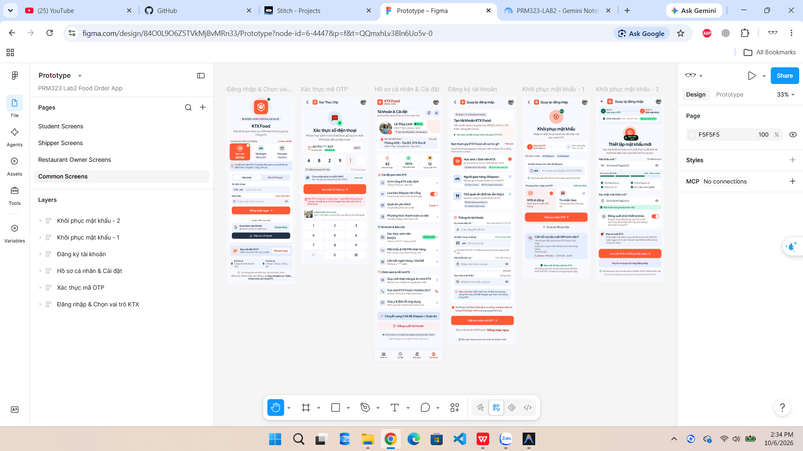
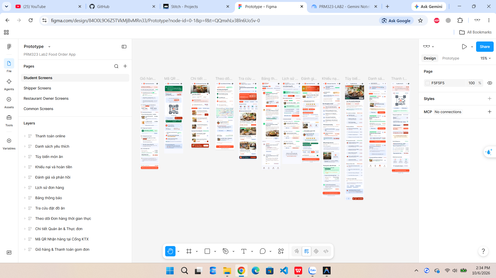
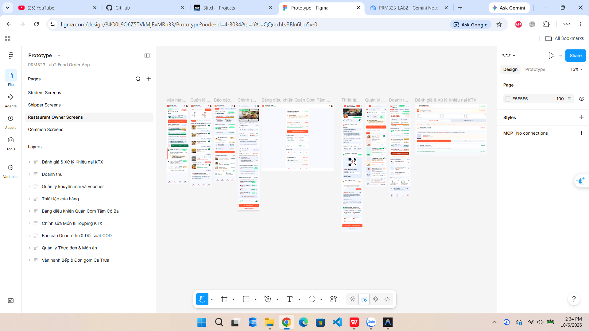
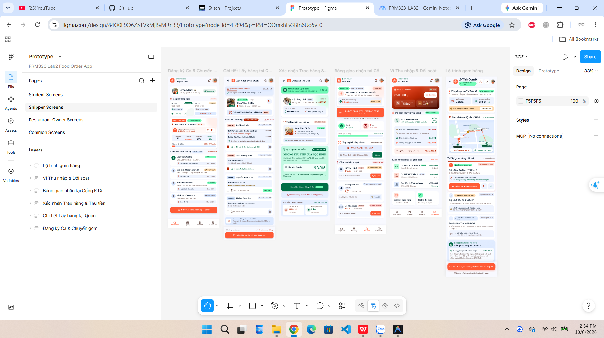

# NHẬT KÝ THIẾT KẾ & SỬ DỤNG AI (AI DESIGN LOG)
## DỰ ÁN: FOOD ORDERING APP – SINH VIÊN KÝ TÚC XÁ ĐHQG-HCM (PRM323 - LAB 2)

---

# PHẦN: THÀNH VIÊN 1 – KHỞI TẠO TOÀN BỘ MÀN HÌNH BAN ĐẦU CỦA DỰ ÁN BẰNG AI
> **Người thực hiện:** Thành viên 1 – Bùi Bảo Dương (MSSV: SE192947)  
> **Vai trò:** Team Leader & Initial UI Ideation / Generation Specialist  
> **Công cụ AI cốt lõi:** Google Stitch (Stitch AI) & Figma AI Agent  
> **Đường dẫn dữ liệu minh chứng:**  
> - Thư mục ảnh prompt Stitch AI: `assests/stitch/Dương/` (20 phiên prompt chi tiết)  
> - Thư mục ảnh kết quả artboard Figma: `assests/figma/Dương/` (4 bộ màn hình hoàn chỉnh theo luồng)

---

## 1. KHAI BÁO CÔNG CỤ AI ĐÃ SỬ DỤNG (TOOL DECLARATION)
Theo tiêu chí Mục 5 của đề bài: *"Ghi lại mọi công cụ AI bạn đã dùng và dùng cho mục đích gì."*

| STT | Công cụ AI sử dụng | Phiên bản / Môi trường | Mục đích sử dụng cụ thể trong dự án |
| :---: | :--- | :--- | :--- |
| 1 | **Google Stitch (Stitch AI)** | Web UI Prompting & Stitch Canvas Agent | Tạo khung giao diện, layout ban đầu, phân bổ thông tin và sinh mockup wireframe/UI cho 32 màn hình nghiệp vụ dựa trên câu lệnh tự nhiên tiếng Việt kết hợp ngữ cảnh SRS. |
| 2 | **Figma AI Agent / Figma Workspace** | Figma Design Plugin & AI Tools | Tổ chức, sắp đặt các màn hình thành các Artboard hoàn chỉnh theo từng nhóm đối tượng (`Common_Screens`, `Student_Screens`, `Restaurant_Owner_Screens`, `Shipper_Screens`), liên kết flow và đối chiếu tỷ lệ khung hình. |

---

## 2. NGUYÊN TẮC THIẾT KẾ & BỐI CẢNH PERSONA TRỌNG TÂM
Toàn bộ quá trình tạo lập và phản biện màn hình bằng AI luôn bám sát chặt chẽ Persona sinh viên:

### 🎓 Persona Sinh viên KTX (Student Persona - Trọng tâm chính)
* **Đại diện:** Nguyễn Văn Tuấn (18 tuổi, sinh viên năm nhất nội trú KTX Khu A – ĐHQG-HCM).
* **Ràng buộc môi trường & Thói quen sử dụng:**
  - Nhận thức thời gian gấp gáp: Cần đặt món trước hạn chốt bếp (*Cut-off Time*) của ca trưa (10h45 chốt đơn, 11h30 giao) hoặc ca tối (17h15 chốt đơn, 18h00 giao).
  - Tương tác ngoài trời nắng gắt: Ra cổng KTX nhận hàng vào buổi trưa ánh nắng chói chang, cần mã QR nhận hàng to rõ và số đuôi điện thoại dễ đọc trong vòng 20 giây.
  - Thiết bị di động phổ thông, dùng một tay khi đang đi bộ từ giảng đường về phòng KTX.

---

## 3. CHI TIẾT NHẬT KÝ PROMPT & KẾT QUẢ CHO TỪNG BỘ MÀN HÌNH

Dưới đây là ghi nhận chi tiết 20 lượt Prompt trên Stitch AI. Các câu lệnh Prompt được đặt chính xác theo tên các file hình ảnh lưu trữ trong thư mục `assests/stitch/Dương/`:

---

### 📌 CỤM 1: KHỞI TẠO TỔNG THỂ & MÀN HÌNH CHUNG (COMMON SCREENS)

#### 🔹 Prompt 01: Khởi tạo ý tưởng UI/UX tổng quan cho dự án từ tài liệu đặc tả
* **Tên file minh chứng:** `assests/stitch/Dương/hãy thiết kế các màn hình UI／UX cho dự án trong tài liệu tôi đưa.png`
* **Câu lệnh Prompt:**
  > `"hãy thiết kế các màn hình UI／UX cho dự án trong tài liệu tôi đưa"`
* **Mục tiêu:** Nạp toàn bộ bối cảnh dự án Food Ordering App cho Ký túc xá ĐHQG-HCM vào AI để sinh ra các khung màn hình đầu tiên.
* **Kết quả thu được:** AI tạo ra bản phác thảo tổng thể ban đầu gồm Trang chủ, Đăng nhập, Chi tiết món và Đơn hàng. Tuy nhiên, luồng giao diện còn mang tính tổng quát chung chung của app giao hàng truyền thống, cần tiếp tục đi sâu vào từng màn hình cụ thể.

---

#### 🔹 Prompt 02: Thiết kế các Màn hình Chung (Đăng nhập, OTP, Profile)
* **Tên file minh chứng:** `assests/stitch/Dương/Thiết kế các Màn hình Chung (Đăng nhập, OTP, Profile).png`
* **Câu lệnh Prompt:**
  > `"Thiết kế các Màn hình Chung (Đăng nhập, OTP, Profile)"`
* **Mục tiêu:** Tạo bộ màn hình định danh và tài khoản dùng chung cho cả 3 vai trò người dùng (Mục 1, Mục 3, Mục 5 SRS).
* **Kết quả thu được:** Bộ 3 màn hình có cấu trúc chuẩn mực, trường nhập liệu rõ ràng, có phân tách rõ ràng giữa khu vực đăng nhập và nút điều hướng đăng ký tài khoản mới.

---

#### 🔹 Prompt 03: Thiết kế màn hình Đăng ký tài khoản (Mục 2 SRS)
* **Tên file minh chứng:** `assests/stitch/Dương/Thiết kế màn hình Đăng ký tài khoản (Mục 2 SRS).png`
* **Câu lệnh Prompt:**
  > `"Thiết kế màn hình Đăng ký tài khoản (Mục 2 SRS)"`
* **Mục tiêu:** Cho phép người dùng mới tạo tài khoản và chọn vai trò hoạt động ngay từ đầu.
* **Kết quả thu được:** Form đăng ký trực quan với phân loại vai trò trực tiếp dạng Card radio, giúp hệ thống định tuyến chính xác giao diện sau khi đăng ký thành công.

---

#### 🔹 Prompt 04: Thiết kế Màn hình Quên / Đặt lại mật khẩu (Mục 4 SRS - Bước 1)
* **Tên file minh chứng:** `assests/stitch/Dương/Thiết kế tiếp Màn hình Quên ／ Đặt lại mật khẩu (Mục 4 SRS).png`
* **Câu lệnh Prompt:**
  > `"Thiết kế tiếp Màn hình Quên ／ Đặt lại mật khẩu (Mục 4 SRS)"`
* **Mục tiêu:** Tạo bước 1 của quy trình khôi phục tài khoản khi người dùng quên mật khẩu.
* **Kết quả thu được:** Màn hình đơn giản, tinh gọn, tập trung vào đúng một tác vụ duy nhất, giảm thiểu tối đa ma sát tâm lý khi người dùng đang gặp sự cố tài khoản.

---

#### 🔹 Prompt 05: Thiết kế Màn hình Đặt mật khẩu mới (Bước 2 sau khi xác thực OTP)
* **Tên file minh chứng:** `assests/stitch/Dương/Thiết kế tiếp Màn hình Đặt mật khẩu mới (Bước 2 sau khi nhập OTP).png`
* **Câu lệnh Prompt:**
  > `"Thiết kế tiếp Màn hình Đặt mật khẩu mới (Bước 2 sau khi nhập OTP)"`
* **Mục tiêu:** Hoàn thiện bước 2 khép kín luồng khôi phục tài khoản theo Heuristic *Error Prevention*.
* **Kết quả thu được:** Màn hình thể hiện tính công thái học cao với icon mắt ẩn/hiện mật khẩu và danh sách checklist quy tắc mật khẩu rõ ràng.

---

#### 🔹 Prompt 06: Thiết kế Màn hình Trung tâm Thông báo (Notification Center)
* **Tên file minh chứng:** `assests/stitch/Dương/Thiết kế thêm màn hình Trung tâm thông báo (Notification Center).png`
* **Câu lệnh Prompt:**
  > `"Thiết kế thêm màn hình Trung tâm thông báo (Notification Center)"`
* **Mục tiêu:** Cung cấp khu vực theo dõi cập nhật đơn hàng và tin tức cho cả 3 đối tượng (Mục 6 SRS).
* **Kết quả thu được:** Hệ thống card thông báo khoa học, phân loại màu sắc icon theo mức độ ưu tiên, phục vụ đắc lực cho việc thông báo shipper đã tới cổng KTX.

---

### 📌 CỤM 2: MÀN HÌNH SINH VIÊN / HỌC SINH KTX (STUDENT FLOW)

#### 🔹 Prompt 07: Thiết kế 5 Màn hình cốt lõi của Học sinh
* **Tên file minh chứng:** `assests/stitch/Dương/Thiết kế trước 5 màn hình cốt lõi của Học sinh.png`
* **Câu lệnh Prompt:**
  > `"Thiết kế trước 5 màn hình cốt lõi của Học sinh"`
* **Mục tiêu:** Dựng bộ khung trung tâm cho hành trình trải nghiệm đặt đồ ăn của sinh viên (Mục 7, 9, 11, 13, 14 SRS).
* **Kết quả thu được:** Hình thành luồng End-to-End hoàn chỉnh từ chọn món đến nhận đồ ăn tại cổng, giải quyết triệt để mục tiêu đặt món dưới 30 giây của Persona Tuấn.

---

#### 🔹 Prompt 08: Thiết kế Màn hình Tùy biến Món ăn (Food Customization Screen / Modal)
* **Tên file minh chứng:** `assests/stitch/Dương/Thiết kế Màn hình Tùy biến Món ăn (Food Customization Screen ／ Modal) của Học sinh.png`
* **Câu lệnh Prompt:**
  > `"Thiết kế Màn hình Tùy biến Món ăn (Food Customization Screen ／ Modal) của Học sinh"`
* **Mục tiêu:** Cung cấp giao diện cấu hình chi tiết theo sở thích ẩm thực cá nhân (Mục 10 SRS).
* **Kết quả thu được:** Modal Bottom Sheet mượt mà, phân cấp thông tin rõ ràng, giá tiền tự động cập nhật linh hoạt theo từng topping được chọn.

---

#### 🔹 Prompt 09: Thiết kế Màn hình Thanh toán Chuyển khoản VietQR (Mục 12 SRS)
* **Tên file minh chứng:** `assests/stitch/Dương/Thiết kế Màn hình Thanh toán Chuyển khoản VietQR (Mục 12 SRS).png`
* **Câu lệnh Prompt:**
  > `"Thiết kế Màn hình Thanh toán Chuyển khoản VietQR (Mục 12 SRS)"`
* **Mục tiêu:** Tối ưu hóa phương thức thanh toán không tiền mặt quen thuộc của sinh viên ĐHQG (Mục 12 SRS).
* **Kết quả thu được:** Giao diện trực quan cao, loại bỏ khả năng sinh viên chuyển sai số tiền hoặc sai cú pháp mã đơn hàng.

---

#### 🔹 Prompt 10: Thiết kế Màn hình Danh sách Quán yêu thích (Favorite Stores)
* **Tên file minh chứng:** `assests/stitch/Dương/Thiết kế tiếp Màn hình Danh sách Quán yêu thích (Favorite Stores) của Học sinh.png`
* **Câu lệnh Prompt:**
  > `"Thiết kế tiếp Màn hình Danh sách Quán yêu thích (Favorite Stores) của Học sinh"`
* **Mục tiêu:** Giúp sinh viên lưu lại các quán cơm quen gần KTX để đặt nhanh hằng ngày (Mục 8 SRS).
* **Kết quả thu được:** Danh sách bố cục gọn gàng, có chỉ báo trạng thái hoạt động trực quan giúp sinh viên không tốn công truy cập vào quán đã hết giờ bán.

---

#### 🔹 Prompt 11: Thiết kế Màn hình Lịch sử Đơn hàng (Order History Screen)
* **Tên file minh chứng:** `assests/stitch/Dương/Thiết kế Màn hình Lịch sử Đơn hàng (Order History Screen).png`
* **Câu lệnh Prompt:**
  > `"Thiết kế Màn hình Lịch sử Đơn hàng (Order History Screen)"`
* **Mục tiêu:** Quản lý vòng đời các bữa ăn đã đặt, hỗ trợ đặt lại đơn trong 1 chạm (Mục 15 SRS).
* **Kết quả thu được:** Cấu trúc tab rõ ràng, thẻ card hiển thị đầy đủ thông tin đối soát, nút "Đặt lại đơn này" giảm thời gian đặt món bữa kế tiếp xuống dưới 15 giây.

---

#### 🔹 Prompt 12: Thiết kế Màn hình Khiếu nại & Yêu cầu hoàn tiền (Mục 17 SRS)
* **Tên file minh chứng:** `assests/stitch/Dương/Thiết kế tiếp Màn hình Khiếu nại & Yêu cầu hoàn tiền (Mục 17 SRS).png`
* **Câu lệnh Prompt:**
  > `"Thiết kế tiếp Màn hình Khiếu nại & Yêu cầu hoàn tiền (Mục 17 SRS)"`
* **Mục tiêu:** Bảo vệ quyền lợi sinh viên khi món ăn bị nguội, thiếu món hoặc đổ vỡ do vận chuyển (Mục 17 SRS).
* **Kết quả thu được:** Form khiếu nại mẫu mực, có chỉ dẫn tải ảnh bằng chứng rõ ràng, đảm bảo tính minh bạch và tin cậy cho dịch vụ.

---

#### 🔹 Prompt 13: Thiết kế Màn hình Đánh giá & Phản hồi (Rating & Review)
* **Tên file minh chứng:** `assests/stitch/Dương/Thiết kế tiếp Màn hình Đánh giá & Phản hồi (Rating & Review).png`
* **Câu lệnh Prompt:**
  > `"Thiết kế tiếp Màn hình Đánh giá & Phản hồi (Rating & Review)"`
* **Mục tiêu:** Thu thập phản hồi chất lượng món ăn và thái độ tài xế sau khi hoàn tất bữa ăn (Mục 16 SRS).
* **Kết quả thu được:** Thiết kế phân tầng thông minh giữa đánh giá chất lượng bếp và chất lượng vận chuyển, giúp dữ liệu phản hồi minh bạch, chính xác.

---

### 📌 CỤM 3: MÀN HÌNH CHỦ QUÁN ĂN (MERCHANT FLOW)

#### 🔹 Prompt 14: Thiết kế luồng Chủ quán ăn (Merchant Flow) tổng quan
* **Tên file minh chứng:** `assests/stitch/Dương/Thiết kế tiếp luồng Chủ quán ăn (Merchant Flow).png`
* **Câu lệnh Prompt:**
  > `"Thiết kế tiếp luồng Chủ quán ăn (Merchant Flow)"`
* **Mục tiêu:** Xây dựng Dashboard trung tâm cho người bán quản lý hoạt động bếp theo đợt (Mục 25, 26, 27 SRS).
* **Kết quả thu được:** Bộ màn hình dashboard tối giản, trực quan, các chỉ số thống kê to rõ, phù hợp với người lớn tuổi thao tác trong không gian bếp quán ăn.

---

#### 🔹 Prompt 15: Thiết kế Màn hình Thiết lập Gian hàng & Bảng tin (Mục 29 SRS)
* **Tên file minh chứng:** `assests/stitch/Dương/Thiết kế tiếp Màn hình Thiết lập Gian hàng & Bảng tin (Mục 29 SRS) của Chủ quán.png`
* **Câu lệnh Prompt:**
  > `"Thiết kế tiếp Màn hình Thiết lập Gian hàng & Bảng tin (Mục 29 SRS) của Chủ quán"`
* **Mục tiêu:** Cho phép chủ quán cấu hình nhận diện thương hiệu, thông tin chuyển khoản và đăng bảng tin tới sinh viên (Mục 29 SRS).
* **Kết quả thu được:** Giao diện quản lý thông tin thân thiện, tích hợp đăng tin nhanh tạo sự kết nối gần gũi giữa quán ăn bình dân và sinh viên nội trú.

---

#### 🔹 Prompt 16: Thiết kế Màn hình Quản lý Khuyến mãi (Mục 30 SRS)
* **Tên file minh chứng:** `assests/stitch/Dương/Thiết kế tiếp Màn hình Quản lý Khuyến mãi (Mục 30 SRS) của Chủ quán.png`
* **Câu lệnh Prompt:**
  > `"Thiết kế tiếp Màn hình Quản lý Khuyến mãi (Mục 30 SRS) của Chủ quán"`
* **Mục tiêu:** Hỗ trợ chủ quán tạo voucher giảm giá kích cầu đơn hàng ca trưa/tối (Mục 30 SRS).
* **Kết quả thu được:** Thiết kế danh thiếp voucher trực quan, có biểu đồ đo lường số lượt sinh viên đã áp dụng mã thực tế.

---

#### 🔹 Prompt 17: Thiết kế Màn hình Báo cáo Doanh thu & Đối soát COD (Mục 31 SRS)
* **Tên file minh chứng:** `assests/stitch/Dương/Thiết kế tiếp Màn hình Báo cáo Doanh thu & Đối soát COD (Mục 31 SRS).png`
* **Câu lệnh Prompt:**
  > `"Thiết kế tiếp Màn hình Báo cáo Doanh thu & Đối soát COD (Mục 31 SRS)"`
* **Mục tiêu:** Cung cấp bức tranh tài chính minh bạch giữa tiền chuyển khoản và tiền mặt COD tài xế thu hộ (Mục 31 SRS).
* **Kết quả thu được:** Báo cáo tài chính mạch lạc, giải quyết triệt để nỗi lo thất thoát tiền hàng khi bán đồ ăn cho sinh viên qua trung gian shipper.

---

#### 🔹 Prompt 18: Thiết kế Màn hình Đánh giá & Xử lý Khiếu nại (Mục 32 SRS)
* **Tên file minh chứng:** `assests/stitch/Dương/Thiết kế Màn hình Đánh giá & Xử lý Khiếu nại (Mục 32 SRS) để hoàn tất luồng Chủ quán.png`
* **Câu lệnh Prompt:**
  > `"Thiết kế Màn hình Đánh giá & Xử lý Khiếu nại (Mục 32 SRS) để hoàn tất luồng Chủ quán"`
* **Mục tiêu:** Giúp chủ quán phản hồi khách hàng và duyệt bồi thường sự cố công bằng (Mục 32 SRS).
* **Kết quả thu được:** Giao diện tương tác 2 chiều chuyên nghiệp, bảo vệ danh tiếng của quán ăn và xây dựng niềm tin với cộng đồng sinh viên KTX.

---

### 📌 CỤM 4: MÀN HÌNH NGƯỜI GIAO HÀNG (SHIPPER FLOW)

#### 🔹 Prompt 19: Thiết kế tiếp luồng Người giao hàng (Shipper Flow)
* **Tên file minh chứng:** `assests/stitch/Dương/Thiết kế tiếp luồng Người giao hàng (Shipper Flow).png`
* **Câu lệnh Prompt:**
  > `"Thiết kế tiếp luồng Người giao hàng (Shipper Flow)"`
* **Mục tiêu:** Xây dựng các màn hình nghiệp vụ cho người giao hàng theo ca gom tập trung (Mục 18, 20, 21, 22, 23, 24 SRS).
* **Kết quả thu được:** Hệ thống màn hình tối ưu cho thao tác di động ngoài đường, hạn chế tối đa việc phải bấm gọi điện thủ công từng bạn sinh viên.

---

#### 🔹 Prompt 20: Thiết kế Màn hình Lộ trình gom hàng tại quán (Pickup Route Screen)
* **Tên file minh chứng:** `assests/stitch/Dương/tạo cho tôi Màn hình Lộ trình gom hàng tại quán (Pickup Route Screen).png`
* **Câu lệnh Prompt:**
  > `"tạo cho tôi Màn hình Lộ trình gom hàng tại quán (Pickup Route Screen)"`
* **Mục tiêu:** Hướng dẫn shipper di chuyển tuần tự lấy đồ ăn quanh khu vực ĐHQG một cách nhanh nhất (Mục 19 SRS).
* **Kết quả thu được:** Bản đồ lộ trình thông minh, tính toán thứ tự ghé quán hợp lý để tài xế tiết kiệm tối đa xăng xe và đảm bảo thức ăn luôn nóng giòn khi tới tay sinh viên.

---

### 🎨 BẢNG TỔNG HỢP CÁC ARTBOARD HOÀN THIỆN TRÊN FIGMA
Sau khi hoàn tất quá trình sinh màn hình trên Stitch AI, toàn bộ giao diện đã được Thành viên 1 import, chuẩn hóa bố cục và phân bổ thành 4 artboard lớn trong Figma để làm tiền đề cho các thành viên khác xây dựng Design System và Prototype.

Các ảnh xuất tổng hợp hoàn thiện được lưu trữ tại `assests/figma/Dương/`:

| Tên File Artboard | Nhóm Màn hình | Số lượng Màn | Nội dung chính | Đường dẫn ảnh minh chứng |
| :--- | :--- | :---: | :--- | :--- |
| **`Common_Screens.png`** | Màn hình Dùng chung | 6 | Đăng nhập, Đăng ký, Xác thực OTP, Quên mật khẩu, Đặt lại mật khẩu mới, Profile & Notification Center | `../../assests/figma/Dương/Common_Screens.png` |
| **`Student_Screens.png`** | Luồng Sinh viên KTX | 11 | Trang chủ, Quán yêu thích, Chi tiết quán/menu, Tùy biến món, Giỏ hàng, VietQR, Tracking, QR nhận hàng, Lịch sử, Đánh giá, Khiếu nại | `../../assests/figma/Dương/Student_Screens.png` |
| **`Restaurant_Owner_Screens.png`** | Luồng Chủ quán ăn | 8 | Merchant Dashboard, Vận hành ca bếp, Thực đơn, Chỉnh sửa món, Gian hàng & Bảng tin, Khuyến mãi, Doanh thu & COD, Xử lý khiếu nại | `../../assests/figma/Dương/Restaurant_Owner_Screens.png` |
| **`Shipper_Screens.png`** | Luồng Người giao hàng | 7 | Nhận ca gom, Lộ trình gom hàng, Lấy hàng tại quán, Bảng giao nhận cổng KTX, Trao hàng thu COD, Đối soát ca, Ví thu nhập | `../../assests/figma/Dương/Shipper_Screens.png` |

#### 🖼️ Hình ảnh trực quan 4 Artboard Figma hoàn thiện:
1. **Artboard Màn hình Chung (Common Screens):**
   - 
2. **Artboard Luồng Sinh viên (Student Screens):**
   - 
3. **Artboard Luồng Chủ quán (Restaurant Owner Screens):**
   - 
4. **Artboard Luồng Shipper (Shipper Screens):**
   - 

---

## 4. KẾT LUẬN & ĐÓNG GÓP CHO GIAI ĐOẠN TIẾP THEO
Quá trình khởi tạo toàn bộ 32 màn hình ban đầu của dự án bằng Stitch AI và Figma AI do Thành viên 1 thực hiện đã:
1. **Thiết lập nền móng giao diện vững chắc:** Bao quát đầy đủ 100% các chức năng quy định trong tài liệu đặc tả SRS (`food_ordering_app_srs.md`) cho cả 3 đối tượng người dùng.
2. **Cung cấp dữ liệu đầu vào chuẩn mực cho nhóm:** Giúp Thành viên 2 (Design System) bóc tách chính xác 9 Master Components thiết yếu; hỗ trợ Thành viên 3 và 4 xây dựng bản User Flow và Prototype tương tác trực quan bám sát 10 Heuristics của Nielsen.
3. **Lưu trữ dữ liệu đầy đủ:** Toàn bộ 20 câu lệnh prompt chi tiết và 4 artboard xuất hoàn chỉnh được lưu trữ đồng bộ, có thể truy cập kiểm tra trực tiếp trong các thư mục `assests/stitch/Dương/` và `assests/figma/Dương/`.

---
*Nhật ký được lập và cập nhật hoàn thiện bởi Trưởng nhóm – Thành viên 1: Bùi Bảo Dương (MSSV: SE192947).*
