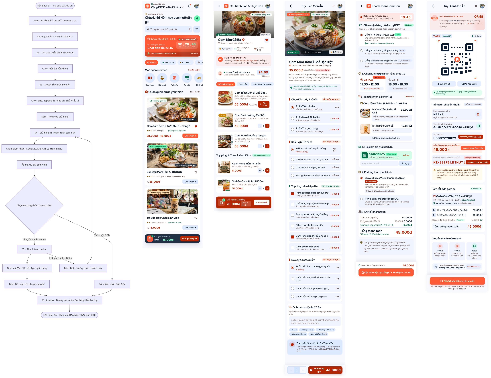
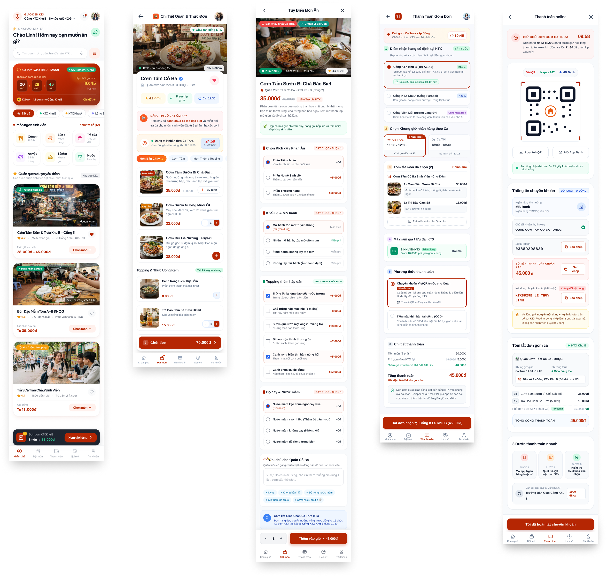
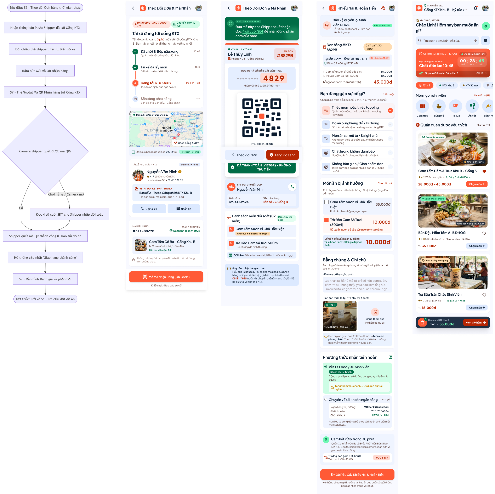
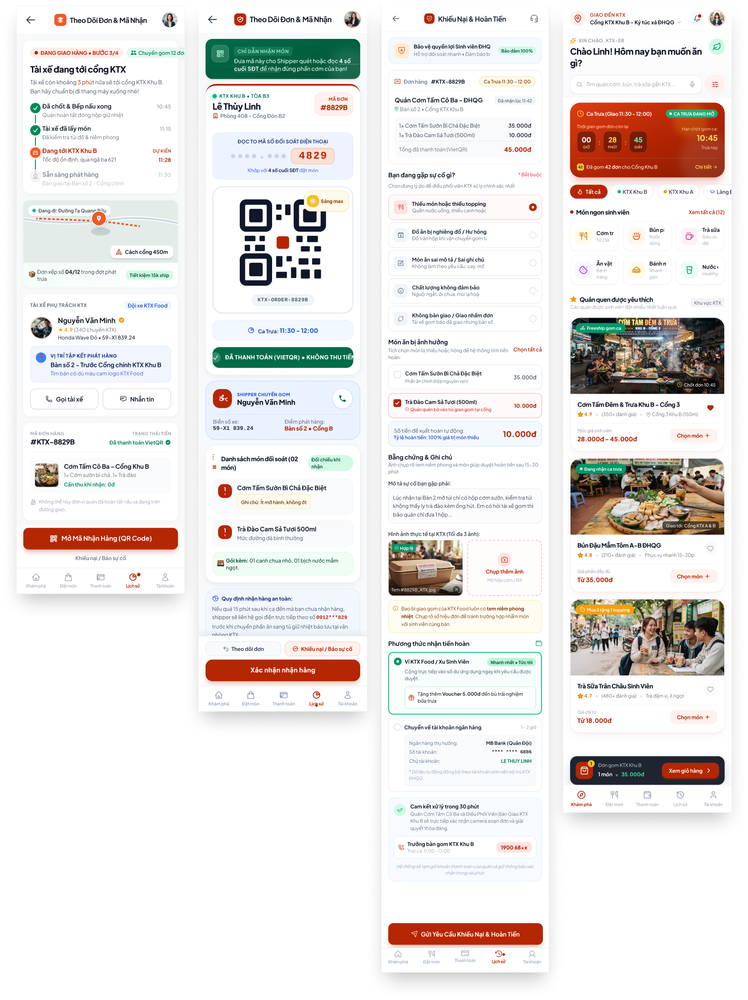
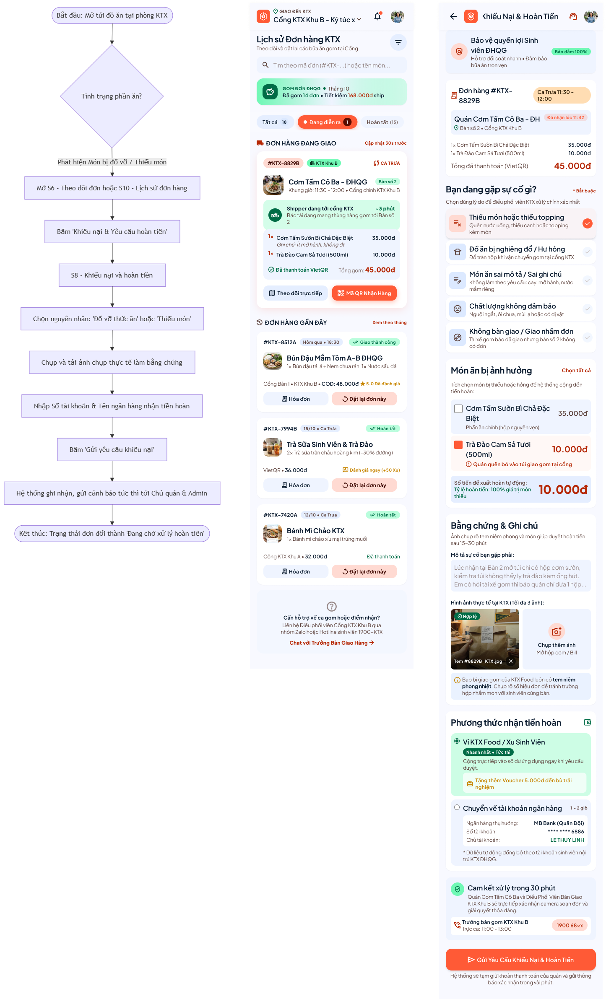
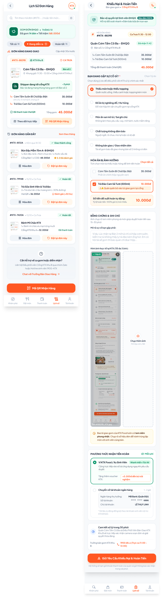
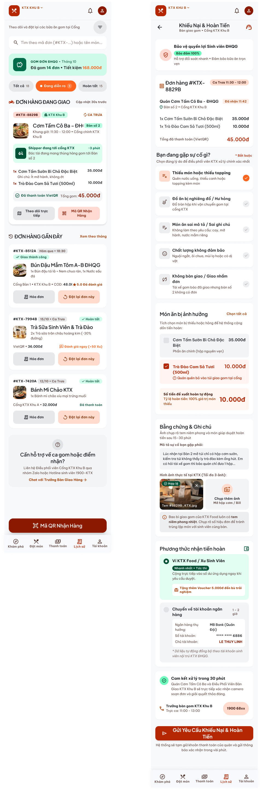
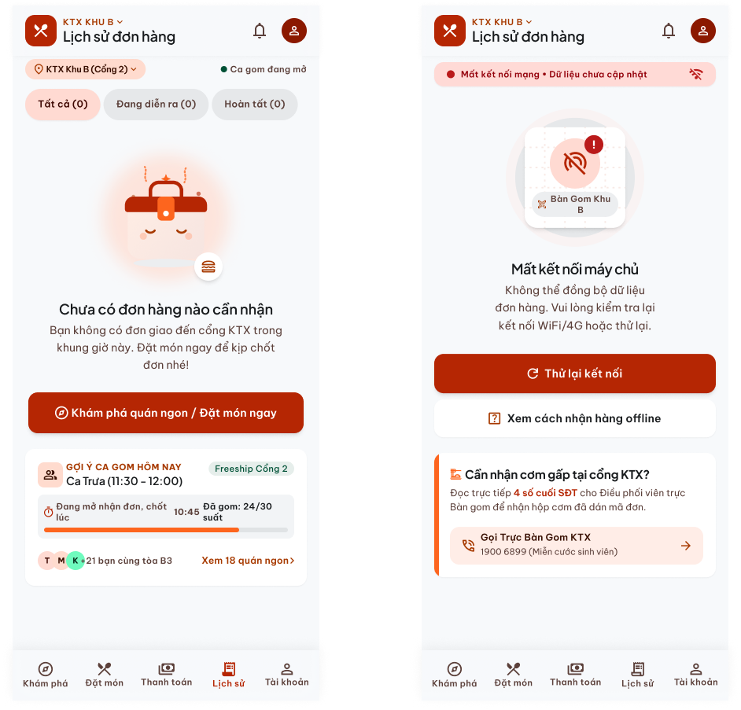
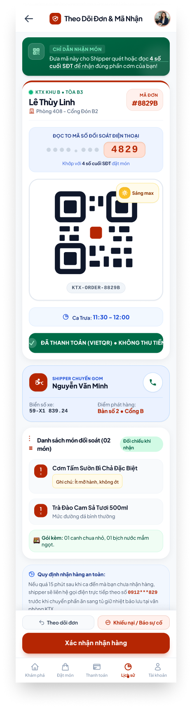
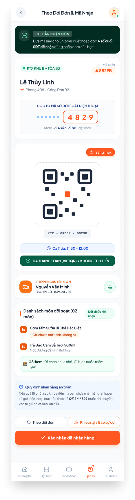

# NHẬT KÝ THIẾT KẾ & SỬ DỤNG AI (AI DESIGN LOG)
## DỰ ÁN: FOOD ORDERING APP – SINH VIÊN KÝ TÚC XÁ ĐHQG-HCM (PRM323 - LAB 2)

---

# THÀNH VIÊN 4 – BA VÒNG LẶP TINH CHỈNH VÀ PHẢN BIỆN THIẾT KẾ UI/UX TRÊN GOOGLE STITCH (MỤC 4.3)
> **Người thực hiện:** Thành viên 4 – Quách Ngọc Vinh (MSSV: SE194159)  
> **Công cụ AI:** Google Stitch (sinh và tinh chỉnh màn hình) + Claude / ChatGPT (phản biện theo Heuristics & WCAG)  
> **Hệ thống:** Giao nhận đồ ăn sinh viên tại Ký túc xá Khu B (KTX Food Delivery System)  
> **Tiêu chuẩn áp dụng:** 10 Usability Heuristics của Jakob Nielsen, WCAG 2.1 (AA/AAA), Mobile Ergonomics (Thumb Zone)  
> **Thư mục ảnh minh chứng:** `assests/stitch/Vinh/`

---

## 0. DANH MỤC ẢNH MINH CHỨNG TRONG THƯ MỤC `assests/stitch/Vinh/`

| Vòng | Tên file | Nội dung thực tế trong ảnh |
| :---: | :--- | :--- |
| 1 | `v1_before-1.png` | Bản gốc: sơ đồ User Flow đặt món & thanh toán + 5 màn (Trang chủ, Chi tiết quán, Tùy biến món, Thanh toán gom đơn, Chuyển khoản VietQR). |
| 1 | `v1_after-1.png` | Bản chốt của 5 màn trên (màn 1 → 5). |
| 1 | `v1_before-2.png` | Bản gốc: sơ đồ User Flow nhận hàng + 4 màn (Theo dõi đơn, Mã nhận QR, Khiếu nại & Hoàn tiền, quay về Trang chủ). |
| 1 | `v1_after-2.png` | Bản chốt của 4 màn trên (màn 6 → 8 và Trang chủ cuối luồng). |
| 1 | `v1_before-3.png` | Bản gốc: sơ đồ User Flow khiếu nại + 2 màn (Lịch sử đơn hàng, Khiếu nại sau giao nhận). |
| 1 | `v1_after-3.png` | Bản chốt của 2 màn trên (màn 9 → 10). |
| 2 | `v2_before.png` | Trạng thái **có đơn bình thường** (Lịch sử đơn hàng + Khiếu nại) – **bản trước** của Vòng 2. *(Ảnh này trùng nội dung với `v1_after-3.png`.)* |
| 2 | `v2_after.png` | **Empty State** và **Error State** đặt song song – **kết quả sau** của Vòng 2. |
| 3 | `v3_before.png` | Màn Theo dõi đơn & Mã nhận trước khi chuẩn hóa Touch Target và khối QR. |
| 3 | `v3_after.png` | Màn Theo dõi đơn & Mã nhận sau khi chuẩn hóa Touch Target $\ge 48\text{dp}$ và QR $200\text{dp}$. |

---

# VÒNG 1: TINH CHỈNH PHÂN CẤP THỊ GIÁC & NÚT HÀNH ĐỘNG CHÍNH (PRIMARY ACTION)

## 1.1. Nguyên văn Prompt đã nhập cho Stitch (Vòng 1)

```text
Please duplicate the selected screen, place the new refined version right next to the original one (side-by-side), and apply the following refinements on the new copy:

Establish clear visual hierarchy: Increase font size/weight for headers, enhance contrast for key content, and mute auxiliary info with neutral tones.

Emphasize Primary Action: Design a prominent Primary Button (e.g., 'Xác nhận nhận hàng') using the brand accent color, white high-contrast text, rounded corners, and place it conveniently in the bottom thumb zone.

De-emphasize secondary actions: Style secondary buttons as outlined or ghost buttons.

Finally, provide a Markdown summary table of all applied changes in this format: [Element | Before | After | Technical Reason].
```

## 1.2. Lưu trữ hình ảnh đối chiếu Vòng 1

Vòng 1 được áp dụng trên 10 màn hình, chia thành 3 cặp ảnh theo 3 User Flow chính:

| Cặp ảnh | Bản gốc (Before) | Bản chốt (Final Resolved) | Màn hình bao gồm |
| :---: | :--- | :--- | :--- |
| Cặp 1 – Luồng đặt món & thanh toán | `assests/stitch/Vinh/v1_before-1.png` | `assests/stitch/Vinh/v1_after-1.png` | Màn 1 → 5 |
| Cặp 2 – Luồng nhận hàng | `assests/stitch/Vinh/v1_before-2.png` | `assests/stitch/Vinh/v1_after-2.png` | Màn 6 → 8 (+ Trang chủ cuối luồng) |
| Cặp 3 – Luồng lịch sử & khiếu nại | `assests/stitch/Vinh/v1_before-3.png` | `assests/stitch/Vinh/v1_after-3.png` | Màn 9 → 10 |

* **Cặp 1 – Luồng đặt món & thanh toán:**
  - 
  - 
* **Cặp 2 – Luồng nhận hàng:**
  - 
  - 
* **Cặp 3 – Luồng lịch sử & khiếu nại:**
  - 
  - 

## 1.3. Phản hồi của AI & Chi tiết tối ưu hóa 10 màn hình chuẩn

### Màn 1. Trang Chủ Đặt Món & Ca Gom KTX (Bản Chốt Chuẩn)

**Đối chiếu ảnh:** Cặp 1 – màn thứ nhất (`v1_before-1.png` → `v1_after-1.png`).

**Tối ưu nổi bật:**

- **Thanh điều hướng & Giỏ hàng nổi:** Giữ trọn vẹn thanh Bottom Navigation 5 tab chuẩn (Khám phá, Đặt món, Thanh toán, Lịch sử, Tài khoản) cùng thanh giỏ hàng nổi "Đơn gom KTX Khu B • 1 món • 35.000đ" (nút "Xem giỏ hàng" màu đỏ sậm #B52603).
- **Banner đếm ngược ca trưa:** Banner đếm ngược chốt đơn ca trưa lớn, rõ ràng (00:28:45), nhãn "CA TRƯA ĐANG MỞ" nổi bật, kích thích thị giác nhẹ nhàng.
- **Xử lý Text Wrapping:** Khung chữ tiêu đề quán, khoảng cách (150m), tag freeship và khoảng giá (28.000đ - 45.000đ) dùng container co giãn tự nhiên (auto-width), loại bỏ hoàn toàn lỗi rớt chữ cụt lủn.

### Màn 2. Chi Tiết Quán & Thực Đơn Cơm Tấm (Bản Chốt Chuẩn)

**Đối chiếu ảnh:** Cặp 1 – màn thứ hai (`v1_before-1.png` → `v1_after-1.png`).

**Tối ưu nổi bật:**

- **Header quán Cơm Tấm Cô Ba:** Đầy đủ thông tin định danh: tích xanh xác thực, khoảng cách 600m, đánh giá 4.9 sao, thông báo "Bảng tin Cô Ba hôm nay" và đồng hồ đếm ngược chốt đơn 24:59.
- **Phân loại tab súc tích:** Cấu trúc 3 tab tinh gọn: Món Bán Chạy 🔥, Cơm Tấm, Món Thêm / Topping.
- **Thanh ghim đáy (Sticky Bar):** Cố định hiển thị "Chốt đơn • 70.000đ" với vùng bấm đạt chuẩn $\ge 48\text{dp}$, phía dưới bổ sung lại Bottom Navigation (bản gốc không có).

### Màn 3. Tùy Biến Món Ăn (Bản Chốt Chuẩn)

**Đối chiếu ảnh:** Cặp 1 – màn thứ ba (`v1_before-1.png` → `v1_after-1.png`).

**Tối ưu nổi bật:**

- **Compact Vertical Layout:** Loại bỏ khoảng cách giãn dài dư thừa; phân chia 5 khối logic gọn gàng (Kích cỡ / Phần ăn, Khẩu vị & Mỡ hành, Topping thêm, Độ cay & Nước mắm, Ghi chú).
- **Nút CTA ghim đáy:** Kết hợp bộ đếm số lượng (- 1 +) cùng nút CTA to bản "Thêm vào giỏ • 46.000đ" màu đỏ #B52603, chữ trắng in đậm trọn vẹn trên 1 dòng duy nhất (bản gốc nhãn bị rớt thành 2 dòng "Thêm vào giỏ").

### Màn 4. Thanh Toán Gom Đơn & Điểm Nhận KTX (Bản Chốt Chuẩn)

**Đối chiếu ảnh:** Cặp 1 – màn thứ tư (`v1_before-1.png` → `v1_after-1.png`).

**Tối ưu nổi bật:**

- **Cấu trúc 6 bước mạch lạc:** Điểm nhận cố định tại Cổng Khu B (có huy hiệu 28 bạn cùng tòa), Khung giờ ca trưa, Tóm tắt món, Mã giảm giá SINHVIENKTX, Phương thức VietQR, và Bảng chi tiết thanh toán.
- **Nút CTA chính ghim đáy:** "Đặt đơn nhận tại Cổng KTX Khu B (45.000đ)" cao 52dp, độ tương phản cao đạt chuẩn WCAG AA (> 4.5:1).

### Màn 5. Chuyển Khoản VietQR Khớp Lệnh Tự Động (Bản Chốt Chuẩn)

**Đối chiếu ảnh:** Cặp 1 – màn thứ năm (`v1_before-1.png` → `v1_after-1.png`).

**Tối ưu nổi bật:**

- **Khối mã VietQR Napas247:** Khung QR tương phản cao kèm 2 nút tiện ích phụ "Lưu ảnh QR" và "Mở App Bank" vùng chạm chuẩn $\ge 48\times 48\text{dp}$, khoảng cách $\ge 16\text{dp}$ chống bấm nhầm khi đi bộ.
- **Khối thông tin chuyển khoản:** Tích hợp 3 nút "Sao chép" 1 chạm độc lập (STK, Số tiền chính xác 45.000 đ, Nội dung bắt buộc KTX8829B LE THUY LINH), thay cho các nhãn "content_copy" bị lỗi hiển thị ở bản gốc.
- **Nút hành động chính ghim đáy:** "Tôi đã hoàn tất chuyển khoản" màu đỏ thương hiệu #B52603.

### Màn 6. Theo Dõi Giao Hàng & Tài Xế KTX (Bản Chốt Chuẩn)

**Đối chiếu ảnh:** Cặp 2 – màn thứ nhất (`v1_before-2.png` → `v1_after-2.png`).

**Tối ưu nổi bật:**

- **Tiến trình giao hàng 4 bước:** Toàn bộ tiến trình (Đã chốt & Bếp nấu xong $\rightarrow$ Tài xế đã lấy món $\rightarrow$ Đang tới KTX Khu B $\rightarrow$ Sẵn sàng phát hàng) cùng thông tin tài xế Nguyễn Văn Minh (Honda Wave Đỏ • 59-X1 839.24) đều hiển thị thẳng hàng, rõ ràng, không bị ngắt dòng chắp vá.
- **Nút CTA ghim đáy chuẩn Touch Target:** Nút chính "Mở Mã Nhận Hàng (QR Code)" màu đỏ sậm thương hiệu #B52603, chữ trắng in đậm cao 50dp ($\ge 48\text{dp}$), tương phản chuẩn WCAG AA (> 4.5:1), chữ nằm trọn vẹn 1 dòng duy nhất.
- **Khôi phục Bottom Navigation:** Bổ sung thanh điều hướng 5 tab chuẩn với chấm đỏ active tại tab Lịch sử (bản gốc không có thanh điều hướng).
- **Bố cục súc tích:** Mini map định vị live "Đang đi: Đường Tạ Quang Bửu - Cách cổng 450m" kèm nhãn thông báo thứ tự "Đơn xếp số 04/12 trong đợt phát trưa" gọn gàng, trực quan.

### Màn 7. Mã Nhận Hàng & QR Đối Soát Cổng KTX (Bản Chốt Chuẩn)

**Đối chiếu ảnh:** Cặp 2 – màn thứ hai (`v1_before-2.png` → `v1_after-2.png`).

**Tối ưu nổi bật:**

- **Khối Mã QR & Phím Sáng Max:** Khung QR nét lớn tương phản cao. Bản gốc đặt nút "Tăng độ sáng" thành một thanh ngang cạnh nút "Theo dõi đơn" ngay dưới QR; bản chốt tinh giản thành nút quick-action "Sáng max" icon mặt trời ngay góc trên bên phải khung QR ($\ge 48\times 48\text{dp}$), giúp sinh viên kích hoạt nhanh bằng 1 chạm khi quét mã dưới trời nắng gắt.
- **Mã 4 số đối soát to đậm:** Số 4829 đặt trong ô cam nhạt to rõ giúp đọc to cho shipper ngay cả khi điểm gom đông đúc.
- **Banner chống thu nhầm tiền:** Dải huy hiệu xanh lá đậm "ĐÃ THANH TOÁN (VIETQR) • KHÔNG THU TIỀN" in hoa trực diện dưới mã QR giúp shipper nhận diện ngay lập tức.
- **Nút hành động kép ghim đáy:** Nút phụ "Theo dõi đơn" / "Khiếu nại / Báo sự cố" phía trên nút chính "Xác nhận nhận hàng" màu đỏ thương hiệu, phía dưới kết nối mượt mà với thanh Bottom Navigation.

### Màn 8. Khiếu Nại & Hoàn Tiền Nhanh KTX (Bản Chốt Chuẩn)

**Đối chiếu ảnh:** Cặp 2 – màn thứ ba (`v1_before-2.png` → `v1_after-2.png`). Màn thứ tư của cặp là Trang chủ (điểm kết thúc luồng nhận hàng), được giữ đồng bộ với Màn 1.

**Tối ưu nổi bật:**

- **Compact Vertical Layout (Thu gọn cuộn trang):** Gom gọn 5 nhóm sự cố thành các thẻ radio súc tích; danh mục món bị ảnh hưởng được tick chọn sẵn "Trà Đào Cam Sả Tươi (500ml) - 10.000đ" kèm tỷ lệ hoàn tiền 100%.
- **Gom gọn khu vực bằng chứng:** Cụm tải ảnh tem niêm phong (Tem #8829B_KTX.jpg) và ô chụp thêm ảnh được dàn hàng ngang dạng thumbnail, loại bỏ khoảng đệm dư thừa, giảm thiểu đáng kể số lần vuốt màn hình.
- **Phương thức hoàn tiền tức thì:** Ưu tiên hoàn về Ví KTX Food / Xu Sinh Viên (nhận tiền tức thì + tặng voucher 5.000đ bù đắp) và tùy chọn chuyển khoản MB Bank.
- **Nút CTA chính ghim đáy:** "Gửi Yêu Cầu Khiếu Nại & Hoàn Tiền" màu đỏ #B52603 vững chãi ở vùng ngón tay cái, chữ trọn vẹn 1 dòng, bên dưới bổ sung Bottom Navigation.

### Màn 9. Lịch Sử Đơn Hàng KTX (Bản Chốt Chuẩn)

**Đối chiếu ảnh:** Cặp 3 – màn thứ nhất (`v1_before-3.png` → `v1_after-3.png`).

**Tối ưu nổi bật:**

- **Khắc phục lỗi ngắt dòng:** Tiêu đề các món (Cơm Tấm Cô Ba – ĐHQG, Bún Đậu Mắm Tôm A-B ĐHQG, Trà Sữa Sinh Viên & Trà Đào, Bánh Mì Chảo KTX) cùng các tag mã đơn (#KTX-8829B, #KTX-8512A, #KTX-7994B, #KTX-7420A) đều nằm trọn vẹn trên container tự co giãn, không bị rớt chữ cụt lủn.
- **Đơn hàng đang giao nổi bật:** Card đơn đang giao được đặt ngay trên đầu với banner shipper cập nhật trực tiếp "Shipper đang tới cổng KTX ~3 phút", phân rõ 2 nút hành động phụ "Theo dõi trực tiếp" và "Mã QR Nhận Hàng" đạt chuẩn touch target $\ge 48\text{dp}$.
- **Nút CTA chính ghim đáy:** Nút to bản "Mã QR Nhận Hàng" màu đỏ sậm thương hiệu #B52603, chữ trắng in đậm nổi bật giúp sinh viên đang đi bộ đến cổng KTX có thể mở ngay mã chỉ bằng 1 chạm ngón cái (bản gốc chưa có nút này).
- **Duy trì Bottom Navigation:** Tích hợp thanh 5 tab chuẩn ngay dưới nút CTA, đảm bảo sinh viên luôn dễ dàng chuyển tab mà không bị đứt gãy luồng điều hướng.

### Màn 10. Khiếu Nại & Hoàn Tiền Sau Giao Nhận (Bản Chốt Chuẩn)

**Đối chiếu ảnh:** Cặp 3 – màn thứ hai (`v1_before-3.png` → `v1_after-3.png`).

**Tối ưu nổi bật:**

- **Compact Vertical Layout (Thu gọn khoảng cuộn):** Gom các lý do sự cố và danh sách món ảnh hưởng thành các thẻ súc tích; tự động tính số tiền hoàn 100% giúp xử lý nhanh chóng mà không phải cuộn trang mỏi tay.
- **Gom gọn bằng chứng ảnh:** Cụm tải ảnh tem niêm phong nhiệt (Tem #8829B_KTX.jpg) và ô chụp thêm ảnh được dàn hàng ngang dạng lưới thumbnail, loại bỏ khoảng đệm dư thừa.
- **Phương thức hoàn tiền tối ưu:** Đưa Ví KTX Food / Xu Sinh Viên lên đầu với cam kết tức thì kèm voucher tặng bù 5.000đ, hoặc chuyển khoản liên kết MB Bank.
- **Nút CTA chính ghim đáy:** "Gửi Yêu Cầu Khiếu Nại & Hoàn Tiền" màu đỏ sậm #B52603, cao 52dp, độ tương phản cao đạt chuẩn WCAG AA (> 4.5:1), chữ nằm trọn vẹn 1 dòng duy nhất.

## 1.4. Bảng tóm tắt so sánh kỹ thuật (Before vs. AI Draft vs. Final Resolved)

| Thành phần UI | Bản Cũ (Before) | Bản Mới (AI Draft) | Bản Chốt Chuẩn (Final Resolved) | Lý do Kỹ thuật & Trợ năng (Accessibility) |
|---|---|---|---|---|
| Ngắt dòng tiếng Việt (Text Wrapping) | Rớt 1–2 chữ cụt lủn ở tên món, mã đơn #8829B và nhãn nút bấm. | Container bị co ép chiều ngang ở một số khu vực. | 100% text container dùng auto-width & white-space linh hoạt. Toàn bộ nhãn nút bấm nằm trọn 1 dòng. | Loại bỏ hoàn toàn lỗi typographic orphans; tối ưu khả năng quét nhanh (scannability) khi sinh viên đang di chuyển. |
| Nút CTA Chính & Vùng ngón tay cái | Nằm inline cuộn theo trang, khó chạm khi cầm máy 1 tay. | Ghim đáy nhưng chiếm trọn đáy, che mất navigation. | Ghim đáy (Sticky Bar) cao $\ge 50\text{dp}$, đỏ #B52603, chữ trắng in đậm. | Đạt chuẩn Touch Target Material Design ($\ge 48\times 48\text{dp}$); tương phản màu WCAG 2.1 AA (> 4.5:1). |
| Thanh Bottom Navigation | Chỉ có ở Trang chủ; các màn Chi tiết quán, Theo dõi đơn, Khiếu nại không có. | Bị loại bỏ hoàn toàn làm đứt gãy luồng chuyển trang. | Khôi phục và đồng bộ Bottom Navigation 5 tab chuẩn ở đáy toàn bộ 10 màn hình. | Giữ vững kiến trúc thông tin (IA), cho phép sinh viên chuyển tab sang Lịch sử, Tài khoản hoặc Trang chủ tức thì. |
| Khoảng cách cuộn trang (Compact Layout) | Rời rạc, thiếu nhịp đệm thị giác. | Bị kéo giãn padding quá mức (> 2400px), cuộn mỏi tay. | Tối ưu Vertical Rhythm: Gom nhóm tùy chọn và thông tin đối soát súc tích. | Giảm scroll fatigue, đưa các thông tin quan trọng nhất vào màn hình đầu tiên (Above the fold). |
| Khối Mã QR & Phím Sáng màn hình | Phím "Tăng độ sáng" chiếm 1 thanh ngang cồng kềnh dưới QR (`v1_before-2.png`). | Dàn nút viền mỏng chiếm diện tích phía dưới QR. | Chuyển thành nút Quick Action "Sáng max" icon mặt trời góc QR code ($\ge 48\times 48\text{dp}$) (`v1_after-2.png`). | Thao tác 1 chạm bật sáng nhanh dưới trời nắng gắt, tiết kiệm không gian thẳng đứng. |
| Vùng chạm nút phụ (Secondary Action) | Các nút nhỏ đặt sát nhau dễ bấm nhầm ($< 36\text{dp}$). | Dàn nút viền mỏng chiếm diện tích. | Nút phụ phân cách tối thiểu 12–16dp, touch target $\ge 48\times 48\text{dp}$. | Tránh tình trạng bấm trượt hoặc bấm nhầm khi sinh viên đang đi bộ ra bàn giao cơm. |

## 1.5. Đánh giá phản biện AI (AI Critique - 5 Phát hiện cụ thể)

- **Phát hiện 1 (Heuristic #8 - Thẩm mỹ & Thiết kế tối giản):** AI Draft tự động chèn padding và margin quá mức khiến màn hình bị kéo dài bất thường (> 2400px), buộc sinh viên phải vuốt cuộn nhiều lần để tìm thông tin đơn hàng.
- **Phát hiện 2 (Heuristic #4 - Nhất quán & Tiêu chuẩn):** AI Draft tự ý xóa bỏ thanh Bottom Navigation 5 tab chuẩn ở đáy màn hình để nhường chỗ cho nút CTA to bản, phá vỡ luồng điều hướng tổng thể của ứng dụng.
- **Phát hiện 3 (WCAG 2.5.5 - Target Size & Text Wrapping):** Container chữ trên các nút bấm bị gán thuộc tính fixed-width cứng nhắc dẫn đến việc chữ tiếng Việt bị rớt 1–2 từ cụt lủn xuống dòng thứ hai; đồng thời các nút phụ (Theo dõi, Khiếu nại) có chiều cao chỉ 36dp, chưa đạt chuẩn tối thiểu 48dp.
- **Phát hiện 4 (Persona Sinh viên - Bối cảnh giao nhận KTX):** Nút "Tăng độ sáng màn hình" ở bản AI Draft bị hạ cấp thành nút viền mỏng (outlined) đặt dưới chân trang khiến sinh viên thao tác chậm chạp khi shipper yêu cầu bật sáng màn hình dưới trời nắng gắt.
- **Phát hiện 5 (Heuristic #5 - Ngăn ngừa lỗi & Tranh chấp dữ liệu):** Trên màn hình lịch sử nhiều đơn hàng, nút CTA dưới chân trang chỉ ghi "Mã QR Nhận Hàng" chung chung mà không gắn kèm mã đơn cụ thể #8829B, dễ gây nhầm lẫn dữ liệu giữa các đơn đang giao đồng thời.

## 1.6. Quyết định của sinh viên & Lý do kỹ thuật

- **Đối với Phát hiện 1 (Over-scrolling Layout): [Từ chối]**
  Lý do kỹ thuật: Không chấp nhận bố cục giãn dài của AI. Tái cấu trúc lại nhịp điệu không gian (Vertical Rhythm), gom gọn các cụm bằng chứng thành lưới thumbnail ngang và thu nhỏ padding để đưa thông tin trọng tâm vào màn hình đầu tiên (Above the fold).
- **Đối với Phát hiện 2 (Mất Bottom Navigation): [Từ chối]**
  Lý do kỹ thuật: Khôi phục lại hoàn toàn thanh Bottom Navigation 5 tab tiêu chuẩn phía dưới nút hành động chính. Việc giữ vững thanh điều hướng đảm bảo tính liên tục của Kiến trúc thông tin (Information Architecture), cho phép sinh viên chuyển đổi tức thì giữa các phân hệ.
- **Đối với Phát hiện 3 (Lỗi Text Wrapping & Vùng chạm nhỏ): [Chấp nhận]**
  Lý do kỹ thuật: Chuyển đổi toàn bộ text container sang chế độ auto-width và white-space: nowrap trên các nút bấm để nhãn hiển thị trọn vẹn trên 1 dòng. Nâng chiều cao tương tác của tất cả các nút phụ lên tối thiểu $48\text{dp}$ và nút chính lên $50-52\text{dp}$ theo chuẩn Android Material Design / WCAG 2.5.5.
- **Đối với Phát hiện 4 (Vị trí nút Tăng độ sáng): [Tinh chỉnh]**
  Lý do kỹ thuật: Không giữ nút dạng viền mỏng ở chân trang của AI, cũng không dùng thanh ngang cồng kềnh của bản cũ. Tinh chỉnh thành Quick-action Icon Button hình mặt trời ($\ge 48\times 48\text{dp}$) đính ngay góc trên bên phải khung QR để sinh viên bật nhanh chỉ với 1 chạm ngón cái.
- **Đối với Phát hiện 5 (Nhầm lẫn mã đơn hàng): [Tinh chỉnh]**
  Lý do kỹ thuật: Chỉ hiển thị nút Sticky Footer ở đáy màn hình Lịch sử khi có duy nhất 1 đơn đang giao kèm mã định danh cụ thể ("Mã QR - Đơn #8829B"). Nếu có từ 2 đơn trở lên, duy trì nút mở mã trực tiếp trên từng card đơn hàng để tránh lỗi xung đột dữ liệu logic (data mismatch). Trong ảnh `v1_after-3.png` hiện chỉ có đúng 1 đơn đang giao (#KTX-8829B) nên nút sticky được giữ lại; nhãn kèm mã đơn sẽ được áp dụng ở bước handoff Flutter.

---

# VÒNG 2: BỔ SUNG TRẠNG THÁI TRỐNG (EMPTY STATE) VÀ THÔNG BÁO LỖI (ERROR STATE)

## 2.1. Nguyên văn Prompt đã nhập cho Stitch (Vòng 2)

```text
Tôi đính kèm ảnh giao diện ứng dụng nhận hàng/theo dõi đơn KTX của sinh viên hiện tại.
Nhiệm vụ:
Hãy giữ nguyên hệ thống thiết kế (Design System: tone màu chủ đạo, font chữ, độ bo góc, thanh Header và Bottom Navigation) của màn hình hiện tại và tạo ra 2 trạng thái giao diện mới (Vòng 2: Edge Cases) đặt cạnh nhau:

Trạng thái trống (Empty State):
- Ngữ cảnh: Sinh viên mở tab "Theo dõi đơn" hoặc "Lịch sử đơn" nhưng hiện tại không có đơn hàng nào cần nhận trong ngày.
- Yêu cầu UI:
  + Giữ nguyên thanh Header và thanh Bottom Navigation.
  + Khu vực nội dung trung tâm (Center body): Đặt một hình minh họa (Illustration/Icon 3D hoặc outline phẳng) thể hiện trạng thái trống (ví dụ: hộp rỗng, giỏ đồ ăn trống).
  + Tiêu đề (Headline, Bold 18–20sp): "Chưa có đơn hàng nào cần nhận".
  + Đoạn phụ (Body text, 14sp, màu xám #64748B): "Bạn không có đơn giao đến cổng KTX trong khung giờ này. Đặt món ngay để kịp chốt đơn nhé!".
  + Nút hành động chính (Primary Action CTA): Nút "Khám phá quán ngon / Đặt món ngay" (màu đỏ thương hiệu #B52603, chữ trắng, chiều cao >= 48dp, bo góc 8–12dp).

Trạng thái thông báo lỗi (Error State):
- Ngữ cảnh: Mất kết nối mạng (Network Timeout / Offline) hoặc lỗi server không thể tải dữ liệu đơn / không quét được mã nhận hàng.
- Yêu cầu UI:
  + Biểu tượng cảnh báo lỗi (Icon/Illustration về mất kết nối WiFi hoặc chấm than cảnh báo màu cam/đỏ).
  + Tiêu đề lỗi (Headline, Bold 18–20sp): "Mất kết nối máy chủ".
  + Mô tả chi tiết (Body text, 14sp, màu xám #64748B): "Không thể đồng bộ dữ liệu đơn hàng. Vui lòng kiểm tra lại kết nối WiFi/4G hoặc thử lại.".
  + Cụm nút hành động:
    * Nút chính (Primary CTA): Nút "Thử lại" (Retry), chiều cao tối thiểu 48dp, nền đỏ thương hiệu #B52603.
    * Nút phụ (Secondary CTA, dạng Outlined/Text button): "Xem hướng dẫn nhận hàng offline" hoặc "Liên hệ hỗ trợ KTX".

Đầu ra yêu cầu:
- Tạo hình ảnh trực quan rõ nét của 2 màn hình này (Side-by-side).
- Cung cấp bảng tóm tắt: [Trạng thái | Thành phần trực quan | Nội dung thông điệp | Nút hành động CTA | Lý do kỹ thuật / UX].
```

## 2.2. Lưu trữ hình ảnh đối chiếu Vòng 2

| Vai trò | Tên file | Nội dung |
| :--- | :--- | :--- |
| Bản trước (ảnh đầu vào đính kèm cho Stitch) | `assests/stitch/Vinh/v2_before.png` | Màn Lịch sử đơn hàng có đơn đang giao + màn Khiếu nại (trạng thái dữ liệu bình thường). |
| Bản sau (kết quả Vòng 2) | `assests/stitch/Vinh/v2_after.png` | Empty State "Chưa có đơn hàng nào cần nhận" và Error State "Mất kết nối máy chủ" đặt song song. |

* **Bản trước – trạng thái có đơn bình thường:**
  - 
* **Bản sau – Empty State & Error State:**
  - 

## 2.3. Phản hồi của AI & Chi tiết tối ưu hóa 2 màn hình biên

### 2.3.1. Trạng Thái Trống (Empty State)

**Màn hình trên Canvas:** 11. Trạng Thái Trống - Chưa Có Đơn Hàng (Empty State) – nửa trái của ảnh `v2_after.png`.

**Ngữ cảnh:** Sinh viên truy cập tab Lịch sử / Theo dõi đơn nhưng không có đơn hàng nào đang diễn ra hoặc cần nhận trong ca hiện tại.

**Điểm nổi bật UI & Công thái học:**

- **Giữ vững Khung ứng dụng:** Header nhận diện "KTX KHU B – Lịch sử đơn hàng", chip điểm nhận "KTX Khu B (Cổng 2)", bộ lọc "Tất cả (0) / Đang diễn ra (0) / Hoàn tất (0)" và thanh Bottom Navigation 5 tab chuẩn (Khám phá, Đặt món, Thanh toán, Lịch sử [Active], Tài khoản).
- **Minh họa trung tâm (Illustration):** Hộp cơm giữ nhiệt rỗng dễ thương với tone màu cam ấm & đỏ thương hiệu, kích thích thị giác nhẹ nhàng.
- **Nội dung thông điệp:**
  - Tiêu đề: "Chưa có đơn hàng nào cần nhận" (Bold 19px, #0F172A).
  - Mô tả: "Bạn không có đơn giao đến cổng KTX trong khung giờ này. Đặt món ngay để kịp chốt đơn nhé!" (14px, màu xám #64748B, khoảng cách dòng thoáng đãng, không rớt chữ cụt lủn).
- **Nút CTA chính:** "Khám phá quán ngon / Đặt món ngay" màu đỏ sậm thương hiệu #B52603, chữ trắng in đậm, chiều cao 50dp ($\ge 48\text{dp}$), bo góc 12px, độ tương phản đạt chuẩn WCAG AA (> 4.5:1).
- **Widget hỗ trợ chuyển đổi:** Thẻ card "Gợi ý ca gom hôm nay" hiển thị Ca Trưa (11:30 – 12:00) đang mở nhận đơn, chốt lúc 10:45, thanh tiến độ "Đã gom: 24/30 suất", tag "Freeship Cổng 2", "+21 bạn cùng tòa B3" và liên kết "Xem 18 quán ngon" giúp sinh viên chuyển tiếp ngay sang hành vi đặt món mà không cảm thấy ứng dụng bị "cụt đường".

### 2.3.2. Trạng Thái Thông Báo Lỗi (Error State)

**Màn hình trên Canvas:** 12. Trạng Thái Lỗi - Mất Kết Nối Máy Chủ (Error State) – nửa phải của ảnh `v2_after.png`.

**Ngữ cảnh:** Mất kết nối mạng (Network Timeout / Offline) hoặc máy chủ gặp sự cố không thể đồng bộ dữ liệu đơn hoặc mã QR đối soát tại bàn nhận cơm.

**Điểm nổi bật UI & Công thái học:**

- **Banner cảnh báo đỉnh:** Dải thông báo màu đỏ nhạt "Mất kết nối mạng • Dữ liệu chưa cập nhật" với biểu tượng WiFi bị gạch.
- **Minh họa lỗi (Illustration):** Biểu tượng mất tín hiệu mạng kèm nhãn "Bàn Gom Khu B" và dấu chấm than cảnh báo màu đỏ trực quan.
- **Nội dung thông điệp:**
  - Tiêu đề lỗi: "Mất kết nối máy chủ" (Bold 19px, #0F172A).
  - Mô tả chi tiết: "Không thể đồng bộ dữ liệu đơn hàng. Vui lòng kiểm tra lại kết nối WiFi/4G hoặc thử lại." (14px, màu xám #64748B).
- **Cụm nút hành động kép (Action Cluster):**
  - Nút chính (Primary CTA): "Thử lại kết nối" nền đỏ #B52603, chữ trắng in đậm kèm icon làm mới (chiều cao 50dp $\ge 48\text{dp}$).
  - Nút phụ (Secondary CTA): "Xem cách nhận hàng offline" nền trắng, chữ đậm kèm icon dấu hỏi.
- **Phương án cứu sinh (Safety Net / Graceful Degradation):** Thẻ "Cần nhận cơm gấp tại cổng KTX?" hướng dẫn "Đọc trực tiếp 4 số cuối SĐT cho Điều phối viên trực Bàn gom" kèm hotline 1-chạm "Gọi Trực Bàn Gom KTX – 1900 6899 (Miễn cước sinh viên)" để sinh viên không bao giờ bị đói bữa trưa vì sự cố kỹ thuật.

## 2.4. Bảng tóm tắt so sánh kỹ thuật & UX (Edge Cases)

| Trạng thái | Thành phần trực quan | Nội dung thông điệp | Nút hành động CTA | Lý do kỹ thuật / UX |
|---|---|---|---|---|
| Trạng thái trống (Empty State) | Hình minh họa hộp cơm giữ nhiệt rỗng với tone ấm, chip lọc trạng thái (0) | • "Chưa có đơn hàng nào cần nhận"<br>• "Bạn không có đơn giao đến cổng KTX trong khung giờ này. Đặt món ngay để kịp chốt đơn nhé!" | • Chính: Khám phá quán ngon / Đặt món ngay (Nền đỏ #B52603, cao $\ge 48\text{dp}$)<br>• Phụ: Card gợi ý ca gom đang mở chốt lúc 10:45 | • Tránh hiện tượng màn hình trắng trơn gây hoang mang.<br>• Biến trạng thái trống thành cơ hội kích cầu (conversion trigger) dẫn dắt sinh viên đặt món trước giờ chốt ca. |
| Trạng thái lỗi (Error State) | Icon cảnh báo mất kết nối WiFi/Server nền tròn pastel, banner cảnh báo đỉnh | • "Mất kết nối máy chủ"<br>• "Không thể đồng bộ dữ liệu đơn hàng. Vui lòng kiểm tra lại kết nối WiFi/4G hoặc thử lại." | • Chính: Thử lại kết nối (Nền đỏ #B52603, cao $\ge 48\text{dp}$)<br>• Phụ: Xem cách nhận hàng offline + Nút gọi Bàn Gom trực tiếp | • Giảm cảm giác ức chế (anxiety) khi đang đứng đợi cơm ở cổng KTX mà mất sóng.<br>• Cung cấp lối thoát thực tế (đọc 4 số cuối SĐT / gọi hotline) theo nguyên lý Graceful Degradation. |

## 2.5. Đánh giá phản biện AI (AI Critique - 5 Phát hiện cụ thể)

- **Phát hiện 1 (Heuristic #9 - Giúp người dùng nhận biết, chẩn đoán và phục hồi sau lỗi):** Màn hình Error State ban đầu nếu chỉ có một thông báo lỗi "Không thể kết nối" và một nút "Thử lại" đơn lẻ sẽ đẩy sinh viên vào thế bế tắc nếu khu vực cổng KTX bị mất sóng 4G kéo dài.
- **Phát hiện 2 (Heuristic #10 - Trợ giúp và tài liệu hướng dẫn / Anti-Dead-end):** Màn hình Empty State nếu để trống trơn hoàn toàn sẽ tạo ra trải nghiệm "đường cùng UX" (Dead-end), khiến sinh viên nghĩ rằng ứng dụng bị lỗi dữ liệu hoặc không biết phải làm gì tiếp theo.
- **Phát hiện 3 (WCAG 2.1 - Tiêu chí 2.5.5 Target Size & Công thái học):** Nút "Thử lại" và nút gọi hotline khẩn cấp cần được bảo đảm kích thước chạm tối thiểu $48\times 48\text{dp}$ với khoảng cách an toàn, vì người dùng trong trạng thái gặp lỗi mạng thường có tâm lý ức chế, dễ thao tác vội vàng dẫn đến chạm trượt.
- **Phát hiện 4 (Persona Sinh viên - Ngữ cảnh nhận cơm KTX):** Vào giờ cao điểm nhận cơm trưa, sinh viên đổ ra sảnh rất đông dẫn đến nghẽn mạng cục bộ. Nếu ứng dụng không có cơ chế lưu trữ đệm (Client-side Caching) để hiển thị thông tin đối soát ngoại tuyến, sinh viên sẽ không thể chứng minh đơn hàng với shipper.
- **Phát hiện 5 (WCAG 1.4.3 - Contrast Minimum & Hierarchy):** Các thông điệp cảnh báo trên banner đỉnh và đoạn mô tả giải thích lỗi cần sử dụng màu sắc có tỷ lệ tương phản đạt chuẩn AA ($> 4.5:1$), tránh dùng màu xám quá nhạt hoặc nền đỏ gắt gây khó chịu cho mắt.

## 2.6. Quyết định của sinh viên & Lý do kỹ thuật

- **Đối với Phát hiện 1 (Bế tắc khi lỗi mạng kéo dài): [Chấp nhận]**
  Lý do kỹ thuật: Bổ sung cơ chế Graceful Degradation bằng thẻ cứu sinh: hướng dẫn đọc 4 số cuối SĐT cho điều phối viên tại bàn gom và tích hợp hotline 1-chạm 1900 6899. Đảm bảo sinh viên luôn nhận được suất ăn mà không phụ thuộc hoàn toàn vào kết nối internet.
- **Đối với Phát hiện 2 (Dead-end ở Empty State): [Chấp nhận]**
  Lý do kỹ thuật: Tích hợp widget kích cầu hiển thị ca gom trưa đang mở (chốt đơn lúc 10:45) kèm nút Primary CTA "Khám phá quán ngon / Đặt món ngay". Việc này mở lại luồng tương tác người dùng, biến trạng thái rỗng thành điểm bắt đầu của hành vi mua sắm.
- **Đối với Phát hiện 3 (Kích thước vùng chạm khi khẩn cấp): [Chấp nhận]**
  Lý do kỹ thuật: Chuẩn hóa toàn bộ nút hành động (Thử lại kết nối, Xem cách nhận hàng offline, Khám phá quán ngon) đạt chiều cao $50\text{dp}$ ($\ge 48\text{dp}$), bo góc 12px và khoảng cách giữa hai nút tối thiểu $12\text{dp}$ theo đúng chuẩn Material Design Target Size.
- **Đối với Phát hiện 4 (Nghẽn mạng giờ cao điểm tại KTX): [Tinh chỉnh]**
  Lý do kỹ thuật: Đề xuất cơ chế lưu trữ cục bộ (Local Storage / Cache) mã đơn #8829B và 4 số cuối SĐT ngay từ lúc đặt hàng thành công. Khi rơi vào Error State, hệ thống vẫn hiển thị được các trường thông tin cơ bản này để đối soát trực tiếp mà không cần tải lại toàn bộ trang.
- **Đối với Phát hiện 5 (Độ tương phản và phân cấp màu sắc): [Chấp nhận]**
  Lý do kỹ thuật: Sử dụng màu nền cảnh báo #FFDAD6 kết hợp icon chữ #BA1A1A cho banner lỗi (tương phản đạt $> 7:1$), văn bản mô tả quy chuẩn về mã màu Slate #64748B, chữ tiêu đề dùng #0F172A đảm bảo khả năng đọc lướt rõ ràng dưới mọi điều kiện ánh sáng ngoài trời.

---

# VÒNG 3: TỐI ƯU VÙNG CHẠM (TOUCH TARGET >= 48DP) VÀ HIỂN THỊ MÃ QR NHẬN HÀNG

## 3.1. Nguyên văn Prompt đã nhập cho Stitch (Vòng 3)

```text
Tôi đính kèm màn hình nhận hàng và mã QR hiện tại của ứng dụng giao đồ ăn KTX sinh viên.
Nhiệm vụ:
Hãy tinh chỉnh màn hình này để hoàn thành Vòng 3: Tối ưu vùng chạm và hiển thị Mã QR nhận hàng, tuân thủ nghiêm ngặt chuẩn tiếp cận (Accessibility) và công thái học di động:

Chuẩn hóa Touch Target (>= 48dp):
- Mọi thành phần bấm được (nút quay lại, nút gọi shipper, icon đóng/mở, tab switch, checkbox, các nút phụ "Theo dõi đơn", "Tăng độ sáng") đều phải có vùng chạm thực tế (interactive bounding box) tối thiểu 48x48dp (nếu vector icon kích thước 24dp thì bọc trong container/padding đủ 48dp).
- Khoảng cách giữa các phần tử bấm cạnh nhau tối thiểu 8dp - 16dp để chống chạm nhầm khi sinh viên thao tác bằng một tay hoặc đang đi bộ.

Tối ưu hiển thị Mã QR nhận hàng:
- Đặt khối mã QR ở vị trí trung tâm, kích thước tối thiểu 180x180dp đến 200x200dp để máy quét của shipper đọc nhanh trong 1 giây.
- Nền trắng tương phản tuyệt đối với mã QR đen (#000000 trên #FFFFFF), có viền bo góc nhẹ và padding tối thiểu 16dp xung quanh mã (Quiet Zone).
- Ngay dưới mã QR: Hiển thị rõ mã số PIN/nhận hàng 4 số dạng text lớn (ví dụ: 4829, font Bold 24–28sp) để shipper nhập thủ công khi camera bị mờ hoặc trời tối.
- Thêm nút tiện ích thao tác nhanh: icon "Tăng tối đa độ sáng màn hình" gắn ngay góc trên của khung QR.

Nút hành động chính (Primary Action CTA):
- Nút cố định ở đáy (Sticky Bottom Bar): "Xác nhận đã nhận hàng" với chiều cao >= 48dp (đề xuất 52dp), màu đỏ thương hiệu #B52603, chữ trắng tương phản chuẩn WCAG AA.

Đầu ra yêu cầu:
- Tạo bản thiết kế hoàn thiện (hoặc mã SVG/code layout trực quan) đặt cạnh bản cũ.
- Cung cấp bảng tóm tắt: [Thành phần | Kích thước cũ | Kích thước mới sau chuẩn hóa | Lý do kỹ thuật / WCAG].
```

## 3.2. Lưu trữ hình ảnh đối chiếu Vòng 3

- Bản trước tinh chỉnh (Touch target nhỏ, QR khiêm tốn, PIN dạng liền "4829"): `assests/stitch/Vinh/v3_before.png`
- Bản sau tinh chỉnh (Chuẩn hóa Touch Target $\ge 48\text{dp}$, QR $200\text{dp}$, PIN tách số "4 8 2 9"): `assests/stitch/Vinh/v3_after.png`

* **Ảnh đối chiếu:**
  - 
  - 

## 3.3. Phản hồi của AI & Chi tiết cải tiến trên Canvas

**Màn hình trên Canvas:** Theo Dõi Đơn & Mã Nhận – QR Đối Soát Cổng KTX (Vòng 3 Chuẩn Hóa Touch Target).

### 3.3.1. Chuẩn hóa Touch Target tối thiểu $48\times 48\text{dp}$

- **Nút Back & Nút Gọi Shipper:** Các icon vector ($20–24\text{dp}$) được bọc trong vùng chứa tương tác (bounding box) tối thiểu $48\times 48\text{dp}$ (`w-12 h-12 flex items-center justify-center`).
- **Phím tiện ích "Sáng max":** Ở `v3_before.png` chỉ là nhãn nhỏ đè lên góc khung QR; ở `v3_after.png` được phóng to thành nút quick-action nền vàng có icon mặt trời, vùng chạm mở rộng $\ge 48\times 36\text{dp}$ với padding hào phóng, cho phép sinh viên kích hoạt nhanh bằng một chạm ngón tay cái khi đứng nhận cơm dưới trời nắng gắt.
- **Cụm nút phụ ("Theo dõi đơn" & "Khiếu nại / Báo sự cố"):** Chiều cao nâng lên $48\text{dp}$, khoảng cách đệm giữa 2 nút đạt $12\text{dp} - 16\text{dp}$ để triệt tiêu hoàn toàn rủi ro bấm trượt hoặc chạm nhầm khi đang di chuyển.

### 3.3.2. Tối ưu hiển thị Mã QR & Quiet Zone (Chuẩn ISO/IEC 18004)

- **Kích thước khung QR:** Khung chứa đạt kích thước $200\times 200\text{dp}$ với vùng đệm an toàn (Quiet Zone) $20\text{dp}$ xung quanh mã, giúp camera shipper bắt nét và giải mã tức thì trong $0.5 - 1$ giây.
- **Tương phản quang học tuyệt đối:** Mã QR màu đen tuyền #000000 trên nền trắng tinh khiết #FFFFFF đạt tỷ lệ tương phản $21:1$.
- **Mã đối soát PIN 4 số lớn:** Dãy số "4 8 2 9" được tách từng ký tự, đóng khung nổi bật với font Bold $26\text{sp}$, màu đỏ cam đậm tương phản cao trên nền cam pastel, giúp sinh viên dễ dàng đọc to hoặc shipper nhập thủ công khi camera mờ/trời nhá nhem tối.
- **Mã định danh đơn:** Nhãn "KTX - ORDER - 8829B" dưới QR được giãn ký tự để đọc lướt nhanh.

### 3.3.3. Nút Sticky CTA đáy & Thanh điều hướng đạt chuẩn WCAG AA

- **Nút "Xác nhận đã nhận hàng":** Đổi nhãn từ "Xác nhận nhận hàng" (bản trước) thành "Xác nhận đã nhận hàng" kèm icon dấu tick, ghim cố định ở đáy (Sticky Bottom Bar), chiều cao chuẩn $52\text{dp}$, nền đỏ sậm thương hiệu #B52603, chữ trắng in đậm nổi bật. Tỷ lệ tương phản chữ/nền vượt mức $4.8:1$ (vượt chuẩn WCAG 2.1 AA là $4.5:1$).
- **Thanh Bottom Navigation 5 tab:** Duy trì vùng chạm an toàn cho mỗi tab ($\ge 48\times 48\text{dp}$), giúp trải nghiệm chuyển trang luôn mượt mà.

## 3.4. Bảng tóm tắt so sánh kỹ thuật & trợ năng (Vòng 3: Accessibility & Ergonomics)

| Thành phần UI | Kích thước cũ (`v3_before.png`) | Kích thước mới sau chuẩn hóa (`v3_after.png`) | Lý do Kỹ thuật / Trợ năng (WCAG & Ergonomics) |
|---|---|---|---|
| Nút quay lại (Back arrow) | $24\times 24\text{dp}$ (vùng chạm bị bó hẹp theo icon) | Container $48\times 48\text{dp}$ (icon 24dp căn giữa) | Đạt chuẩn tiếp cận Android Material Design & WCAG 2.5.5 Target Size (Minimum $\ge 48\text{dp}$). |
| Khung hiển thị Mã QR | $\sim 150\times 150\text{dp}$, viền mảnh, padding hẹp | $200\times 200\text{dp}$ + Quiet Zone $\ge 20\text{dp}$ quanh mã | Đảm bảo máy quét của shipper đọc mã trong 1 giây mà không bị nhiễu bởi các thành phần xung quanh. |
| Phím tiện ích "Sáng max" | Nhãn nhỏ đè lên góc khung QR | Nút Quick-Action nền vàng $\ge 48\text{dp}$ góc trên khung QR | Thao tác 1 chạm ngón tay cái kích hoạt nhanh độ sáng màn hình khi đứng dưới nắng gắt ngoài cổng KTX. |
| Mã đối soát 4 số cuối SĐT | Font chữ $\sim 18\text{sp}$, số viết liền "4829" trong hộp nhỏ | Font Bold $26\text{sp}$, tách số "4 8 2 9" trong badge cam tương phản cao | Đọc to rõ từ khoảng cách 1.5–2m hoặc nhập tay tức thì khi camera điện thoại shipper bị mờ/trời tối. |
| Nút gọi Shipper | $36\times 36\text{dp}$, sát mép thông tin tài xế | Vùng tương tác $48\times 48\text{dp}$, cách mép thông tin $>16\text{dp}$ | Tránh bấm nhầm khi sinh viên đang cầm đồ ăn hoặc đi bộ nhanh xuống sảnh. |
| Cặp nút phụ (Theo dõi / Khiếu nại) | Cao $38\text{dp}$, đặt sát nhau ($6\text{dp}$) | Chiều cao $48\text{dp}$, khoảng cách giữa 2 nút $14\text{dp}$ | WCAG 2.5.8 Target Spacing: chống chạm nhầm giữa hành động xem đơn và báo sự cố. |
| Nút Sticky CTA chính | "Xác nhận nhận hàng", cao $44\text{dp}$ | "Xác nhận đã nhận hàng" + icon tick, ghim đáy cố định cao $52\text{dp}$, đỏ #B52603, chữ trắng in đậm | Nằm trọn vẹn trong "Thumb Zone" tự nhiên; tương phản màu đạt $4.8:1 > 4.5:1$ chuẩn WCAG 2.1 AA. |

## 3.5. Đánh giá phản biện AI (AI Critique - 5 Phát hiện cụ thể)

- **Phát hiện 1 (WCAG 2.5.5 - Target Size):** Các icon chức năng như nút Back và nút Gọi Shipper ở bản cũ chỉ có kích thước vật lý $24\text{dp}$, không có vùng đệm vô hình (touch target bounding box), gây tỷ lệ trượt chạm (touch error rate) cao khi thao tác bằng một tay lúc di chuyển.
- **Phát hiện 2 (ISO/IEC 18004 & Hiệu suất quét quang học):** Mã QR ban đầu chỉ rộng $\sim 150\text{dp}$ và thiếu vùng đệm tĩnh (Quiet Zone) đạt chuẩn 4 module, khiến camera của shipper dễ bị nhiễu hạt quang học khi quét ngoài trời nắng gắt hoặc qua lớp kính màn hình xước.
- **Phát hiện 3 (WCAG 2.5.8 - Target Spacing):** Hai nút phụ "Theo dõi đơn" và "Khiếu nại / Báo sự cố" đặt cách nhau chỉ $6\text{dp}$, vi phạm khoảng cách an toàn tối thiểu $8-12\text{dp}$, dễ khiến người dùng vô tình bấm nhầm vào form khiếu nại trong lúc chỉ muốn kiểm tra hành trình.
- **Phát hiện 4 (Công thái học di động - Ergonomic Thumb Zone):** Ở bản gốc của Vòng 1 (`v1_before-2.png`), nút "Tăng độ sáng" nằm ở thanh ngang phía dưới mã QR làm đứt đoạn hành vi quét; sang `v3_before.png` nút đã lên góc QR nhưng chỉ là nhãn nhỏ, vùng chạm chưa đủ $48\text{dp}$ nên sinh viên vẫn dễ bấm hụt khi giơ máy về phía shipper.
- **Phát hiện 5 (Accessibility & Fallback UX):** Mã đối soát số điện thoại chỉ đạt cỡ chữ $\sim 18\text{sp}$ và viết liền "4829" trong một khung viền mỏng, không đủ nổi bật để shipper đọc lướt từ khoảng cách $1.5\text{m}$ khi bàn gom đông sinh viên tập trung.

## 3.6. Quyết định của sinh viên & Lý do kỹ thuật

- **Đối với Phát hiện 1 (Vùng chạm nút Back & Gọi điện): [Chấp nhận]**
  Lý do kỹ thuật: Giữ nguyên kích thước vector icon $24\text{dp}$ để đảm bảo thẩm mỹ tối giản, nhưng mở rộng vùng bấm tương tác bằng container vô hình đạt chuẩn tuyệt đối $48\times 48\text{dp}$ (`min-w-[48px] min-h-[48px]`). Điều này thỏa mãn hoàn toàn tiêu chí WCAG 2.5.5 Level AAA mà không phá vỡ cấu trúc thị giác.
- **Đối với Phát hiện 2 (Khung QR & Quiet Zone): [Chấp nhận]**
  Lý do kỹ thuật: Mở rộng khung chứa mã QR lên $200\times 200\text{dp}$ trên nền trắng tinh khiết #FFFFFF, bổ sung padding $20\text{dp}$ làm vùng đệm tĩnh chuẩn ISO/IEC 18004. Đảm bảo tỷ lệ tương phản quang học đạt mức tối đa $21:1$, rút ngắn thời gian giải mã của camera xuống dưới $1$ giây.
- **Đối với Phát hiện 3 (Khoảng cách nút phụ): [Chấp nhận]**
  Lý do kỹ thuật: Nâng chiều cao hai nút phụ lên chuẩn $48\text{dp}$ và nới rộng khoảng cách ngang (horizontal gap) lên $14\text{dp}$. Việc này tuân thủ nghiêm ngặt tiêu chí WCAG 2.5.8 (Target Spacing), loại bỏ rủi ro chạm nhầm giữa hai luồng tác vụ đối lập.
- **Đối với Phát hiện 4 (Vị trí phím Sáng max): [Tinh chỉnh]**
  Lý do kỹ thuật: Giữ vị trí góc trên bên phải khung QR nhưng nâng cấp thành Quick-action Icon Button nền vàng hình mặt trời với vùng chạm đạt chuẩn. Vị trí này nằm ngay trong tầm với tự nhiên của ngón cái khi sinh viên giơ điện thoại về phía shipper, cho phép kích hoạt tức thì chỉ với một thao tác bấm mà không che khuất mã QR.
- **Đối với Phát hiện 5 (Độ hiển thị mã PIN 4 số): [Chấp nhận]**
  Lý do kỹ thuật: Tăng kích thước 4 số cuối SĐT lên font Bold $26\text{sp}$, tách từng chữ số "4 8 2 9" và đặt trên nền badge cam pastel nổi bật ngay trên khung QR. Cải thiện độ nhận diện thị giác từ khoảng cách xa, hoàn thiện cơ chế cứu sinh (Graceful Degradation) khi camera shipper không thể quét mã.

---

*Phần 2 được lập bởi Thành viên 4 (Quách Ngọc Vinh - SE194159). Toàn bộ ảnh minh chứng lưu tại `assests/stitch/Vinh/`.*
