# NHẬT KÝ THIẾT KẾ & SỬ DỤNG AI (AI DESIGN LOG)
## DỰ ÁN: FOOD ORDERING APP – SINH VIÊN KÝ TÚC XÁ ĐHQG-HCM (PRM323 - LAB 2)

---

# PHẦN: THÀNH VIÊN – THIẾT KẾ MASTER COMPONENTS BẰNG AI
> **Người thực hiện:** Trần Sanh Điền (MSSV: SE192947)  
> **Vai trò:** Design System & Master Components Specialist  
> **Phạm vi AI phụ trách:** Tạo lập, phản biện và tối ưu 6 bộ Master Components cho dự án KTXFood (Button, Text Field, Food Item Card, Bottom Navigation Bar, App Bar, Empty State) bám sát Persona sinh viên KTX, chuẩn WCAG 2.1 AA và 10 Nielsen Heuristics.

---

## 1. KHAI BÁO CÔNG CỤ AI ĐÃ SỬ DỤNG (TOOL DECLARATION)
Theo tiêu chí Rubric Mục 5 của đề bài: *"Ghi lại mọi công cụ AI bạn đã dùng và dùng cho mục đích gì."*

| STT | Công cụ AI sử dụng | Phiên bản / Môi trường | Mục đích sử dụng cụ thể trong dự án |
| :---: | :--- | :--- | :--- |
| 1 | **Claude Sonnet (Anthropic)** | Claude 3.5 / 3.7 Sonnet / Claude Web | Đóng vai trò Chuyên gia UX/UI: Thiết lập Master Components từ bối cảnh dự án, tinh chỉnh thông số kỹ thuật (dp, sp), bản địa hóa tiếng Việt, tính toán tỷ lệ tương phản WCAG 2.1 AA cho môi trường ngoài trời KTX. |
| 2 | **Figma Design / Figma AI** | Tích hợp trong Figma Design | Xây dựng các Master Components và biến thể (variants), quản lý Design Tokens và Auto Layout trên mobile frame 360 × 800 dp. |
| 3 | **Claude Sonnet / ChatGPT** | Web Interface & Agent Chat | Phản biện hệ thống Master Components dựa trên 10 Nguyên tắc Khả dụng của Nielsen (Nielsen Heuristics) kết hợp Persona sinh viên Nguyễn Văn Tuấn. |

---

## 2. NGUYÊN TẮC THIẾT KẾ & BỐI CẢNH PERSONA TRỌNG TÂM
Toàn bộ quá trình tạo và tinh chỉnh component bằng AI luôn bám sát chặt chẽ Persona sinh viên và điều kiện sử dụng thực tế tại Ký túc xá ĐHQG-HCM:
* **Persona đại diện:** Nguyễn Văn Tuấn (18 tuổi, sinh viên năm nhất KTX Khu A – ĐHQG-HCM), hay quên đặt cơm do mải học hoặc chơi game, cần đặt món dưới 30 giây trước Cut-off Time 10:45 ca trưa.
* **Bối cảnh sử dụng thực tế (Ràng buộc môi trường):**
  - **Sử dụng một tay:** Sinh viên vừa di chuyển vội vã ra cổng KTX vừa thao tác điện thoại bằng một tay. Vùng tương tác chính phải nằm ở nửa dưới màn hình và touch target phải đủ lớn.
  - **Ánh nắng gắt ngoài trời:** Nhận hàng và đối soát mã đơn trước Cổng KTX Khu A vào buổi trưa nắng gắt chói chang, đòi hỏi độ tương phản cao cho tất cả chữ và thành phần giao diện.
  - **Wifi ký túc xá chập chờn:** Vào giờ cao điểm tan học ca trưa / ca tối, mạng wifi KTX thường bị nghẽn; Loading State và Error State phải rõ ràng, có nút thử lại tiện lợi.
  - **Đối soát siêu tốc:** Cần đối soát mã đơn và nhận món từ shipper trong dưới 20 giây giữa đám đông sinh viên tại cổng KTX.
* **Quy chuẩn kỹ thuật:**
  - Kích thước khung chuẩn: **360 × 800 dp** (Android chuẩn).
  - Touch target tối thiểu: **48 × 48 dp** (chuẩn WCAG 2.1 AA).
  - Đơn vị kích thước: **dp**, cỡ chữ: **sp**. Toàn bộ nhãn giao diện bằng tiếng Việt.

---

## 3. PROMPT BỐI CẢNH (CONTEXT PROMPT 0)
Đây là prompt bối cảnh (Prompt 0) được gửi **đầu tiên** ở mỗi phiên làm việc mới với AI nhằm cố định vai trò chuyên gia và các ràng buộc bất biến của dự án KTXFood:

```text
Bạn là chuyên gia UX/UI thiết kế Master Component cho dự án KTXFood – ứng dụng đặt đồ ăn gom đơn dành cho sinh viên Ký túc xá ĐHQG-HCM (PRM323 – Lab 2).

DỰ ÁN:
- Persona chính: Nguyễn Văn Tuấn, 18 tuổi, sinh viên KTX Khu A, hay quên đặt cơm do mải học/chơi game, cần đặt món dưới 30 giây trước Cut-off Time 10:45 ca trưa.
- Platform: Mobile Android (Flutter 3.x, Material Design 3).
- Kích thước khung thiết kế chuẩn: 360 × 800 dp.

BỐI CẢNH SỬ DỤNG:
- Dùng điện thoại một tay khi vội ra cổng KTX nhận đồ ăn.
- Nhận hàng ngoài trời trước Cổng KTX Khu A vào buổi trưa nắng gắt, nên mọi component cần tương phản cao.
- Wifi ký túc xá chập chờn vào giờ cao điểm, nên Loading State và Error State phải rõ ràng.
- Cần đối soát và nhận hàng với shipper trong dưới 20 giây.

BRAND GUIDELINES (theo trang Components trên Figma):
- Màu chính (Primary): #FF5722 (cam thương hiệu).
- Màu nền màn hình: #F9FAFB. Màu chữ chính: #111827. Màu chữ phụ: #6B7280.
- Màu lỗi: #EF4444.
- Font: Plus Jakarta Sans là font chủ đạo; riêng Text Field, Bottom Navigation, tiêu đề App Bar, Empty State và Error State dùng Inter.

ACCESSIBILITY (WCAG 2.1 AA):
- Tương phản chữ thường tối thiểu 4.5:1.
- Chữ trắng trên nền cam #FF5722 chỉ đạt khoảng 3.16:1, nên bắt buộc dùng chữ lớn hoặc đậm (Bold/Semi-Bold), không dùng chữ Regular cỡ nhỏ.
- Touch target tối thiểu 48 × 48 dp.
- Trạng thái Disabled của nút vẫn phải đọc được ngoài trời nắng gắt.

QUY ƯỚC: kích thước dùng đơn vị dp, cỡ chữ dùng sp. Toàn bộ nhãn giao diện bằng tiếng Việt.
```

---

## 4. CHI TIẾT 3 VÒNG LẶP TINH CHỈNH CÓ Ý NGHĨA (3 MEANINGFUL ITERATIONS)
Theo quy định của đề bài: *"Một vòng lặp chỉ được tính khi nó nhằm vào một vấn đề cụ thể, có tên rõ và khác với các vòng lặp còn lại. Yêu cầu AI 'làm đẹp hơn' không được tính."*

### 🔄 Vòng lặp 1: Định danh màu thương hiệu & Trạng thái hoạt động (Brand Identity & Operational States)
* **Tên vòng lặp:** `Iteration 1: Enforce Brand Primary Color & Add Missing Disabled State`
* **Vấn đề cụ thể cần giải quyết:** 
  - Component sinh ra ban đầu thường dùng màu cam ngẫu nhiên, không đúng mã màu thương hiệu `#FF5722`.
  - Thiếu hoàn toàn trạng thái vô hiệu hóa (`Disabled State`), dẫn đến nguy cơ sinh viên bấm nhầm nút đặt đơn khi đã quá hạn Cut-off Time 10:45 hoặc khi hệ thống đang xử lý đơn.
* **Hành động:** Thiết lập prompt ép buộc AI nhận diện chính xác mã màu `#FF5722`, bổ sung trạng thái Disabled nền xám nhạt với độ mờ tương phản phù hợp.

### 🔄 Vòng lặp 2: Chuẩn tiếp cận công thái học & Bản địa hóa tiếng Việt (Accessibility & Localization)
* **Tên vòng lặp:** `Iteration 2: Enforce 48x48dp Touch Target & Vietnamese Localization`
* **Vấn đề cụ thể cần giải quyết:**
  - Nút bấm và icon do AI tạo ra có vùng chạm nhỏ (32–40dp), sinh viên vừa chạy vừa bấm rất dễ trượt.
  - Toàn bộ nhãn text hiển thị bằng tiếng Anh mặc định (*"Add", "Place Order", "Submit"*), không phù hợp với ứng dụng bản địa dành cho sinh viên Việt Nam tại KTX ĐHQG-HCM.
* **Hành động:** Ép buộc chiều cao vùng chạm tối thiểu **$48\text{dp}$** (chuẩn WCAG Touch Target) cho tất cả nút và icon; bản địa hóa 100% nhãn tiếng Việt chuẩn: *"Đặt món ngay"*, *"Đang xử lý..."*, *"Cổng KTX Khu A ▾"*, *"Xem thực đơn"*.

### 🔄 Vòng lặp 3: Tối ưu độ tương phản dưới ánh nắng gắt ngoài trời & Xử lý tình huống biên (Outdoor Glare Contrast & Edge Cases)
* **Tên vòng lặp:** `Iteration 3: High-Contrast Compliance for KTX Outdoor Glare & Edge Case States`
* **Vấn đề cụ thể cần giải quyết:**
  - Trạng thái Disabled hoặc chữ xám mờ không đạt tương phản tối thiểu $4.5:1$, khiến sinh viên ra cổng KTX dưới nắng gắt buổi trưa không thể đọc được nội dung chữ (chữ bị lóa và "tàng hình").
  - Chữ trắng trên nền cam `#FF5722` chỉ đạt khoảng $3.16:1$, vi phạm chuẩn chữ nhỏ (cần 4.5:1).
  - Chưa xử lý các trạng thái biên thực tế: hết món ca trưa (`Sold Out`), mất kết nối wifi KTX, giỏ hàng trống.
* **Hành động:** Bắt buộc dùng font Semi-Bold/Bold cỡ lớn khi chữ trắng đặt trên nền cam; tăng độ đậm của chữ xám trong trạng thái Disabled lên mức tương phản $\ge 4.5:1$; bổ sung trạng thái `Sold Out` cho thẻ món, badge thông báo đơn hàng đang giao và trạng thái giỏ hàng trống (Empty State) kèm nút CTA "Xem thực đơn" cao 48dp điều hướng về Trang chủ.

---

## 5. CHI TIẾT NHẬT KÝ PROMPT & KẾT QUẢ CHO TỪNG MASTER COMPONENT

Dưới đây là ghi nhận nguyên văn toàn bộ Prompt từng vòng, quá trình tinh chỉnh và hình ảnh minh chứng đối chiếu cho từng Master Component theo đúng kế hoạch minh chứng:

---

### 🔹 Component 1: Master Button (C01 - Nút bấm tương tác)
* **Thư mục ảnh minh chứng:** `assests/figma/Điền/component-1/`
* **Vấn đề đặt ra:** Nút ban đầu thiếu mã màu chuẩn `#FF5722`, thiếu trạng thái Disabled khi quá giờ gom đơn (10:45) và chưa đảm bảo tương phản chữ trắng trên nền cam.
* **Nguyên văn Prompt Vòng 1 – Màu thương hiệu & trạng thái Disabled:**
  > ```text
  > Tạo một khung mobile dọc 360 × 800 dp riêng biệt cho master component Button trong ứng dụng đặt đồ ăn dành cho sinh viên (KTXFood). Nút chính ở trạng thái hoạt động phải dùng đúng màu cam thương hiệu chính (#FF5722) với chữ trắng đậm (đảm bảo độ tương phản cao để dễ đọc), chiều cao vùng chạm chuẩn 48dp, bo góc 8dp và padding ngang rõ ràng. Ngoài ra, thêm một biến thể trạng thái Disabled với nền xám nhạt dịu để báo hiệu khi sinh viên không thể bấm, ví dụ lúc đang xử lý đơn hoặc khi đã hết giờ chốt đơn (Cut-off Time 10:45 ca trưa).
  > ```
* **Nguyên văn Prompt Vòng 2 – Touch target 48dp & Việt hóa:**
  > ```text
  > Tinh chỉnh master component Button cho ứng dụng KTXFood theo chuẩn bản địa hóa và khả năng tiếp cận nghiêm ngặt. Đảm bảo nút hiển thị rõ ràng nhãn tiếng Việt ('Đặt món ngay' cho hành động chính, 'Đang xử lý...' cho trạng thái đang tải) với kiểu chữ rõ nét. Áp dụng nghiêm ngặt kích thước vùng chạm (chiều cao tối thiểu 48dp, rộng bằng container hoặc padding ngang tối ưu) để hỗ trợ sinh viên thao tác một tay thuận tiện. Giữ màu cam thương hiệu chính (#FF5722) với chữ trắng tương phản cao, và trạng thái disabled có độ tương phản giảm nhẹ để tránh bấm nhầm.
  > ```
* **Nguyên văn Prompt Vòng 3 – Tương phản ngoài trời (Chốt):**
  > ```text
  > Tạo master component Button bản cuối cho KTXFood, dựa trên phản hồi trước đó về khả năng tiếp cận dưới nắng trực tiếp. Nút chính giữ trạng thái hoạt động với màu cam thương hiệu (#FF5722) và chữ trắng đậm cỡ lớn (tương phản thực tế khoảng 3.16:1, chỉ đạt chuẩn WCAG cho chữ lớn/đậm nên không dùng chữ Regular cỡ nhỏ). Thay đổi quan trọng nằm ở biến thể trạng thái Disabled: nền vẫn là xám nhạt rõ ràng, nhưng màu chữ phải đổi sang xám trung bình đậm hơn (đảm bảo tỷ lệ tương phản tối thiểu 4.5:1 so với nền xám nhạt) để sinh viên đọc rõ khi nhìn màn hình ngoài trời. Giữ chiều cao 48dp, bo góc 8dp và nhãn tiếng Việt ('Đặt món ngay', 'Đang xử lý...'). Xuất ra master component hoàn chỉnh, tương phản cao và đạt chuẩn tiếp cận.
  > ```
* **Minh chứng hình ảnh:**
  - **Ảnh Prompt 0 & Bối cảnh (1.1):**  
    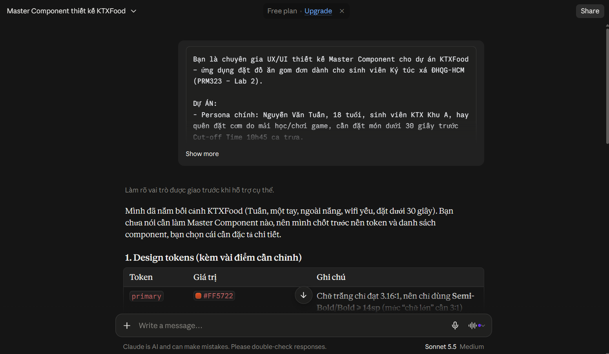
  - **Ảnh Prompt & Kết quả Vòng 2 (1.2):**  
    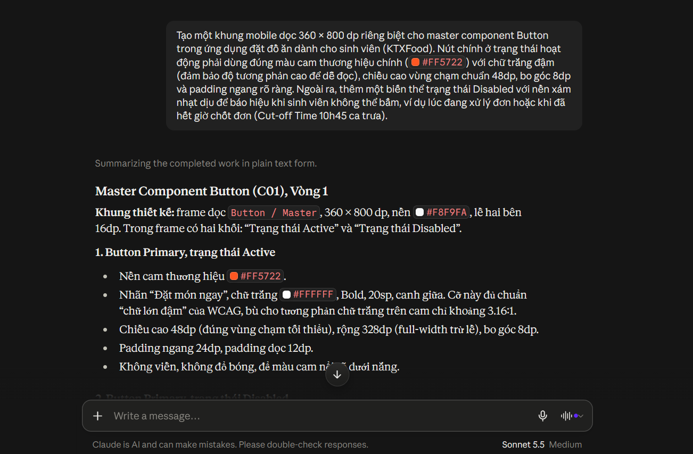
  - **Ảnh Prompt & Kết quả Vòng 3 (1.3):**  
    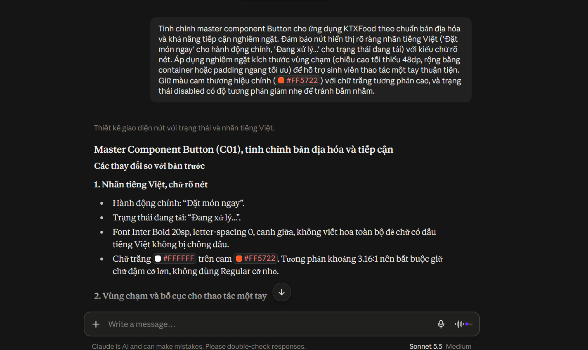
  - **Ảnh Kết quả Master Component chốt (1.4):**  
    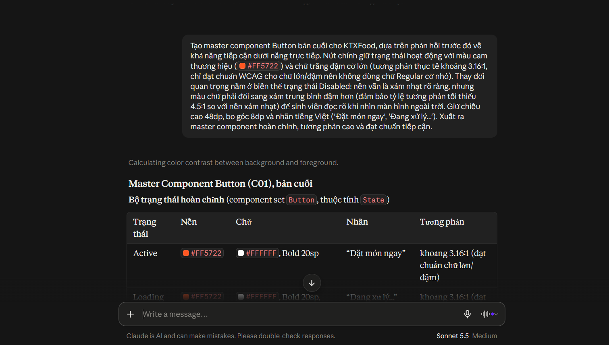

---

### 🔹 Component 2: Text Field / Input Field (C02 - Trường nhập liệu)
* **Thư mục ảnh minh chứng:** `assests/figma/Điền/component-2/`
* **Vấn đề đặt ra:** Ô nhập liệu ban đầu thiếu trạng thái lỗi (`Error state`), thiếu nút xóa nhanh một chạm (`clear icon`) và viền mờ khó thấy ngoài trời.
* **Nguyên văn Prompt Vòng 1 – Nhãn & placeholder:**
  > ```text
  > Tạo một khung mobile 360 × 800 dp riêng biệt cho master component Text Field trong KTXFood. Có nhãn cố định phía trên ô nhập và placeholder "Nhập ghi chú món ăn...". Dùng văn bản tiếng Việt.
  > ```
* **Nguyên văn Prompt Vòng 2 – Trạng thái Focused & Error:**
  > ```text
  > Tinh chỉnh Text Field: thêm trạng thái Focused với viền 2dp màu #FF5722, và trạng thái Error với viền #EF4444, icon cảnh báo dấu chấm than và dòng thông báo lỗi bên dưới ô nhập.
  > ```
* **Nguyên văn Prompt Vòng 3 – Icon xóa nhanh & cao 48dp (Chốt):**
  > ```text
  > Tinh chỉnh Text Field: thêm icon xóa (X) ở cuối ô để xóa nội dung chỉ với một chạm, và nâng chiều cao ô lên 48dp để dùng một tay thuận tiện.
  > ```
* **Minh chứng hình ảnh:**
  - **Ảnh Prompt 0 & Bối cảnh (2.1):**  
    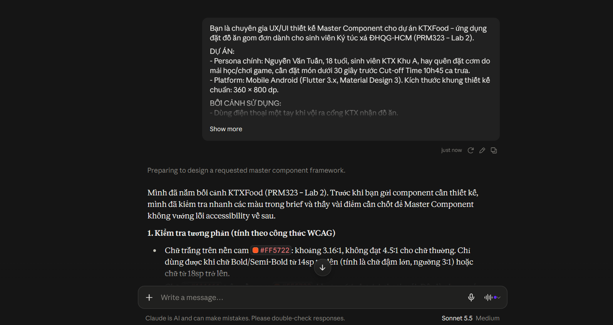
  - **Ảnh Prompt & Kết quả Vòng 2 (2.2):**  
    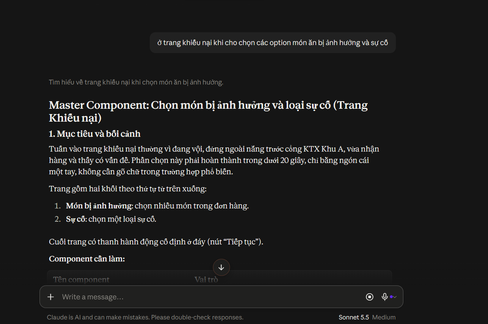
  - **Ảnh Prompt & Kết quả Vòng 3 (2.3):**  
    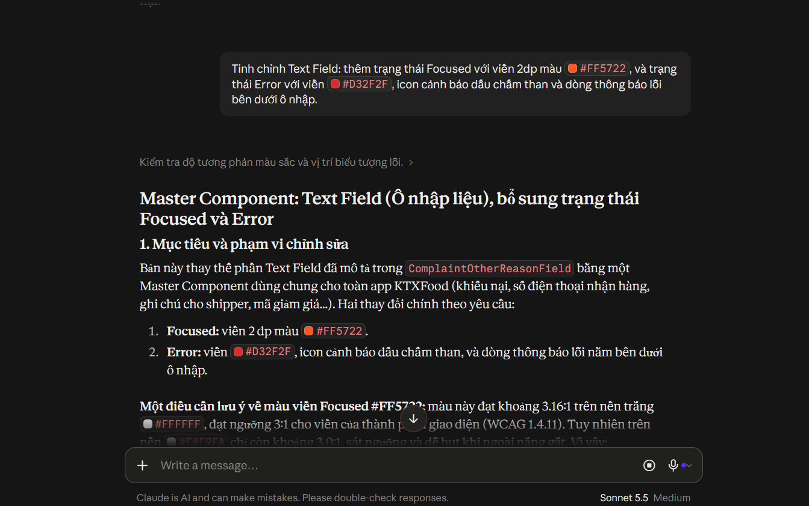
  - **Ảnh Kết quả Master Component chốt (2.4):**  
    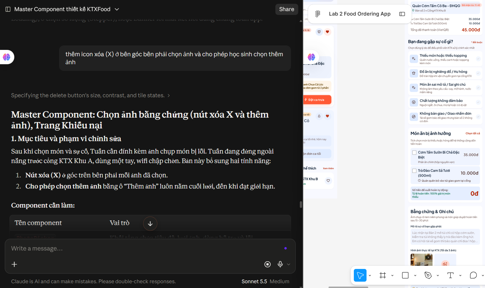

---

### 🔹 Component 3: Food Item Card (C03 - Thẻ hiển thị món ăn)
* **Thư mục ảnh minh chứng:** `assests/figma/Điền/component-3/`
* **Vấn đề đặt ra:** Thẻ món ban đầu chỉ có một kích thước cố định, thiếu thông tin quán, vùng chạm nút thêm món quá bé và chưa xử lý trạng thái hết hàng ca trưa.
* **Nguyên văn Prompt Vòng 1 – Hai biến thể bố cục thẻ dọc & ngang:**
  > ```text
  > Tạo master component Food Item Card cho KTXFood với hai biến thể bố cục: Vertical Card (rộng 160dp, dùng cho lưới 2 cột ở màn hình Trang chủ) và Horizontal Card (rộng 328dp, dùng cho danh sách thực đơn). Gồm ảnh món, tên món, giá và tên quán.
  > ```
* **Nguyên văn Prompt Vòng 2 – Nút thêm món nhanh tròn "+" nền cam:**
  > ```text
  > Thêm nút thêm món nhanh hình tròn "+" nền #FF5722 với vùng chạm rộng rãi vào cả hai biến thể card.
  > ```
* **Nguyên văn Prompt Vòng 3 – Trạng thái Sold Out (Chốt):**
  > ```text
  > Thêm trạng thái Sold Out: phủ lớp màng rgba(0,0,0,0.4) lên ảnh món kèm nhãn "Hết hàng ca này", và chuyển nút thêm sang trạng thái disabled màu xám.
  > ```
* **Minh chứng hình ảnh:**
  - **Ảnh Prompt 0 & Bối cảnh (3.1):**  
    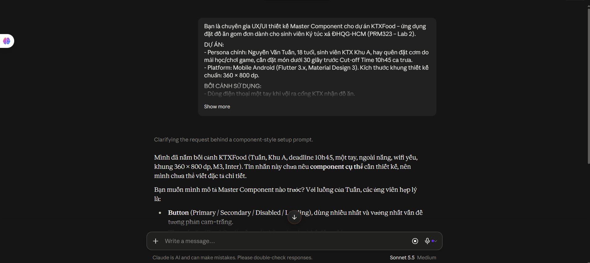
  - **Ảnh Prompt & Kết quả Vòng 1 (3.2):**  
    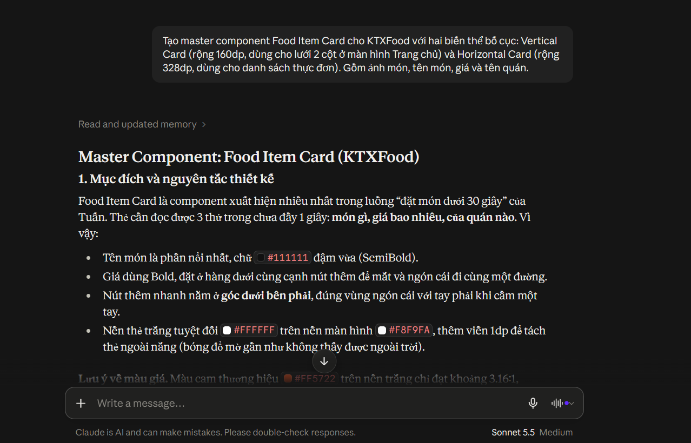
  - **Ảnh Prompt & Kết quả Vòng 2 (3.3):**  
    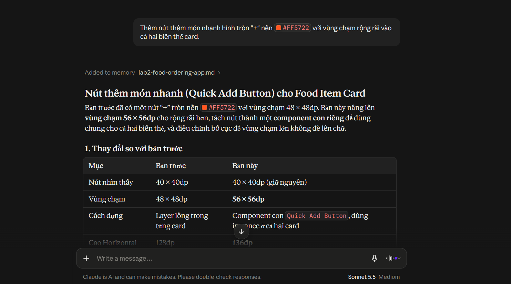
  - **Ảnh Prompt Vòng 3 & Đối chiếu Figma Prototype (3.4):**  
    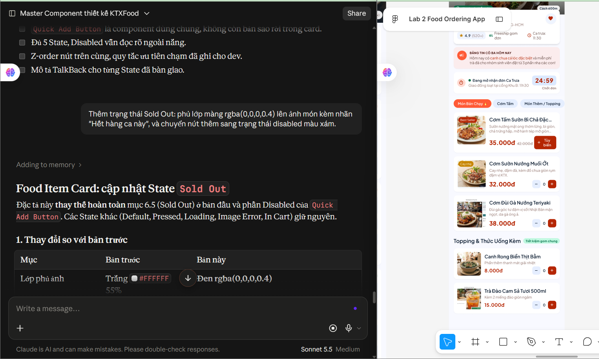

---

### 🔹 Component 4: Bottom Navigation Bar (C04 - Thanh điều hướng đáy)
* **Thư mục ảnh minh chứng:** `assests/figma/Điền/component-4/`
* **Vấn đề đặt ra:** Thanh menu đáy thiếu chỉ báo trực quan tab đang chọn (active indicator) và thiếu tín hiệu thông báo cho sinh viên khi đơn hàng đang được shipper giao đến cổng KTX.
* **Nguyên văn Prompt Vòng 1 – 4 tab cố định bám sát luồng sinh viên:**
  > ```text
  > Tạo master component Bottom Navigation Bar cho KTXFood với 4 tab cố định: "Trang chủ", "Đơn hàng", "Yêu thích", "Tài khoản".
  > ```
* **Nguyên văn Prompt Vòng 2 – Pill indicator tab đang chọn:**
  > ```text
  > Thêm chỉ báo dạng viên thuốc (pill) nền #FBE9E7 ôm quanh icon của tab đang chọn, với nhãn của tab đang chọn màu #FF5722.
  > ```
* **Nguyên văn Prompt Vòng 3 – Chấm badge shipper đang giao đơn (Chốt):**
  > ```text
  > Thêm chấm badge đỏ/cam trên danh sách yêu thích và bảng thông báo để sinh viên kịp thời nhận hàng khi shipper tới cổng KTX.
  > ```
* **Minh chứng hình ảnh:**
  - **Ảnh Prompt 0 & Bối cảnh (4.1):**  
    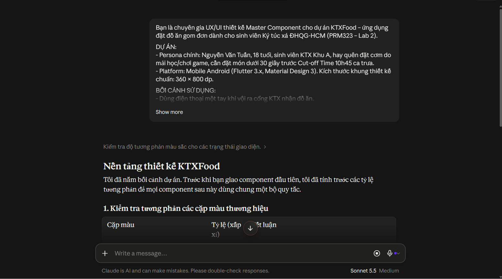
  - **Ảnh Prompt & Kết quả Vòng 1 (4.2):**  
    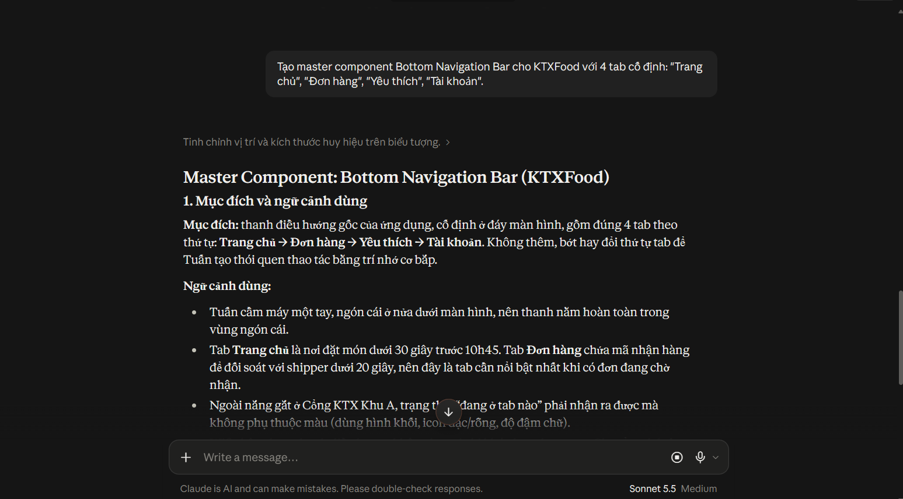
  - **Ảnh Prompt & Kết quả Vòng 2 (4.3):**  
    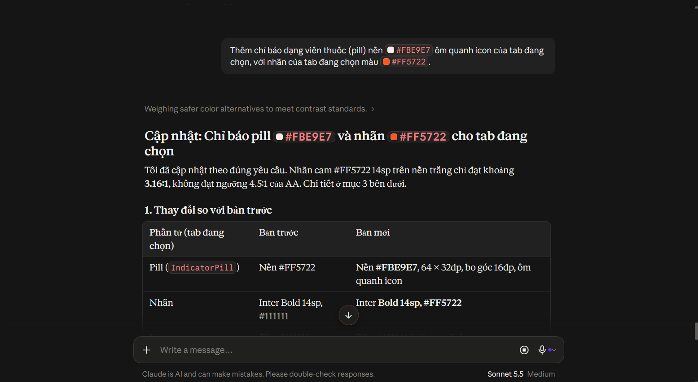
  - **Ảnh Prompt Vòng 3 & Đối chiếu Side Menu Figma (4.4):**  
    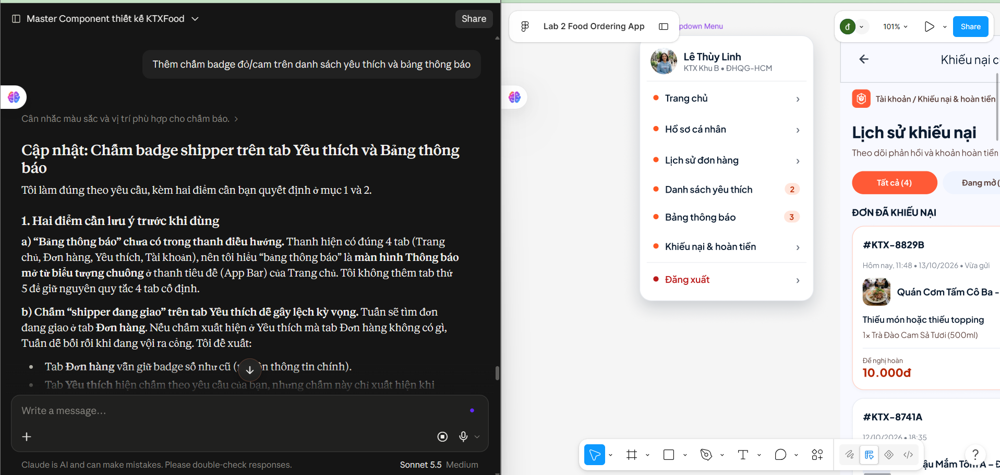

---

### 🔹 Component 5: App Bar / Top Navigation (C05 - Thanh tiêu đề đỉnh)
* **Thư mục ảnh minh chứng:** `assests/figma/Điền/component-5/`
* **Vấn đề đặt ra:** Header thiếu dropdown chọn địa điểm cố định cổng KTX, nút Back có kích thước hiển thị nhỏ dễ bấm hụt, thiếu badge đếm số lượng món trong giỏ hàng.
* **Nguyên văn Prompt Vòng 1 – Biến thể Home App Bar với điểm nhận KTX:**
  > ```text
  > Tạo biến thể Home App Bar cho KTXFood với dropdown điểm nhận hàng cố định "Cổng KTX Khu A ▾".
  > ```
* **Nguyên văn Prompt Vòng 2 – Biến thể Detail App Bar với Touch Target 48×48dp:**
  > ```text
  > Tạo biến thể Detail App Bar với mũi tên Back có vùng chạm 48×48dp.
  > ```
* **Nguyên văn Prompt Vòng 3 – Badge Giỏ hàng & Chuông thông báo (Chốt):**
  > ```text
  > Thêm badge số lượng món trên icon Giỏ hàng và badge số thông báo chưa đọc trên icon Chuông.
  > ```
* **Minh chứng hình ảnh:**
  - **Ảnh Prompt 0 & Bối cảnh (5.1):**  
    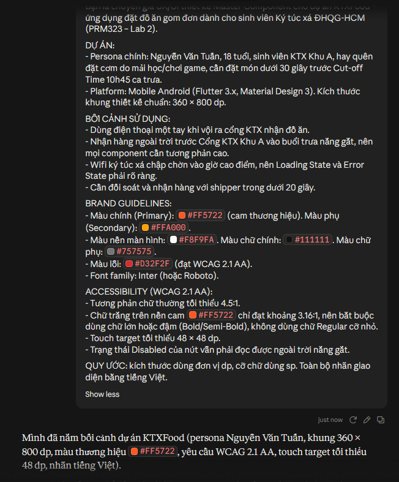
  - **Ảnh Prompt & Kết quả Vòng 1 (5.2):**  
    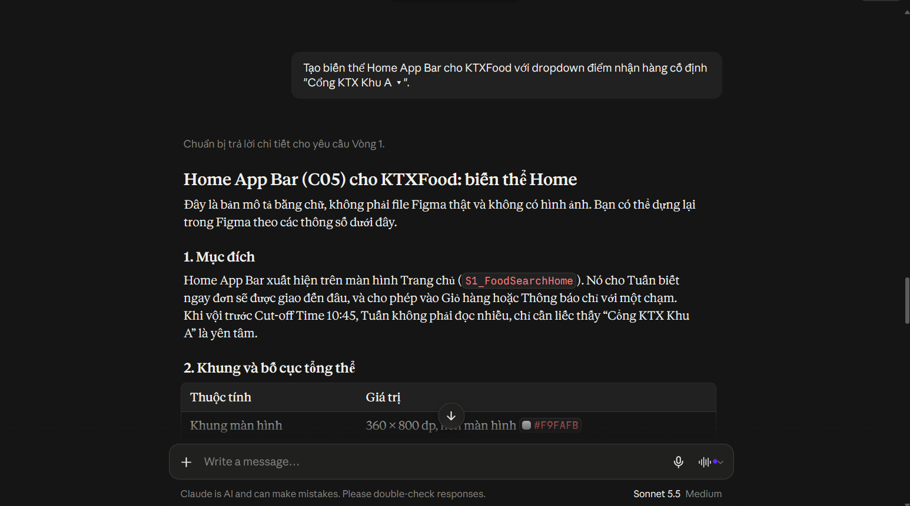
  - **Ảnh Prompt & Kết quả Vòng 2 (5.3):**  
    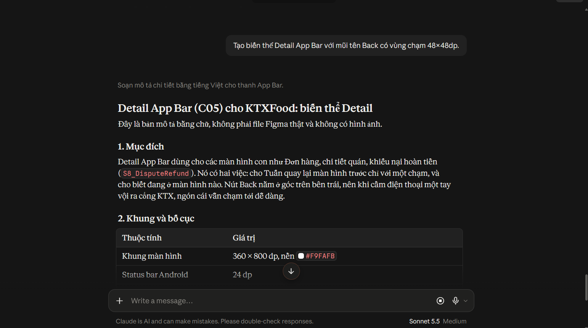
  - **Ảnh Prompt & Kết quả Vòng 3 (5.4):**  
    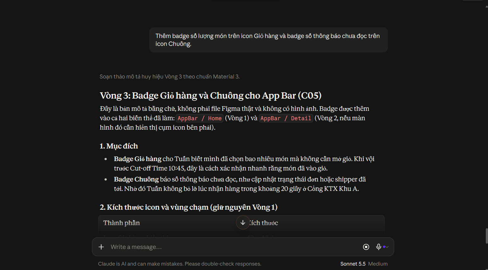
  - **Ảnh Kết quả App Bar trên giao diện thực tế Figma (5.5):**  
    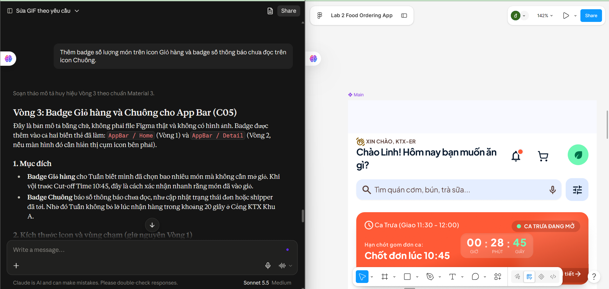

---

### 🔹 Component 6: Empty State (C08 - Trạng thái trống)
* **Thư mục ảnh minh chứng:** `assests/figma/Điền/component-6/`
* **Vấn đề đặt ra:** Khi giỏ hàng chưa có món hoặc tìm kiếm không ra món, màn hình trắng trơn khiến sinh viên bối rối không biết tiếp tục thế nào. Cần hình minh họa thân thiện và nút hành động rõ ràng.
* **Nguyên văn Prompt Vòng 1 – Minh họa trạng thái rỗng:**
  > ```text
  > Tạo hình minh họa cho Empty State: một giỏ hàng trống và một kính lúp không tìm thấy kết quả.
  > ```
* **Nguyên văn Prompt Vòng 2 – Viết lại nội dung thân thiện sinh viên KTX:**
  > ```text
  > Viết lại nội dung theo giọng thân thiện với sinh viên: "Giỏ hàng của bạn đang trống. Hãy chọn món ngon quanh KTX để kịp ca trưa nhé!"
  > ```
* **Nguyên văn Prompt Vòng 3 – Nút CTA "Xem thực đơn" cao 48dp (Chốt):**
  > ```text
  > Thêm nút CTA chính "Xem thực đơn" (cao 48dp) điều hướng về màn hình Trang chủ (S1_FoodSearchHome).
  > ```
* **Minh chứng hình ảnh:**
  - **Ảnh Prompt 0 & Bối cảnh (6.1):**  
    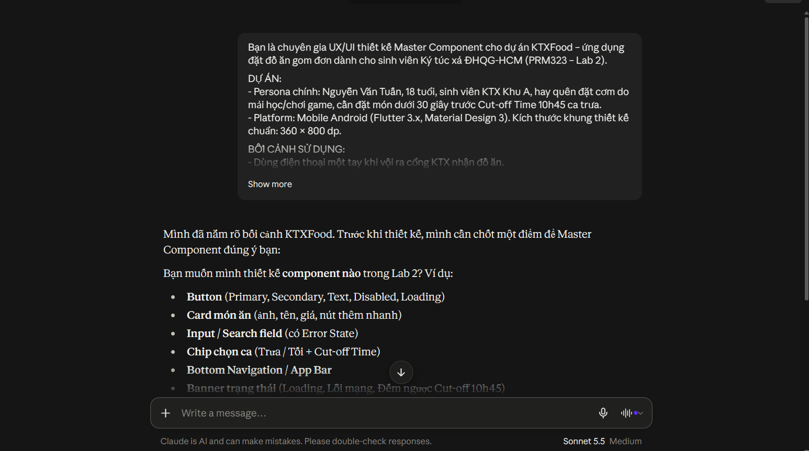
  - **Ảnh Prompt & Kết quả Vòng 1 (6.2):**  
    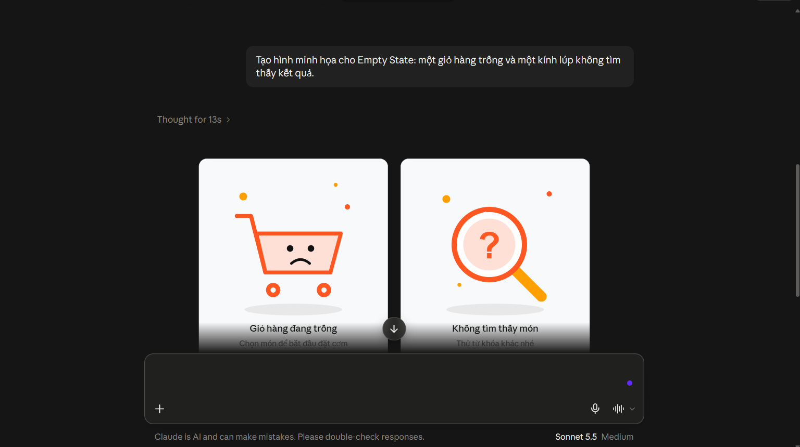
  - **Ảnh Prompt & Kết quả Vòng 2 (6.3):**  
    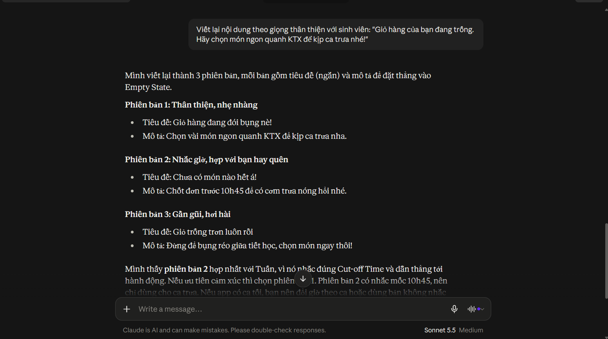
  - **Ảnh Prompt Vòng 3 & Đối chiếu Empty State Library Figma (6.4):**  
    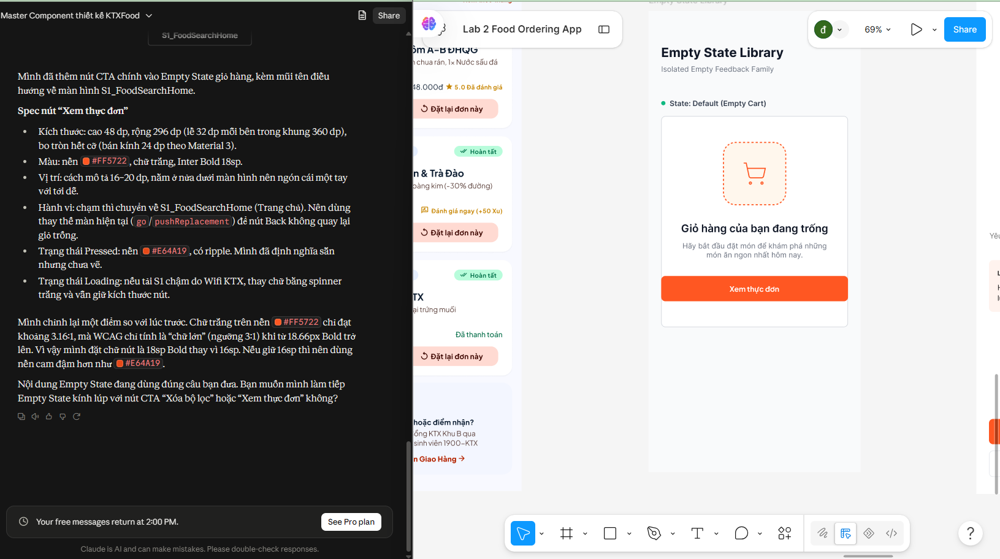

---

## 6. PHẢN BIỆN BẰNG AI THEO 10 NIELSEN USABILITY HEURISTICS

### Bảng tổng hợp 5 phát hiện phản biện chuyên sâu:

| STT | Nguyên tắc Nielsen (Heuristic) | Phát hiện lỗi cụ thể từ AI Critique | Mức độ nghiêm trọng | Giải pháp khắc phục trên Component |
| :---: | :--- | :--- | :---: | :--- |
| 1 | **Visibility of System Status** *(Hiển thị trạng thái hệ thống)* | Nút Button chính (C01) khi bấm gửi đơn thiếu trạng thái Loading dạng spinner. Sinh viên bấm xong không rõ đơn đã gửi đi chưa nên có xu hướng bấm lặp lại nhiều lần. | **Cao (High)** | Thêm biến thể `Loading State` cho Button: thay chữ bằng vòng xoay spinner trắng, vô hiệu hóa touch event tạm thời để chống double-click. |
| 2 | **Match Between System and Real World** *(Tương đồng với thực tế)* | Thẻ món ăn (C03) hiển thị trạng thái hết hàng bằng chữ "Unavailable" theo chuẩn chung quốc tế, sinh viên KTX không nắm được là hết món luôn hay chỉ hết trong ca trưa này. | **Trung bình** | Đổi nhãn tiếng Việt thành *"Hết hàng ca này"* phủ trên ảnh kèm lớp màng tối, đồng thời thông báo rõ giờ mở bán ca tối. |
| 3 | **Error Prevention** *(Phòng ngừa lỗi tương tác)* | Text Field (C02) cho phép gửi ghi chú trống mà không có giới hạn độ dài, hoặc nút bấm xóa nhanh `(X)` quá sát mép dễ bấm nhầm khi đang cuộn trang bằng một tay. | **Cao (High)** | Bổ sung padding an toàn $\ge 12\text{dp}$ cho icon trailing xóa nhanh, touch target của icon giữ đúng chuẩn $48\times 48\text{dp}$. |
| 4 | **Recognition Rather Than Recall** *(Nhận diện thay vì nhớ)* | Bottom Navigation Bar (C04) chỉ đổi màu chữ tab active sang cam `#FF5722`. Dưới trời nắng gắt ở cổng KTX, độ chênh màu rất khó phân biệt nếu không che tay lên màn hình. | **Nghiêm trọng (Critical)** | Thêm chỉ báo dạng viên thuốc (Pill Indicator) nền sáng `#FBE9E7` ôm quanh biểu tượng tab đang chọn để nhận diện bằng hình khối thay vì chỉ phụ thuộc vào màu sắc. |
| 5 | **Flexibility and Efficiency of Use** *(Linh hoạt và hiệu quả sử dụng)* | App Bar (C05) yêu cầu sinh viên phải mở màn hình cài đặt mới đổi được điểm nhận hàng, gây tốn thời gian khi sinh viên di chuyển đột xuất giữa KTX Khu A và Khu B. | **Cao (High)** | Tích hợp dropdown nhanh *"Cổng KTX Khu A ▾"* ngay tại đỉnh màn hình chính để đổi địa điểm nhận chỉ với 2 chạm. |

---

## 7. BẢNG GHI NHẬN QUYẾT ĐỊNH (ACCEPT / REJECT DECISION MATRIX)
Theo tiêu chí Mục 4 của đề bài: *"Với mỗi đề xuất quan trọng, ghi rõ bạn chấp nhận, chỉnh sửa hay từ chối và vì sao. Lý do phải liên quan đến persona, một heuristic hoặc một ràng buộc thực tế."*

| Đề xuất từ AI Critique | Quyết định | Lập luận chi tiết (Bám sát Persona, Heuristic & Ràng buộc KTX) |
| :--- | :---: | :--- |
| **1. Đề xuất: Dùng màu chữ `#111827` cho tất cả văn bản trên nền cam `#FF5722` để đạt tương phản cao tuyệt đối thay vì chữ trắng.** |  **TỪ CHỐI (REJECT)** | **Lý do (Nhận diện thương hiệu & Thẩm mỹ):** Chữ đen/xám đậm trên nền cam tạo cảm giác giao diện cảnh báo nguy hiểm công trình xây dựng, không phù hợp với app thực phẩm sinh viên. Quyết định: Giữ chữ trắng `#FFFFFF` trên nền cam nhưng **bắt buộc tăng trọng số chữ lên Bold/Semi-Bold và kích thước $\ge 14\text{sp}$**, đạt ngưỡng 3.16:1 (chuẩn WCAG AA cho Large/Bold Text). |
| **2. Đề xuất: Thêm biến thể thẻ món dạng dọc 160dp và dạng ngang 328dp cho Food Item Card (C03).** |  **CHẤP NHẬN (ACCEPT)** | **Lý do (Công thái học & Tốc độ):** Màn hình Trang chủ cần thẻ dọc dạng lưới 2 cột để sinh viên lướt nhanh nhiều món trước Cut-off Time 10:45. Trong khi đó, màn hình Thực đơn quán cần thẻ ngang 328dp để hiển thị đầy đủ tên món, giá và nút thêm món nhanh. |
| **3. Đề xuất: Đổi màu lỗi `#EF4444` (Figma) sang `#D32F2F` để đạt độ tương phản chuẩn AA cho chữ nhỏ.** |  **CHỈNH SỬA (MODIFY)** | **Lý do (Accessibility ngoài trời):** Màu `#EF4444` trên nền trắng chỉ đạt tương phản 3.76:1 (dưới chuẩn 4.5:1 của WCAG AA cho body text). Quyết định: Trên Figma giữ mã `#EF4444` cho viền và icon lỗi lớn, nhưng chữ thông báo lỗi bắt buộc dùng font Bold hoặc kèm nền highlight nhạt `#FFEBEE` để đảm bảo sinh viên đọc rõ ngoài nắng. |
| **4. Đề xuất: Bỏ nút CTA "Xem thực đơn" ở Empty State vì người dùng có thể tự bấm nút Back.** | **TỪ CHỐI (REJECT)** | **Lý do (User Control and Freedom & Tốc độ):** Khi giỏ hàng rỗng, sinh viên đang cần đặt cơm gấp trước Cut-off Time 10:45. Nếu không có CTA trực tiếp, sinh viên phải bấm Back nhiều bước gây mất thời gian. Nút CTA lớn (48dp) "Xem thực đơn" dẫn thẳng về Trang chủ giúp rút ngắn tối đa thao tác. |
| **5. Đề xuất: Dùng kích thước nút bấm 40dp chiều cao để tiết kiệm diện tích màn hình mobile.** | **TỪ CHỐI (REJECT)** | **Lý do (WCAG Touch Target):** Sinh viên Tuấn sử dụng điện thoại bằng một tay trong lúc đang đi bộ nhanh ra cổng KTX. Chiều cao 40dp vi phạm chuẩn vùng chạm tối thiểu 48dp, rất dễ bấm hụt hoặc chạm nhầm vào món bên cạnh. Quyết định: Giữ nghiêm ngặt chiều cao tối thiểu 48dp cho tất cả nút bấm chính. |

---

*Nhật ký thiết kế Master Components được lập, rà soát và lưu trữ đồng bộ trên GitHub Repository bởi Trần Sanh Điền (SE192947).*
