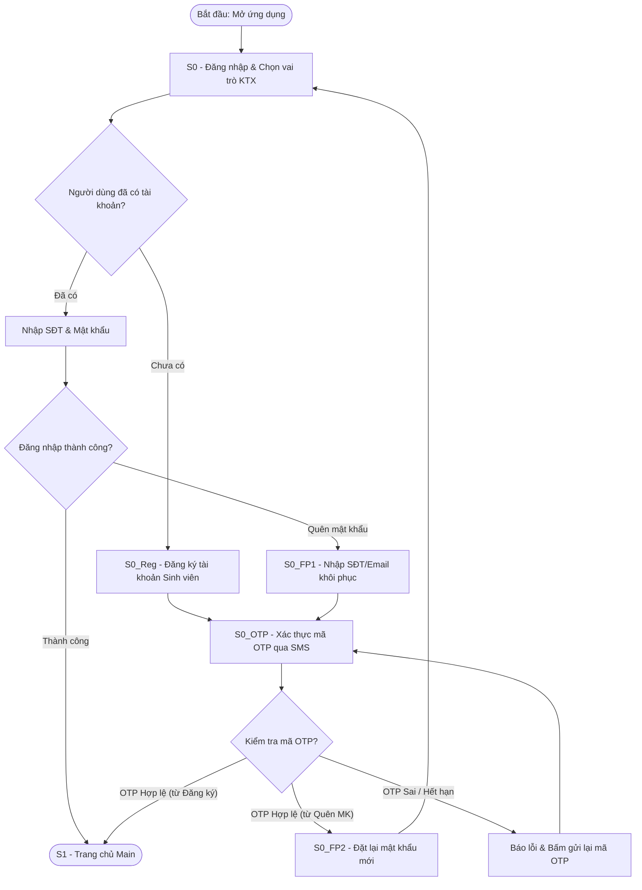
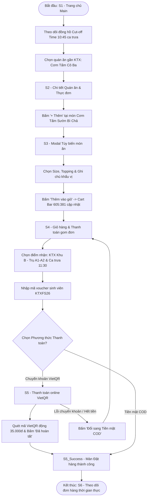
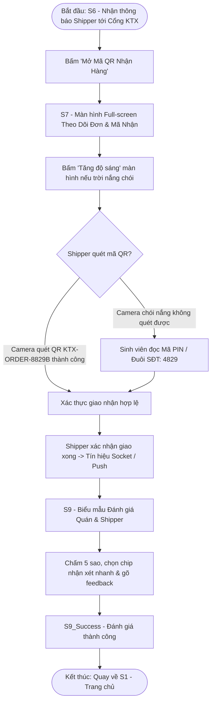
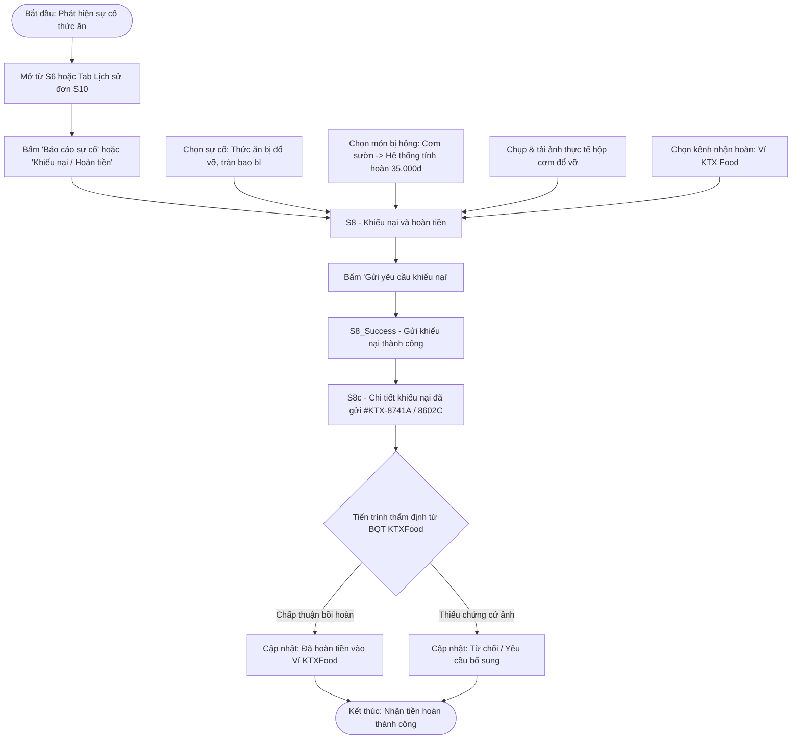

# Screen Spec – Food Ordering App KTX

> **Dự án:** Food Ordering App cho Sinh viên Ký túc xá ĐHQG-HCM (PRM323 – Lab 2)  
> **Người thực hiện:** Thành viên 4 – Trần Sanh Điền - Prototyping & Flutter Handoff Lead   
> **Tài liệu tham chiếu:** `ux/persona.md`, `ux/user-flow.md`, `design/DESIGN.md`, `food_ordering_app_srs.md` (Mục 3 & 4.A).  
> **Ghi chú về quy chuẩn kích thước & hiện trạng Figma:**  
> - Toàn bộ các artboard/frame trên Figma đã được chuẩn hóa theo chiều rộng di động tiêu chuẩn: **360dp** (chiều cao linh hoạt từ **1074dp đến 2822dp** để chứa toàn bộ nội dung cuộn; viewport hiển thị thực tế trên thiết bị chuẩn là **360 × 800 dp**).  
> - Mọi node ID trong tài liệu đều được trích xuất trực tiếp từ file duy nhất `ALDYFWUZ72BaeyulpVi7uY`. Bỏ toàn bộ các phân định "file chính / file phụ" trước đây.  
> - Các điểm không đồng nhất trong dữ liệu text hoặc trạng thái được đánh dấu rõ bằng nhãn `⚠ MÂU THUẪN NGUỒN` hoặc `⚠ CẦN BỔ SUNG`.

---

## 1. Tổng quan Hệ thống Màn hình

Bảng tổng hợp toàn bộ các màn hình, trạng thái, modal và dialog trên Figma được ánh xạ vào 4 User Flows (Flow 0: Xác thực tiền đề, Flow 1: Đặt món & Thanh toán, Flow 2: Nhận hàng & Đánh giá, Flow 3: Khiếu nại & Hoàn tiền) cùng các màn hình cấp cao hỗ trợ:

| Mã Màn | Tên Màn hình / Phân hệ | Loại Màn hình | Thuộc User Flow | Node Figma (fileKey: `ALDYFWUZ72BaeyulpVi7uY`) |
| :---: | :--- | :--- | :--- | :--- |
| **S0** | `S0_StudentLogin` (Đăng nhập & Chọn vai trò KTX) | Root Entry Screen | Flow 0 (Start) | `438:4829` |
| **S0_Reg** | `S0_StudentRegister` (Đăng ký tài khoản sinh viên) | Nested Screen | Flow 0 (Alt Branch) | `438:4279` |
| **S0_OTP** | `S0_OTPVerification` (Xác thực OTP) | Nested Screen | Flow 0 (Step xác thực) | `438:5011` *(Bản chính)* *(Node `438:3843` là bản sao duplicate)* |
| **S0_FP1** | `S0_ForgotPasswordStep1` (Khôi phục mật khẩu - Nhập SĐT/Email) | Nested Screen | Flow 0 (Recovery) | `438:4498` |
| **S0_FP2** | `S0_ForgotPasswordStep2` (Khôi phục mật khẩu - Đặt lại MK mới) | Nested Screen | Flow 0 (Recovery) | `438:4656` |
| **S1** | `S1_FoodSearchHome` (Trang chủ "Main" - Tra cứu đặt đồ ăn) | Root Screen (Tab Home) | Flow 0 (End), Flow 1 (Start), Flow 2 (End) | `462:1932` *(Loading: `588:233`)* |
| **S2** | `S2_StoreDetailMenu` (Chi tiết Quán ăn & Thực đơn) | Nested Screen | Flow 1 (Step) | `438:1030` *(Loading: `588:564`)* |
| **S3** | `S3_FoodCustomization` (Tùy biến món ăn) | Nested / Modal Bottom Sheet | Flow 1 (Step) | `438:2507` |
| **S4** | `S4_GroupCartCheckout` (Giỏ hàng & Thanh toán gom đơn) | Nested Screen | Flow 1 (Step / Alt) | `438:699` *(Giỏ trống: `438:5594`, Sticky Cart Bar: `605:381`)* |
| **S5** | `S5_OnlinePayment` (Thanh toán online VietQR) | Nested Screen | Flow 1 (Step) | `438:3191` |
| **S5_Success** | `S5_OrderSuccessDialog` (Dialog/Màn Đặt hàng thành công) | Pop-up / Overlay | Flow 1 (Step phản hồi) | `438:5157` |
| **S6** | `S6_LiveOrderTracking` (Theo dõi Đơn hàng thời gian thực) | Root Screen (Tab Orders) | Flow 1 (End), Flow 2 (Start), Flow 3 (Khởi phát & End) | `438:1274` |
| **S7** | `S7_PickupQRCode` (Theo Dõi Đơn & Mã Nhận tại Cổng KTX) | Full-screen Screen | Flow 2 (Step xác thực) | `438:1468` |
| **S8** | `S8_DisputeRefund` (Khiếu nại và hoàn tiền) | Nested Screen | Flow 3 (Recovery Start) | `438:2307` *(Phần phụ: `438:5191–5485`, Thành công: `438:5174`)* |
| **S8b** | `S8b_DisputeHistory` (Lịch sử khiếu nại đã gửi) | Nested / Tab Support | Flow 3 (Step tra cứu) | `438:571` *(Loading: `588:1134`)* |
| **S8c** | `S8c_DisputeDetail` (Chi tiết khiếu nại đã gửi) | Nested Screen | Flow 3 (Recovery End) | `438:478` *(Biến thể: `#KTX-8741A`: `438:5621`, `#KTX-8602C`: `438:5714`, `#KTX-8420A`: `438:5807`)* |
| **S9** | `S9_ReviewFeedback` (Đánh giá và phản hồi) | Nested Screen | Flow 2 (End) | `438:1971` *(Đánh giá thành công: `438:5577`)* |
| **S10** | `S10_OrderHistory` (Lịch sử đơn hàng) | Root Screen (Tab Orders cũ) | Flow 3 (Khởi phát thay thế) | `438:3541` *(Loading: `588:820`)* |
| **S11** | `S11_FavoriteList` (Danh sách quán quen yêu thích) | Top-level Support (Menu) | Hỗ trợ Flow 1 | `438:2822` *(Loading: `588:1296`)* |
| **S12** | `S12_NotificationBoard` (Bảng thông báo trung tâm) | Top-level Support (Header) | Hỗ trợ Flow 1 & 2 | `438:1710` *(Loading: `588:1677`)* |
| **S13** | `S13_ProfileSettings` (Hồ sơ cá nhân & Cài đặt) | Root Screen (Tab Profile) | Cấu hình & Định danh | `438:3979` |

> *Ghi chú thành phần dùng chung (Page Components, không tính là màn hình riêng):*
> - **User Dropdown Menu:** Node `438:5147` (Gồm 7 mục: *Trang chủ, Hồ sơ cá nhân, Lịch sử đơn hàng, Danh sách yêu thích, Bảng thông báo, Khiếu nại & hoàn tiền, Đăng xuất*).
> - **Thư viện trạng thái chờ (Loading Placeholders):** Node `438:5148`.
> - **Bottom Floating Sticky Batch Order Cart Bar:** Node `605:381`.
> - **Sub-components Khiếu nại:** Issue Options (`438:5191/5216/5241/5266/5291`), Affected Items (`438:5316`), Refund Method (`438:5485`).

---

## 2. Đặc tả Chi tiết Từng Màn hình

### S0 – Cụm Khởi tạo & Xác thực Định danh KTX (Flow 0)

#### 1. S0 – `S0_StudentLogin` (Đăng nhập & Chọn vai trò KTX)
* **Mục đích:** Xác thực danh tính sinh viên nội trú KTX ĐHQG-HCM, cho phép chọn vai trò đăng nhập (*Sinh viên KTX / Chủ quán / Tài xế KTX*) để phân quyền giao diện.
* **Nội dung hiển thị:**
  - Header: Logo ứng dụng KTXFood, biểu ngữ chào đón.
  - Tab / Bộ chọn vai trò: Mặc định chọn vai trò **Sinh viên KTX**.
  - Ô nhập liệu: Số điện thoại (`+84 ...`) hoặc Mã số sinh viên / Email `@vnuhcm.edu.vn`.
  - Ô nhập liệu Mật khẩu (kèm icon ẩn/hiện mật khẩu).
  - Nút liên kết phụ: "Quên mật khẩu?" và "Đăng ký tài khoản mới".
  - Nút CTA chính: **"Đăng nhập"** (`FilledButton` 48dp).
* **Thuộc flow & vai trò:** **Flow 0** – **Start Point** (Bắt đầu chu trình xác thực).
* **Hành động chính:** Nhập thông tin hợp lệ $\rightarrow$ Bấm "Đăng nhập" để vào Trang chủ `S1` (hoặc chuyển sang OTP nếu đăng nhập từ thiết bị lạ).
* **Vào từ / Đi tới:**
  - Vào từ: Khởi chạy app khi chưa có token đăng nhập.
  - Đi tới: `S1_FoodSearchHome` (nếu thành công), `S0_StudentRegister` (bấm Đăng ký), `S0_ForgotPasswordStep1` (bấm Quên MK).
* **Node Figma:** `438:4829`.

#### 2. S0_Reg – `S0_StudentRegister` (Đăng ký tài khoản sinh viên)
* **Mục đích:** Thu thập thông tin định danh sinh viên nội trú (Họ tên, SĐT, Tòa nhà KTX, Phòng) để phục vụ việc giao nhận chính xác tận cụm tòa nhà.
* **Nội dung hiển thị:**
  - Top Bar: Nút Back quay lại Đăng nhập.
  - Tiêu đề: "Đăng ký tài khoản Sinh viên KTX".
  - Các trường nhập liệu: Họ và tên, Số điện thoại di động, Email sinh viên ĐHQG, Chọn KTX (Khu A / Khu B), Chọn Tòa nhà (ví dụ: *Tòa B3*), Số phòng (ví dụ: *Phòng 408*), Mật khẩu và Xác nhận mật khẩu.
  - Checkbox chấp thuận điều khoản dịch vụ và quy định giao nhận tại Cổng KTX.
  - Nút CTA chính: **"Tiếp tục"** (`FilledButton` 48dp).
* **Thuộc flow & vai trò:** **Flow 0** – **Alternative Branch (Nhánh đăng ký mới)**.
* **Hành động chính:** Bấm "Tiếp tục" để chuyển sang bước Xác thực OTP qua SMS.
* **Vào từ / Đi tới:** Vào từ `S0_StudentLogin` $\rightarrow$ Đi tới `S0_OTPVerification`.
* **Node Figma:** `438:4279`.

#### 3. S0_OTP – `S0_OTPVerification` (Xác thực OTP)
* **Mục đích:** Xác thực quyền sở hữu số điện thoại sinh viên qua mã OTP 6 chữ số gửi qua tin nhắn SMS, bảo vệ tài khoản và lịch sử giao dịch.
* **Nội dung hiển thị:**
  - Top Bar: Nút Back.
  - Tiêu đề: "Xác thực mã OTP".
  - Dữ liệu mẫu thực tế: Hiển thị tên người dùng **"Lê Thùy Linh"**, khu vực **"KTX Khu B"**, và số điện thoại nhận mã **`+84 912 *** 829`** (Đuôi SĐT: `4829`).
  - Hàng 6 ô nhập mã PIN/OTP độc lập (tự động nhảy focus).
  - Đồng hồ đếm ngược hiệu lực mã (60 giây) và nút "Gửi lại mã OTP" (kích hoạt khi hết 60s).
  - Nút CTA chính: **"Xác nhận OTP"** (`FilledButton` 48dp).
* **Thuộc flow & vai trò:** **Flow 0** – **Step xác thực bảo mật**. Có nhánh lỗi khi nhập sai OTP quá 3 lần.
* **Hành động chính:** Nhập đủ 6 số OTP $\rightarrow$ Bấm "Xác nhận OTP".
* **Vào từ / Đi tới:**
  - Vào từ: `S0_StudentRegister` hoặc `S0_ForgotPasswordStep1`.
  - Đi tới: `S1_FoodSearchHome` (nếu đăng ký thành công) hoặc `S0_ForgotPasswordStep2` (nếu là luồng khôi phục MK).
* **Node Figma:** `438:5011` *(Bản chính xác trong luồng)*.  
  *(⚠ Ghi chú duplicate: Frame `438:3843` có nội dung giống hệt nhưng nằm ngoài luồng, kiến nghị nhóm xóa hoặc đổi tên thành duplicate).*

#### 4. S0_FP1 & S0_FP2 – `S0_ForgotPassword` (Khôi phục mật khẩu)
* **Mục đích:** Giúp sinh viên lấy lại mật khẩu đăng nhập thông qua xác thực số điện thoại và email nội bộ ĐHQG mà không cần liên hệ quản trị viên.
* **Nội dung hiển thị:**
  - `S0_FP1` (`438:4498`): Ô nhập Số điện thoại hoặc Email đã đăng ký $\rightarrow$ Nút "Nhận mã OTP xác minh".
  - `S0_FP2` (`438:4656`): Sau khi xác thực OTP thành công $\rightarrow$ Mở màn hình nhập "Mật khẩu mới" và "Nhập lại mật khẩu mới" $\rightarrow$ Nút CTA **"Đổi mật khẩu"**.
* **Thuộc flow & vai trò:** **Flow 0** – **Recovery Branch (Khôi phục tài khoản)**.
* **Node Figma:** Bước 1: `438:4498`, Bước 2: `438:4656`.

---

### S1 – `S1_FoodSearchHome` (Trang chủ "Main" - Tra cứu đặt đồ ăn)
* **Mục đích (gắn pain point Persona):** Phục vụ sinh viên **Lê Thùy Linh (KTX Khu B)** khám phá nhanh các quán cơm/nước bình dân quanh KTX, theo dõi chính xác thời gian đóng bếp ca trưa (**Cut-off 10:45**) và số lượng đơn đang gom cho cổng KTX Khu B, đảm bảo đặt kịp bữa ăn trước khi tan học với thời gian thao tác dưới 30 giây.
* **Nội dung hiển thị (Khớp 100% Figma `462:1932`):**
  - **Header chuẩn:** Logo thương hiệu KTXFood, lời chào cá nhân hóa **"Chào Linh!"**, icon Chuông thông báo (kèm badge đỏ), icon Giỏ hàng (kèm badge số món), và Avatar tài khoản (bấm vào mở User Dropdown Menu `438:5147`).
  - **Thanh tìm kiếm:** Ô nhập liệu (`Text Field`) "Tìm món ăn, quán cơm quanh KTX...".
  - **Banner Gom đơn Ca Trưa:**
    - Khung nổi bật hiển thị: **"Giao 11:30–12:00, chốt đơn lúc 10:45"**.
    - Chỉ số thực tế: **"Đã gom 42 đơn cho Cổng KTX Khu B"**.
    - Đồng hồ đếm ngược thời gian thực tới 10:45 (ví dụ: *Còn 04 phút 58 giây*).
  - **Bộ lọc Chip khu vực:** Hàng chip bo tròn: `Tất cả` (Active), `KTX Khu B`, `KTX Khu A`, `Làng ĐH`.
  - **Danh mục nhanh (Quick Categories):** Dãy icon cuộn ngang: *Cơm trưa, Bún phở, Trà sữa, Ăn vặt, Bánh mì, Nước ép*.
  - **Section "Quán quen được yêu thích":**
    - Danh sách hiển thị theo dạng **Thẻ dọc (Vertical List Card)**:
      - Quán 1: *Cơm Tấm Sinh Viên Cô Ba - KTX Khu B* (Đánh giá 4.8 ⭐, Cự ly 450m, Món nổi bật: Cơm sườn trứng ốp la - 32.000đ, Nút **"Chọn món +"**).
      - Quán 2: *Bún Bò Huế Cây Điệp - Làng ĐH* (Đánh giá 4.7 ⭐, Cự ly 800m, Nút **"Chọn món +"**).
  - **Điều hướng đáy (Navigation Bar):** 4 tabs chuẩn: *Trang chủ (Home - Active)*, *Khám phá (Explore)*, *Đơn hàng (Orders)*, *Hồ sơ (Profile)*.
* **Thuộc flow & vai trò:**
  - **Flow 0:** End Point (Điểm đến sau khi xác thực thành công).
  - **Flow 1:** **Start Point** (Khởi đầu hành trình đặt món ca trưa).
  - **Flow 2:** **End Point** (Điểm quay về sau khi gửi đánh giá xong ở S9).
* **Hành động chính:** Bấm nút "Chọn món +" hoặc chạm vào thẻ quán ăn để điều hướng sang `S2_StoreDetailMenu`.
* **Vào từ / Đi tới:**
  - Vào từ: Mở app sau đăng nhập (`S0`), hoặc quay về từ `S9`.
  - Đi tới: `S2_StoreDetailMenu` (chọn quán), `S4_GroupCartCheckout` (chạm icon Giỏ hàng header), `S12` (icon Chuông), `S6` (Tab Orders).
* **Node Figma:** `462:1932` *(State Loading Shimmer: `588:233`)*.

---

### S2 – `S2_StoreDetailMenu` (Chi tiết Quán ăn & Thực đơn)
* **Mục đích:** Cung cấp thông tin thực đơn chi tiết, các mức giá sinh viên và thông báo vận hành của quán ăn (tránh quán nghỉ đột xuất), cho phép chọn món nhanh và cập nhật vào thanh gom đơn nổi.
* **Nội dung hiển thị:**
  - Header: Ảnh bìa quán ăn, nút Back, nút Yêu thích (icon Tim), nút Chia sẻ.
  - Khối thông tin quán: Tên quán *"Cơm Tấm Sinh Viên Cô Ba - KTX Khu B"*, Đánh giá 4.8 ⭐, Giờ mở cửa, Khoảng cách (450m).
  - Bảng tin quán: Thông báo từ chủ quán (ví dụ: *"Hôm nay có sườn nướng mật ong và canh chua cá lóc"*).
  - Tab danh mục món ăn: *Cơm sườn / bì / chả, Món thêm, Đồ uống giải khát*.
  - Danh sách món ăn: Thẻ món ăn nằm ngang gồm ảnh đại diện, tên món (*Cơm Tấm Sườn Bì Chả* - 35.000đ, *Cơm Sườn Ốp La* - 32.000đ), mô tả ngắn, nút `+ Thêm` hoặc nhãn `Hết hàng` (Sold Out).
  - Đáy màn hình: **Bottom Floating Sticky Batch Order Cart Bar** (Component `605:381`) hiển thị tổng tiền tạm tính, số lượng món và nút "Xem giỏ hàng".
* **Thuộc flow & vai trò:** **Flow 1** – **Step (Khám phá thực đơn và chọn món)**.
* **Hành động chính:** Bấm nút `+ Thêm` trên món ăn để mở Modal `S3_FoodCustomization`.
* **Vào từ / Đi tới:** Vào từ `S1` $\rightarrow$ Đi tới `S3` (Modal) hoặc `S4` (bấm giỏ hàng nổi).
* **Node Figma:** `438:1030` *(State Loading Shimmer: `588:564`)*.

---

### S3 – `S3_FoodCustomization` (Tùy biến món ăn)
* **Mục đích:** Đáp ứng nhu cầu cá nhân hóa khẩu vị của sinh viên (chọn size, thêm trứng/chả, bớt cay, không mỡ hành) trong thời gian dưới 10 giây.
* **Nội dung hiển thị:**
  - Modal Bottom Sheet có Handle bar trượt ở đỉnh.
  - Ảnh món ăn chi tiết, Tên món *"Cơm Tấm Sườn Bì Chả"*, Đơn giá cơ sở 35.000đ.
  - **Nhóm Kích cỡ (Size):** Radio button chọn *Size Vừa (+0đ)* hoặc *Size Lớn (+10.000đ)*.
  - **Nhóm Khẩu vị / Mức cay:** Radio button chọn *Không cay / Cay vừa / Cay nhiều*.
  - **Nhóm Topping thêm:** Checkbox chọn nhiều: *Trứng ốp la (+5.000đ)*, *Chả thêm (+7.000đ)*, *Canh khổ qua (+6.000đ)*.
  - **Ghi chú cho quán:** Ô nhập văn bản (ví dụ: *"Nhiều nước mắm, không lấy mỡ hành"*).
  - **Bộ đếm số lượng:** Nút `[-] [1] [+]`.
  - **Nút CTA cố định đáy:** **"Thêm vào giỏ - 40.000đ"** (`FilledButton` 48dp).
* **Thuộc flow & vai trò:** **Flow 1** – **Step (Modal tùy biến món)**.
* **Hành động chính:** Bấm nút CTA để cập nhật cấu hình món vào giỏ hàng và đóng Modal.
* **Vào từ / Đi tới:** Vào từ `S2` $\rightarrow$ Đóng modal quay lại `S2` với Cart Bar `605:381` cập nhật giá trị.
* **Node Figma:** `438:2507`.

---

### S4 – `S4_GroupCartCheckout` (Giỏ hàng & Thanh toán gom đơn)
* **Mục đích (gắn pain point Persona):** Hiện thực hóa cơ chế gom đơn tiết kiệm chi phí vận chuyển (0đ hoặc 3.000đ) về các điểm cố định tại KTX ĐHQG, giúp Linh chọn chính xác ca nhận trưa và phương thức thanh toán không tiền mặt.
* **Nội dung hiển thị (Khớp 100% Figma `438:699`):**
  - Top Bar: Nút Back, Tiêu đề "Giỏ hàng & Thanh toán gom đơn".
  - Banner cảnh báo: **"Đợt gom Ca Trưa sắp đóng"** (Đồng hồ đếm ngược thời gian chốt đơn).
  - **Bước 1: Điểm nhận hàng cố định (Bắt buộc):**
    - 3 tùy chọn Radio Button:
      1. **KTX Khu B – Trụ A1–A2** *(Lựa chọn mặc định của Linh)*.
      2. **KTX Khu A – Cổng Parabol**.
      3. **Cổng Viện Môi trường Làng ĐH**.
    - *(⚠ MÂU THUẪN NGUỒN: Tại S4 ghi "KTX Khu B – Trụ A1-A2", trong khi tại màn S7 ghi "Cổng Đón B2" và "Bàn số 2 • Cổng B". Kiến nghị nhóm thiết kế Figma thống nhất một danh xưng điểm đón)*.
  - **Bước 2: Chọn khung giờ theo Ca:**
    - 2 tùy chọn Radio Button:
      1. **Ca trưa: 11:30 – 12:00 (Chốt đơn lúc 10:45)**.
      2. **Ca tối: 18:00 – 18:30 (Chốt đơn lúc 17:15)**.
  - **Bước 3: Tóm tắt món đã chọn:**
    - Danh sách món trong giỏ: Tên món, topping đã chọn, số lượng `[-] [1] [+]`, nút Xóa món.
    - Ô áp dụng mã ưu đãi sinh viên: Nhập mã (ví dụ: `KTXFS26`) kèm nút "Áp dụng".
  - **Phương thức thanh toán:** Radio button chọn:
    1. **Chuyển khoản online (VietQR)** – Khuyên dùng.
    2. **Tiền mặt khi nhận hàng (COD)**.
  - **Bảng thanh toán:** Tạm tính (40.000đ), Phí gom đơn KTX (0đ), Giảm giá (-5.000đ), **Tổng thanh toán nổi bật: 35.000đ**.
  - **Nút Sticky CTA chân trang:** "Tiến hành thanh toán" (nếu chọn VietQR) hoặc "Xác nhận đặt đơn" (nếu chọn COD).
* **Thuộc flow & vai trò:**
  - **Flow 1:** **Step (Chốt đơn gom)** trong Happy Path.
  - **Alternative Path:** Điểm quay về đổi sang COD khi S5 gặp trục trặc chuyển khoản.
* **Hành động chính:** Chọn điểm nhận và ca giao $\rightarrow$ Bấm nút CTA thanh toán.
* **Vào từ / Đi tới:**
  - Vào từ: `S2` (bấm giỏ hàng nổi), icon Giỏ hàng `S1`, hoặc quay lại từ `S5`.
  - Đi tới: `S5_OnlinePayment` (chọn VietQR) HOẶC `S5_Success` (chọn COD).
* **Node Figma:** `438:699` *(State Giỏ hàng trống Empty State: `438:5594`)*.

---

### S5 – `S5_OnlinePayment` (Thanh toán online VietQR)
* **Mục đích:** Hỗ trợ sinh viên chuyển khoản không tiền mặt bằng mã VietQR động chứa chính xác số tiền và cú pháp mã đơn, tránh nhầm lẫn nội dung thanh toán.
* **Nội dung hiển thị:**
  - Top Bar: Nút Back, Tiêu đề "Thanh toán VietQR".
  - Thông tin đơn hàng: Mã đơn **`#8829B`**, Tổng tiền thanh toán **`35.000đ`**.
  - Khung mã VietQR động chính giữa (mã hóa chuỗi `KTX-ORDER-8829B`).
  - Nút phụ: "Tải mã QR" hoặc "Mở App Ngân hàng".
  - Thông tin tài khoản thụ hưởng: Tên chủ quán, Số tài khoản, Ngân hàng kèm icon Sao chép nhanh.
  - Cú pháp chuyển khoản bắt buộc: `KTX8829B LINH`.
  - Đồng hồ đếm ngược phiên thanh toán (10:00 phút).
  - Nút liên kết chuyển đổi: "Gặp sự cố chuyển khoản? Đổi sang Tiền mặt (COD)".
  - Nút CTA chính chân trang: **"Đã hoàn tất chuyển khoản"** (`FilledButton` 48dp).
* **Thuộc flow & vai trò:** **Flow 1** – **Step (Thanh toán online)**.
* **Hành động chính:** Quét mã chuyển khoản $\rightarrow$ Bấm "Đã hoàn tất chuyển khoản" để hệ thống kiểm tra và kích hoạt `S5_Success`.
* **Vào từ / Đi tới:** Vào từ `S4` $\rightarrow$ Đi tới `S5_Success` (thành công) hoặc quay lại `S4` (đổi phương thức COD).
* **Node Figma:** `438:3191`.

---

### S5_Success – `S5_OrderSuccessDialog` (Màn/Dialog Đặt hàng thành công)
* **Mục đích:** Cung cấp Immediate Feedback (Heuristic #1) xác nhận đơn đã gửi tới bếp, hiển thị rõ giờ có mặt tại điểm đón KTX Khu B để nhận đồ ăn.
* **Nội dung hiển thị:**
  - Pop-up modal hoặc Màn hình overlay thành công.
  - Icon Checkmark xanh lá nổi bật kèm hiệu ứng xác nhận.
  - Tiêu đề: **"Đặt đơn Ca Trưa thành công!"**.
  - Nội dung chi tiết: Mã đơn **`#8829B`**. Đơn hàng đang được quán chuẩn bị. Vui lòng có mặt tại **Cổng KTX Khu B (Trụ A1–A2)** lúc **11:30** để nhận đồ ăn.
  - Nút CTA chính: **"Theo dõi đơn hàng ngay"** (`FilledButton` 48dp).
* **Thuộc flow & vai trò:** **Flow 1** – **Step phản hồi thành công (Confirmation Overlay)** trước khi đóng flow đặt món.
* **Hành động chính:** Bấm "Theo dõi đơn hàng ngay" để chuyển tới `S6_LiveOrderTracking`.
* **Vào từ / Đi tới:** Vào từ `S5` (sau chuyển khoản) hoặc `S4` (sau đặt COD) $\rightarrow$ Đi tới `S6`.
* **Node Figma:** `438:5157`.

---

### S6 – `S6_LiveOrderTracking` (Theo dõi Đơn hàng thời gian thực)
* **Mục đích:** Minh bạch tiến trình chế biến và vận chuyển gom đơn, thông báo thời gian tài xế tới điểm đón KTX Khu B giúp sinh viên chủ động xuống nhận món đúng giờ.
* **Nội dung hiển thị:**
  - Top Bar: Tiêu đề mã đơn **`#8829B`**, icon gọi Hotline hỗ trợ.
  - Stepper tiến trình trực tiếp: `1. Đã nhận đơn` $\rightarrow$ `2. Đang nấu` $\rightarrow$ `3. Đang gom chuyến` $\rightarrow$ `4. Đã tới Cổng KTX`.
  - Bộ đếm thời gian: "Dự kiến tới Cổng KTX trong: 08 phút".
  - Thẻ thông tin shipper: Ảnh đại diện, Tên tài xế **"Nguyễn Văn Minh"**, Biển số xe **"59-X1 839.24"**, Vị trí đứng đón: **"Trụ A1–A2 Cổng KTX Khu B"**, nút gọi điện thoại nhanh.
  - Tóm tắt danh sách món trong bọc đơn hàng.
  - Nút phụ: "Hủy đơn hàng" (bị vô hiệu hóa khi quán đã nấu).
  - Nút liên kết phụ: "Báo cáo sự cố đơn hàng" (mở `S8`).
  - Nút CTA cố định chân trang: **"Mở Mã QR Nhận Hàng"** (`FilledButton` 48dp, sáng rõ khi shipper đến cổng).
* **Thuộc flow & vai trò:**
  - **Flow 1:** **End Point** (Hoàn tất chu trình đặt món).
  - **Flow 2:** **Start Point** (Bắt đầu chu trình nhận hàng tại cổng KTX).
  - **Flow 3:** **Khởi phát báo lỗi** (bấm Báo cáo sự cố).
* **Hành động chính:** Chạm "Mở Mã QR Nhận Hàng" để mở `S7_PickupQRCode`.
* **Vào từ / Đi tới:** Vào từ `S5_Success`, Tab Orders trên Bottom Nav, hoặc từ Push Notification $\rightarrow$ Đi tới `S7` hoặc `S8`.
* **Node Figma:** `438:1274`.

---

### S7 – `S7_PickupQRCode` (Theo Dõi Đơn & Mã Nhận tại Cổng KTX)
* **Mục đích (gắn pain point Persona):** Màn hình đối soát siêu tốc (< 20s) ngoài trời nắng gắt tại cổng KTX đông đúc; hiển thị mã QR kích thước lớn kèm số PIN/đuôi SĐT dự phòng, loại bỏ hoàn toàn tình trạng shipper gọi điện tìm người và lấy nhầm đơn.
* **Nội dung hiển thị (Khớp 100% Figma `438:1468`):**
  - **Đặc điểm kiến trúc:** Là **Màn hình độc lập Full-screen** (không phải modal che khuất), tiêu đề: **"Theo Dõi Đơn & Mã Nhận"**.
  - **Thông tin đơn hàng:** Mã đơn **`#8829B`**, Tòa nhà **"KTX KHU B • TÒA B3"**, Số phòng **"Phòng 408"**, Ca nhận **"Ca Trưa: 11:30 - 12:00"**.
  - **Mã QR đối soát trung tâm:** Kích thước lớn, mã hóa chuỗi `KTX-ORDER-8829B`.
  - **Vùng đối soát thủ công nổi bật dưới QR:**
    - Hiển thị dòng mã text đơn hàng dưới QR.
    - Hiển thị nổi bật: **"Mã PIN / Đuôi SĐT: 4829"** (dùng đọc nhanh cho shipper khi camera bị chói nắng).
  - **Huy hiệu thanh toán:** **"Đã thanh toán (VietQR) • Không thu tiền"** (tránh shipper thu nhầm tiền mặt).
  - **Vị trí đón nhận:** "Cổng Đón B2" / "Bàn số 2 • Cổng B" *(⚠ MÂU THUẪN NGUỒN so với S4 ghi Trụ A1-A2)*.
  - **Thông tin tài xế & Quy định:** Shipper *Nguyễn Văn Minh – 59-X1 839.24*. Quy định: *Vui lòng có mặt nhận món trong vòng tối đa 15 phút kể từ khi shipper tới cổng*.
  - **Danh sách món đối soát:** Tên món, số lượng để sinh viên tự kiểm tra tại chỗ.
  - **2 Nút tương tác chân trang (Chính xác trên Figma):**
    1. Nút bên trái: **"Theo dõi đơn"** (quay lại `S6`).
    2. Nút bên phải: **"Tăng độ sáng"** (bật max độ sáng màn hình để quét dưới trời nắng).
    - *(⚠ GHI CHÚ LUỒNG ĐIỀU HƯỚNG S7 $\rightarrow$ S9: Trên UI Figma S7 không có nút 'Đã nhận được thức ăn'. Trong kiến trúc vận hành thực tế của app, sau khi shipper quét mã QR hoặc bấm xác nhận giao thành công trên app tài xế, hệ thống sẽ đẩy tín hiệu WebSocket / Push Notification để tự động chuyển màn hình S7 sang S9_ReviewFeedback. Trong Prototype Figma, hành vi này được mô phỏng bằng tương tác `After delay` từ S7 sang S9 để đảm bảo flow chạy xuyên suốt không ngõ cụt)*.
* **Thuộc flow & vai trò:** **Flow 2** – **Step xác thực giao nhận**.
* **Hành động chính:** Đưa mã cho tài xế quét hoặc đọc 4 số cuối SĐT `4829`; bấm "Tăng độ sáng" nếu trời nắng chói.
* **Vào từ / Đi tới:** Vào từ `S6_LiveOrderTracking` $\rightarrow$ Tự động chuyển tới `S9_ReviewFeedback` sau khi shipper xác nhận; hoặc bấm "Theo dõi đơn" quay lại `S6`.
* **Node Figma:** `438:1468`.

---

### S8 – `S8_DisputeRefund` (Khiếu nại và hoàn tiền)
* **Mục đích:** Bảo vệ quyền lợi tài chính cho sinh viên khi đơn hàng gặp sự cố (đổ vỡ, thiếu món, sai khẩu vị), hỗ trợ tính toán số tiền hoàn tự động và chọn kênh nhận tiền tiện lợi.
* **Nội dung hiển thị (Khớp 100% Figma `438:2307`):**
  - Top Bar: Nút Back, Tiêu đề "Khiếu nại & Hoàn tiền".
  - Thông tin đơn hàng gặp sự cố: Mã đơn `#8829B`, Quán *Cơm Tấm Cô Ba*.
  - **Phần 1: Chọn loại sự cố (Sub-components Issue Options `438:5191–5291`):** Checkbox chọn 1 hoặc nhiều nguyên nhân:
    - [ ] 1. Thức ăn bị đổ vỡ, tràn bao bì
    - [ ] 2. Giao thiếu món / thiếu topping
    - [ ] 3. Giao sai món / không đúng ghi chú khẩu vị
    - [ ] 4. Thức ăn không đảm bảo vệ sinh / chất lượng
    - [ ] 5. Shipper giao trễ quá thời gian cam kết ca trưa
  - **Phần 2: Danh sách món ăn bị ảnh hưởng (Sub-component Affected Items `438:5316`):**
    - Checkbox chọn từng món ăn cụ thể trong đơn.
    - Nút chọn nhanh: "Chọn tất cả món".
    - Ô hiển thị tự động: **Số tiền yêu cầu hoàn** (tự động cộng dồn theo giá trị các món được chọn).
  - **Phần 3: Bằng chứng thực tế:** Khu vực tải ảnh chụp đồ ăn hư hỏng (tối thiểu 1 ảnh) và ô `Text Field` mô tả chi tiết sự cố.
  - **Phần 4: Phương thức nhận tiền hoàn (Sub-component Refund Method `438:5485`):**
    1. **Ví KTX Food** (Tiền về tức thì để đặt đơn sau).
    2. **Chuyển khoản Ngân hàng** (Mở các trường nhập Tên ngân hàng, Số tài khoản, Tên chủ tài khoản).
  - **Nút CTA chính:** **"Gửi yêu cầu khiếu nại"** (`FilledButton` 48dp).
* **Thuộc flow & vai trò:** **Flow 3** – **Recovery Start Point (Màn hình khởi tạo bồi hoàn sự cố)**.
* **Hành động chính:** Nhập thông tin sự cố $\rightarrow$ Bấm "Gửi yêu cầu khiếu nại".
* **Vào từ / Đi tới:** Vào từ `S6` hoặc `S10` $\rightarrow$ Đi tới màn hình Gửi thành công (`438:5174`) $\rightarrow$ Dẫn sang `S8c_DisputeDetail`.
* **Node Figma:** `438:2307` *(Node Gửi thành công: `438:5174`)*.

---

### S8b & S8c – Phân hệ Lịch sử & Chi tiết Khiếu nại (Màn mới Flow 3)

#### 1. S8b – `S8b_DisputeHistory` (Lịch sử khiếu nại đã gửi)
* **Mục đích:** Cho phép sinh viên theo dõi tập trung danh sách tất cả các yêu cầu khiếu nại/hoàn tiền đã tạo, xem trạng thái phê duyệt từ ban quản trị KTXFood.
* **Nội dung hiển thị:**
  - Top Bar: Nút Back, Tiêu đề "Lịch sử khiếu nại".
  - Bộ lọc trạng thái: Chip lọc *Tất cả*, *Đang xử lý*, *Đã hoàn tiền*, *Từ chối*.
  - Danh sách thẻ khiếu nại:
    - Thẻ 1: Đơn `#KTX-8741A` - Trạng thái: "Đang xử lý thẩm định".
    - Thẻ 2: Đơn `#KTX-8602C` - Trạng thái: "Đã hoàn tiền vào Ví (35.000đ)".
    - Thẻ 3: Đơn `#KTX-8420A` - Trạng thái: "Từ chối (Không đủ bằng chứng ảnh)".
* **Thuộc flow & vai trò:** **Flow 3** – **Step tra cứu danh sách khiếu nại**.
* **Hành động chính:** Bấm vào thẻ khiếu nại để mở màn hình Chi tiết khiếu nại `S8c`.
* **Vào từ / Đi tới:** Vào từ User Dropdown Menu `438:5147` hoặc từ tab Orders `S10` $\rightarrow$ Đi tới `S8c_DisputeDetail`.
* **Node Figma:** `438:571` *(State Loading Shimmer: `588:1134`)*.

#### 2. S8c – `S8c_DisputeDetail` (Chi tiết khiếu nại đã gửi)
* **Mục đích:** Minh bạch toàn bộ tiến trình thẩm định bồi hoàn của một mã đơn cụ thể, hiển thị lý do chấp thuận/từ chối và chi tiết số tiền hoàn.
* **Nội dung hiển thị:**
  - Top Bar: Nút Back, Tiêu đề "Chi tiết khiếu nại".
  - Stepper thẩm định: `Đã gửi yêu cầu` $\rightarrow$ `Đang xác minh với quán/shipper` $\rightarrow$ `Đã duyệt hoàn tiền`.
  - Khung thông tin đơn hàng, số tiền yêu cầu hoàn và phương thức hoàn đã chọn.
  - Ghi chú phản hồi từ kiểm duyệt viên KTXFood.
  - Các biến thể giao diện tương ứng từng mã đơn:
    - Biến thể `#KTX-8741A` (`438:5621`): Trạng thái đang xác minh.
    - Biến thể `#KTX-8602C` (`438:5714`): Trạng thái đã duyệt hoàn tất.
    - Biến thể `#KTX-8420A` (`438:5807`): Trạng thái từ chối kèm lý do.
* **Thuộc flow & vai trò:** **Flow 3** – **Recovery End Point (Điểm kết thúc theo dõi bồi hoàn)**.
* **Node Figma:** `438:478`.

---

### S9 – `S9_ReviewFeedback` (Đánh giá và phản hồi)
* **Mục đích:** Thu thập phản hồi chất lượng món ăn và thái độ giao hàng của tài xế KTX, khép lại chu trình trải nghiệm ẩm thực.
* **Nội dung hiển thị (Khớp 100% Figma `438:1971`):**
  - Top Bar: Nút Đóng `(X)` / Bỏ qua, Tiêu đề "Đánh giá đơn hàng".
  - **Phần 1: Đánh giá Quán ăn:**
    - Tên quán *Cơm Tấm Sinh Viên Cô Ba*.
    - Thanh đánh giá 5 sao ⭐ tương tác (1–5 sao).
    - Hàng chip nhận xét nhanh: *Món ngon, Đúng khẩu vị, Đóng gói cẩn thận, Đầy đặn*.
    - Ô `Text Field` nhập góp ý chi tiết cho quán.
  - **Phần 2: Đánh giá Shipper:**
    - Tên tài xế *Nguyễn Văn Minh* kèm avatar.
    - Thanh đánh giá 5 sao ⭐ riêng cho shipper.
    - Chip nhận xét nhanh: *Giao đúng giờ tại cổng, Thân thiện lịch sự, Bảo quản cẩn thận*.
    - Ô `Text Field` góp ý riêng cho tài xế.
  - **Nút CTA chính:** **"Gửi đánh giá"** (`FilledButton` 48dp).
* **Thuộc flow & vai trò:** **Flow 2** – **End Point (Kết thúc chu trình giao nhận & đánh giá)**.
* **Hành động chính:** Bấm "Gửi đánh giá" $\rightarrow$ Hiển thị màn hình Đánh giá thành công (`438:5577`) $\rightarrow$ Quay về Trang chủ `S1`.
* **Vào từ / Đi tới:** Vào từ `S7` (sau khi nhận hàng) hoặc từ `S10` $\rightarrow$ Đi tới `S1_FoodSearchHome`.
* **Node Figma:** `438:1971` *(Node Đánh giá thành công: `438:5577`)*.

---

### S10 – `S10_OrderHistory` (Lịch sử đơn hàng)
* **Mục đích:** Giúp sinh viên tra cứu các đơn hàng đã đặt, hỗ trợ tính năng "Đặt lại đơn này" chỉ với 1 chạm hoặc khởi tạo khiếu nại cho đơn hàng cũ.
* **Nội dung hiển thị:**
  - Top Bar: Tiêu đề "Lịch sử đơn hàng".
  - Segmented Tabs: *Tất cả*, *Đang xử lý*, *Hoàn tất*, *Đã hủy*.
  - Danh sách thẻ đơn hàng cũ:
    - Thẻ đơn hàng: Mã đơn `#8829B`, Thời gian đặt, Tên quán, Danh sách món tóm tắt, Tổng tiền (35.000đ).
    - Huy hiệu trạng thái: *Đã giao thành công* (Xanh lá), *Đang xử lý hoàn tiền* (Cam), *Đã hủy* (Xám).
    - Cặp nút hành động:
      - Nút **"Đặt lại đơn này"** (`Secondary Button`): Nạp lại các món vào giỏ hàng `S4`.
      - Nút **"Khiếu nại / Hoàn tiền"** (`Outline/Danger Button`): Dẫn sang `S8`.
      - Nút **"Đánh giá"** (dành cho đơn hoàn tất chưa đánh giá).
  - Navigation Bar cố định chân trang (Active: Tab Orders).
* **Thuộc flow & vai trò:** **Flow 3** – **Start Point thay thế** (Khởi tạo khiếu nại sau khi về phòng) và **End Point** (hiển thị trạng thái hoàn tất).
* **Node Figma:** `438:3541` *(State Loading Shimmer: `588:820`)*.

---

### S11, S12, S13 – Các Màn hình Hỗ trợ Cấp cao

#### 1. S11 – `S11_FavoriteList` (Danh sách yêu thích)
* **Vị trí trong hệ thống:** Màn hình quản lý các quán ăn ruột được lưu từ S2, mở từ User Dropdown Menu `438:5147`.
* **Nội dung:** Danh sách các thẻ quán ăn yêu thích kèm đánh giá sao, khoảng cách và nút "Xem thực đơn" chuyển nhanh sang S2.
* **Node Figma:** `438:2822` *(State Loading Shimmer: `588:1296`)*.

#### 2. S12 – `S12_NotificationBoard` (Bảng thông báo trung tâm)
* **Vị trí trong hệ thống:** Kích hoạt từ icon Chuông trên Header của S1.
* **Nội dung:** Danh sách thông báo biến động đơn hàng ("Shipper Nguyễn Văn Minh đã tới Cổng KTX Khu B"), cảnh báo giờ Cut-off time ca trưa, và thông báo hoàn tiền.
* **Node Figma:** `438:1710` *(State Loading Shimmer: `588:1677`)*.

#### 3. S13 – `S13_ProfileSettings` (Hồ sơ cá nhân & Cài đặt)
* **Vị trí trong hệ thống:** Root Screen (Tab Profile trên Navigation Bar hoặc mở từ User Dropdown Menu).
* **Nội dung:** Hiển thị thông tin sinh viên **Lê Thùy Linh**, SĐT `+84 912 *** 829`, KTX Khu B, Tòa B3, Phòng 408; các mục cài đặt địa chỉ nhận mặc định, số tài khoản ngân hàng liên kết, đổi mật khẩu và nút Đăng xuất (quay về S0).
* **Node Figma:** `438:3979`.

---

## 3. Bảng Ánh xạ Toàn diện Màn hình ↔ User Flows

Bảng đối chiếu đảm bảo **100% màn hình, modal và trạng thái trong Figma đều được ánh xạ vào ít nhất một flow**, tuân thủ tuyệt đối Rubric chấm điểm Information Architecture:

| Mã Màn | Tên Màn hình / Trạng thái | Flow 0 (Xác thực tiền đề) | Flow 1 (Đặt món & Thanh toán) | Flow 2 (Nhận hàng tại Cổng) | Flow 3 (Khiếu nại & Hoàn tiền) | Vai trò cụ thể trong Flow |
| :---: | :--- | :---: | :---: | :---: | :---: | :--- |
| **S0** | Đăng nhập & Chọn vai trò KTX (`438:4829`) | **X** | | | | **Start Point (Flow 0)** |
| **S0_Reg** | Đăng ký tài khoản sinh viên (`438:4279`) | **X** | | | | Nhánh rẽ đăng ký mới |
| **S0_OTP** | Xác thực OTP (`438:5011`) | **X** | | | | Step bảo mật (kèm nhánh lỗi OTP sai) |
| **S0_FP1/2**| Khôi phục mật khẩu 1 & 2 (`438:4498/4656`)| **X** | | | | Recovery Branch (quên MK) |
| **S1** | Trang chủ "Main" (`462:1932`) | **X** | **X** | **X** | | **End Point (F0) / Start Point (F1) / End Point (F2)** |
| **S1_Load**| Loading Shimmer Trang chủ (`588:233`) | | **X** | | | State chờ dữ liệu quán ăn |
| **S2** | Chi tiết Quán & Thực đơn (`438:1030`) | | **X** | | | Step khám phá menu quán |
| **S2_Load**| Loading Shimmer Thực đơn (`588:564`) | | **X** | | | State chờ thực đơn |
| **S3** | Modal Tùy biến món ăn (`438:2507`) | | **X** | | | Step cấu hình món |
| **S4** | Giỏ hàng & Gom đơn (`438:699`) | | **X** | | | Step chốt gom đơn / Alt path đổi sang COD |
| **S4_Empty**| Giỏ hàng trống (`438:5594`) | | **X** | | | State khi chưa có món |
| **S5** | Thanh toán VietQR (`438:3191`) | | **X** | | | Step thanh toán online |
| **S5_Succ** | Đặt hàng thành công (`438:5157`) | | **X** | | | Confirmation Step phản hồi |
| **S6** | Theo dõi đơn trực tiếp (`438:1274`) | | **X** | **X** | **X** | **End Point (F1) / Start Point (F2) / Khởi phát lỗi (F3)** |
| **S7** | Theo Dõi Đơn & Mã Nhận (`438:1468`) | | | **X** | | Step xuất trình mã QR & PIN 4829 |
| **S8** | Khiếu nại và hoàn tiền (`438:2307`) | | | | **X** | **Recovery Start Point (F3)** |
| **S8_Succ** | Gửi khiếu nại thành công (`438:5174`) | | | | **X** | Step phản hồi gửi khiếu nại |
| **S8b** | Lịch sử khiếu nại (`438:571`) | | | | **X** | Step tra cứu tiến độ khiếu nại |
| **S8b_Load**| Loading Lịch sử khiếu nại (`588:1134`)| | | | **X** | State chờ danh sách khiếu nại |
| **S8c** | Chi tiết khiếu nại đã gửi (`438:478`) | | | | **X** | **Recovery End Point (F3)** |
| **S9** | Đánh giá và phản hồi (`438:1971`) | | | **X** | | **End Point (F2)** |
| **S9_Succ** | Đánh giá thành công (`438:5577`) | | | **X** | | Step hoàn tất đánh giá |
| **S10** | Lịch sử đơn hàng (`438:3541`) | | | | **X** | Start Point thay thế của F3 |
| **S10_Load**| Loading Lịch sử đơn (`588:820`) | | | | **X** | State chờ lịch sử đơn |
| **S11** | Danh sách yêu thích (`438:2822`) | | **X** | | | Lối tắt chọn quán ruột (hỗ trợ F1) |
| **S12** | Bảng thông báo (`438:1710`) | | **X** | **X** | | Kênh nhận tin trạng thái đơn |
| **S13** | Hồ sơ cá nhân & Cài đặt (`438:3979`) | **X** | | | | Cấu hình định danh & STK nhận tiền hoàn |

---

## 4. Chi tiết Sơ đồ Mermaid của 4 User Flows

### Flow 0: Khởi tạo, Định danh & Xác thực Sinh viên KTX (Pre-requisite Flow)
* **Bắt đầu:** Mở ứng dụng lần đầu $\rightarrow$ `S0_StudentLogin`.
* **Mục tiêu:** Xác thực hợp lệ danh tính sinh viên nội trú KTX ĐHQG.
* **Kết thúc:** Truy cập Trang chủ `S1_FoodSearchHome`.
* **Nhánh lỗi / Phục hồi:** Nhập sai OTP $\rightarrow$ Nhập lại; Quên mật khẩu $\rightarrow$ Xác thực qua SMS và đặt lại MK mới.

---

### Flow 1: Khám phá, Đặt món & Thanh toán Gom đơn Ca Trưa
* **Bắt đầu:** `S1_FoodSearchHome` (Đồng hồ đếm ngược Cut-off 10:45 ca trưa).
* **Mục tiêu:** Chốt đơn cơm trưa trước 10:45, chọn điểm nhận Trụ A1–A2 KTX Khu B, thanh toán thành công.
* **Kết thúc:** `S6_LiveOrderTracking` (Tiến trình đơn hàng trực tiếp).
* **Nhánh thay thế (Alt Path):** Tại bước thanh toán, lỗi VietQR $\rightarrow$ Chuyển sang COD tại `S4`.

---

### Flow 2: Nhận hàng tại Cổng KTX & Gửi Đánh giá Feedback
* **Bắt đầu:** `S6_LiveOrderTracking` (Shipper Nguyễn Văn Minh tới Trụ A1–A2 KTX Khu B).
* **Mục tiêu:** Xuất trình mã QR và số PIN 4829 nhận đúng đồ ăn trong < 20s, gửi đánh giá sao cho quán và shipper.
* **Kết thúc:** `S1_FoodSearchHome` (hoàn tất chu trình).

---

### Flow 3: Xử lý Sự cố, Báo lỗi & Hoàn tiền (Error & Recovery Flow)
* **Bắt đầu:** Phát hiện sự cố tại `S6` hoặc `S10` (Hộp cơm bị đổ vỡ bao bì).
* **Mục tiêu:** Gửi hồ sơ bồi hoàn kèm bằng chứng ảnh, theo dõi trạng thái thẩm định và nhận tiền hoàn thành công.
* **Kết thúc:** `S8c_DisputeDetail` (Cập nhật trạng thái "Đã duyệt hoàn tiền vào Ví").

