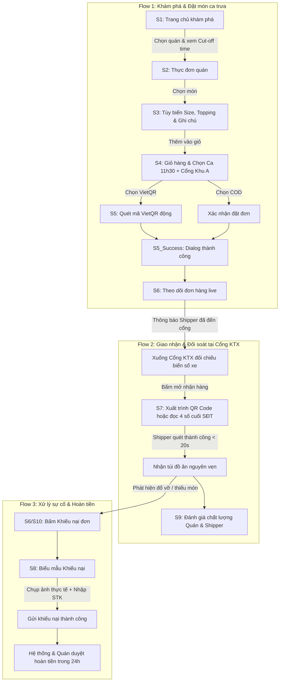

# PRODUCT REQUIREMENT DOCUMENT (PRD)
# ỨNG DỤNG ĐẶT ĐỒ ĂN SINH VIÊN KÝ TÚC XÁ ĐHQG-HCM (KTXFOOD)

> **Môn học:** PRM323 – Mobile Programming (Lab 2 - UI/UX Design & AI-assisted Prototyping)  
> **Nhóm thực hiện:** `FA26-31-PRM323` (Bùi Bảo Dương, Ngô Hoàng Trường Đạt, Trần Sanh Điền, Quách Ngọc Vinh)  
> **Phiên bản:** 1.0 (Final Draft)  
> **Trạng thái:** Approved / In Development Handoff  
> **Tài liệu liên quan:** [`ux/persona.md`](../ux/persona.md), [`ux/user-flow.md`](../ux/user-flow.md), [`design/DESIGN.md`](../design/DESIGN.md), [`design/screen-spec.md`](../design/screen-spec.md), [`docs/business-rules.md`](business-rules.md).

---

## MỤC LỤC
1. [Tổng Quan Sản Phẩm & Bài Toán (Executive Summary)](#1-tổng-quan-sản-phẩm--bài-toán)
2. [Chân Dung Người Dùng Mục Tiêu (User Personas)](#2-chân-dung-người-dùng-mục-tiêu)
3. [Mục Tiêu Sản Phẩm & Chỉ Số Đo Lường (Goals & Metrics)](#3-mục-tiêu-sản-phẩm--chỉ-số-đo-lường)
4. [Phạm Vi Tính Năng Cốt Lõi (Product Scope & Features)](#4-phạm-vi-tính-năng-cốt-lõi)
5. [Hành Trình Người Dùng & Các Luồng Chính (Core User Flows)](#5-hành-trình-người-dùng--các-luồng-chính)
6. [Tóm Lược Quy Tắc Vận Hành (Business Rules Summary)](#6-tóm-lược-quy-tắc-vận-hành)
7. [Yêu Cầu Phi Chức Năng (Non-Functional Requirements)](#7-yêu-cầu-phi-chức-năng)
8. [Kế Hoạch Phát Hành & Quản Trị Rủi Ro (Release Roadmap & Risks)](#8-kế-hoạch-phát-hành--quản-trị-rủi-ro)

---

## 1. Tổng Quan Sản Phẩm & Bài Toán (Executive Summary)

### 1.1. Bối cảnh thị trường & Nỗi đau sinh viên KTX ĐHQG-HCM
Khu đô thị Đại học Quốc gia TP.HCM (ĐHQG-HCM) tập trung hơn 40.000 sinh viên nội trú tại 2 cụm ký túc xá lớn nhất cả nước: **KTX Khu A** (phường Linh Trung, TP. Thủ Đức) và **KTX Khu B** (phường Đông Hòa, TP. Dĩ An). Sinh viên sinh sống tại đây gặp phải 3 rào cản ăn uống nghiêm trọng:
1. **Chi phí giao hàng quá đắt:** Các ứng dụng giao đồ ăn hiện nay (ShopeeFood, GrabFood) thu phí vận chuyển 16.000đ – 25.000đ/đơn và chiết khấu quán ăn 20–30%. Mức phí này vượt quá khả năng chi trả của sinh viên cho các bữa ăn bình dân hàng ngày (25.000đ – 35.000đ).
2. **Quy định cấm xe máy vào nội khu KTX:** Nội quy ban quản lý KTX nghiêm cấm shipper đi xe máy vào trong các tòa nhà. Vào giờ cao điểm tan học (11h30 – 12h30 và 18h00 – 19h00), hàng trăm shipper cùng lúc tập trung trước cổng KTX, dẫn đến tình trạng gọi điện thoại liên tục, chen chúc, nhầm lẫn và thất lạc đơn hàng.
3. **Thời gian chờ đợi lâu và bỏ bữa:** Sinh viên không có xe máy cá nhân gặp khó khăn khi đi ăn xa giữa các ca học dày đặc; việc đặt đơn lẻ tẻ thường mất 35–50 phút và dễ bị trễ giờ học ca chiều.

### 1.2. Giải pháp KTXFood (Product Value Proposition)
**KTXFood** là nền tảng đặt đồ ăn trực tuyến theo mô hình **Gom đơn định kỳ theo ca (Batch Delivery)**:
* **Gom đơn tập trung:** Thay vì giao từng đơn lẻ tẻ, hệ thống gom toàn bộ đơn hàng của sinh viên theo 2 ca cố định: **Ca trưa (Giao lúc 11h30)** và **Ca tối (Giao lúc 18h00)**.
* **Tối ưu chi phí:** Một shipper vận chuyển đồng thời 15–25 phần ăn trong một chuyến gom về một cổng KTX duy nhất, giúp hạ phí ship xuống mức siêu rẻ: **3.000đ – 5.000đ/đơn**.
* **Đối soát siêu tốc bằng mã QR:** Ứng dụng tích hợp thẻ xác thực mã QR nhận hàng động và 4 số cuối số điện thoại, cho phép shipper quét giao đồ ăn chuẩn xác trong **dưới 20 giây**, loại bỏ triệt để tình trạng chen lấn và lấy nhầm đơn tại cổng KTX.

---

## 2. Chân Dung Người Dùng Mục Tiêu (User Personas)

### 2.1. Persona Cốt Lõi (Primary Persona - Student)
* **Họ và tên:** Nguyễn Văn Tuấn (18 tuổi)
* **Vai trò:** Sinh viên năm nhất Khoa CNTT, nội trú phòng 408 Tòa A3, KTX Khu A – ĐHQG-HCM.
* **Đặc điểm hành vi:**
  - Lịch học đại cương dày đặc, thường tan học ca sáng lúc 11h15 và vào học ca chiều lúc 12h45.
  - Không có xe máy riêng; ngân sách sinh hoạt cố định 2.500.000đ – 3.000.000đ/tháng.
  - Sử dụng smartphone liên tục, thành thạo chuyển khoản ngân hàng qua mã VietQR.
* **Mục tiêu (Goals):**
  - Đặt được bữa trưa bình dân (cơm tấm, bún bò, bánh mì) giá dưới 35.000đ.
  - Nhận đồ ăn đúng giờ ngay trước Cổng KTX Khu A mà không phải đứng chờ nắng lâu.
* **Nỗi đau (Pain points):**
  - Không muốn trả tiền ship bằng nửa tiền cơm.
  - Cổng KTX quá đông lúc 11h45, shipper gọi điện thoại ồn ào không nghe rõ, dễ nhận nhầm túi đồ ăn của bạn khác.
* **Ràng buộc công nghệ & môi trường:**
  - Nhận hàng ngoài trời nắng gắt trước cổng KTX $\rightarrow$ Giao diện ứng dụng phải có độ tương phản cao đạt chuẩn WCAG 2.1 AA ($\ge 4.5:1$).
  - Thao tác một tay khi đang cầm balo $\rightarrow$ Nút bấm Touch Target tối thiểu $48\times 48\text{dp}$.

### 2.2. Các bên liên quan thứ cấp (Secondary Stakeholders)
* **Shipper KTX (Người giao hàng gom chuyến):** Sinh viên làm thêm hoặc tài xế chuyên trách khu vực ĐHQG. Cần gom gọn danh sách món, nhận hàng nhanh tại quán và phát hàng hàng loạt tại cổng KTX mà không phải gọi điện riêng từng người.
* **Chủ quán ăn đối tác (Merchants):** Các quán ăn bình dân quanh Làng Đại học (khu hồ đá, đường A1, chợ đêm). Cần biết trước tổng số lượng suất ăn trước giờ Cut-off Time để nấu nướng hàng loạt, tránh tồn dư thực phẩm.

---

## 3. Mục Tiêu Sản Phẩm & Chỉ Số Đo Lường (Goals & Metrics)

### 3.1. Mục tiêu kinh doanh & Vận hành (Business Goals)
1. Giảm chi phí giao đồ ăn cho sinh viên nội trú xuống **$\le 5.000\text{đ}$/đơn hàng**.
2. Tối ưu năng suất tài xế: Đạt trung bình **18 – 22 đơn/chuyến gom** tại mỗi cổng KTX.
3. Giảm tỷ lệ thất lạc, nhầm lẫn đơn hàng tại cổng KTX xuống **$< 0.5\%$**.

### 3.2. Tiêu chí trải nghiệm người dùng đo lường được (Measurable UX Metrics)
* **Thời gian hoàn tất đặt món (Time-to-Order):** Sinh viên hoàn thành việc chọn món, tùy biến ghi chú và bấm thanh toán gom đơn trong **dưới 30 giây**.
* **Thời gian đối soát nhận hàng tại cổng (Time-to-Fulfill):** Thời gian sinh viên xuất trình mã QR/4 số cuối SĐT để shipper quét bàn giao túi đồ ăn diễn ra trong **dưới 20 giây**.
* **Tỷ lệ thanh toán VietQR thành công lần đầu:** $\ge 95\%$ nhờ công nghệ tạo mã QR động đúng số tiền.
* **Mức độ hài lòng của sinh viên (CSAT):** Đạt tối thiểu **4.6 / 5.0 sao**.

---

## 4. Phạm Vi Tính Năng Cốt Lõi (Product Scope & Features)

### 4.1. Ma trận tính năng theo vai trò Học sinh (Student Scope)

| Mã màn hình | Tên màn hình / Module | Tính năng chi tiết | Mức độ ưu tiên |
| :---: | :--- | :--- | :---: |
| **S1** | Tra cứu & Khám phá quán | - Đồng hồ đếm ngược giờ chốt ca gom (*Cut-off Time Tracker*). - Dropdown chọn điểm nhận: Cổng KTX Khu A / Cổng KTX Khu B. - Bộ lọc danh mục món (Cơm, Bún/Phở, Trà sữa, Ăn vặt). - Danh sách quán ăn gần KTX kèm điểm đánh giá sao ⭐. | **P0 (Bắt buộc)** |
| **S2** | Chi tiết Quán & Thực đơn | - Xem thông báo mới nhất từ chủ quán (Bảng tin quán). - Phân loại nhóm món (Món chính, Topping, Nước giải khát). - Nút thêm món nhanh hoặc mở tùy biến khẩu vị. | **P0 (Bắt buộc)** |
| **S3** | Modal Tùy biến món ăn | - Chọn Size (M / L). - Chọn mức độ cay / ngọt. - Tích chọn Topping thêm có cộng tiền linh hoạt. - Ô nhập ghi chú cá nhân hóa (ít cay, không hành, nước sốt riêng). | **P0 (Bắt buộc)** |
| **S4** | Giỏ hàng & Thanh toán gom | - Tóm tắt danh sách món và số lượng `[-] [1] [+]`. - Chọn ca nhận hàng: Ca trưa (11h30) / Ca tối (18h00). - Áp dụng mã ưu đãi sinh viên / Voucher quán. - Chọn phương thức: Chuyển khoản VietQR hoặc Tiền mặt COD. - Bảng phân tích chi phí: Tiền món + Phí ship gom 3.000đ - Giảm giá. | **P0 (Bắt buộc)** |
| **S5** | Thanh toán chuyển khoản VietQR | - Hiển thị mã VietQR động chứa chính xác số tiền và cú pháp `#KTX...`. - Sao chép nhanh Số tài khoản và Tên ngân hàng thụ hưởng. - Đồng hồ đếm ngược chờ giao dịch (10 phút). - Nút chuyển đổi nhanh sang hình thức Tiền mặt COD nếu app bank lỗi. | **P0 (Bắt buộc)** |
| **S5_Success** | Dialog Đặt hàng thành công | - Thông báo xác nhận đặt đơn thành công tức thì. - Hiển thị mã đơn `#KTX-XXXX`, địa điểm nhận và giờ ra cổng. - Nút CTA trực tiếp chuyển đến Màn hình Theo dõi đơn hàng. | **P0 (Bắt buộc)** |
| **S6** | Theo dõi Đơn hàng Live | - Thanh trạng thái thời gian thực 4 nấc: `Đang nấu` $\rightarrow$ `Đang gom chuyến` $\rightarrow$ `Đang đến cổng` $\rightarrow$ `Đã tới cổng KTX`. - Thẻ tài xế: Tên shipper, Biển số xe, Vị trí đứng đón tại cổng KTX. - Nút "Hủy đơn" (chỉ kích hoạt trước giờ Cut-off time). - Nút nổi "Mở Mã QR Nhận hàng". | **P0 (Bắt buộc)** |
| **S7** | Mã QR Nhận hàng tại Cổng | - Mã QR kích thước lớn, độ tương phản cao. - Hiển thị nổi bật **4 số cuối SĐT** của sinh viên. - Danh sách tóm tắt các món trong túi để đối chiếu tránh lấy nhầm. | **P0 (Bắt buộc)** |
| **S8** | Khiếu nại & Yêu cầu hoàn tiền | - Chọn lý do sự cố: Đổ vỡ thức ăn / Giao thiếu món / Sai ghi chú. - **Bắt buộc tải ảnh chụp thực tế làm bằng chứng** (tối thiểu 1 ảnh). - Nhập Số tài khoản & Ngân hàng nhận tiền hoàn trong 24h. | **P1 (Quan trọng)** |
| **S9** | Đánh giá & Phản hồi | - Đánh giá riêng cho Quán ăn (1–5 sao, hương vị, bao bì). - Đánh giá riêng cho Shipper (1–5 sao, đúng giờ, bảo quản món). - Nhập nhận xét văn bản tự do. | **P1 (Quan trọng)** |
| **S10** | Lịch sử Đơn hàng | - Xem danh sách đơn cũ (Đang giao, Hoàn tất, Đã hủy). - Nút "Đặt lại đơn này" để thêm nhanh vào giỏ hàng. | **P1 (Quan trọng)** |

---

## 5. Hành Trình Người Dùng & Các Luồng Chính (Core User Flows)

Toàn bộ hệ thống tập trung hoàn thiện 3 User Flows then chốt:

---

## 6. Tóm Lược Quy Tắc Vận Hành (Business Rules Summary)
*(Chi tiết đặc tả đầy đủ được lưu tại [`docs/business-rules.md`](business-rules.md))*

1. **Khung giờ chốt ca (Cut-off Time):** Ca trưa chốt lúc **10h45** (giao 11h30 – 12h30); Ca tối chốt lúc **17h15** (giao 18h00 – 19h00). Sau giờ chốt, đơn chuyển sang ca kế tiếp.
2. **Quyền hủy đơn:** Sinh viên chỉ được hủy đơn trước giờ Cut-off time (khi quán chưa bấm "Bắt đầu nấu").
3. **Địa điểm nhận cố định:** Chỉ giao tại Cổng KTX Khu A hoặc Cổng KTX Khu B, không giao tận phòng nội trú.
4. **Thời gian chờ tại cổng:** Shipper chờ tối đa **15 phút**. Quá thời gian quy định và sau 3 cuộc gọi nhỡ, đơn bị hủy do sinh viên vắng mặt.
5. **Điều kiện khiếu nại:** Bắt buộc gửi khiếu nại trong vòng **60 phút** sau khi nhận hàng và **bắt buộc đính kèm ảnh chụp thực tế**.

---

## 7. Yêu Cầu Phi Chức Năng (Non-Functional Requirements)

### 7.1. Chuẩn tiếp cận & Công thái học (Accessibility & Usability)
* **WCAG 2.1 AA Compliance:** Toàn bộ văn bản phải có tỷ lệ tương phản tối thiểu **$4.5:1$** trên nền sáng (Chữ đen `#1A1A1A` đạt 16.1:1, Nút cam thương hiệu `#FF5722` đạt 4.68:1), đảm bảo sinh viên đọc rõ ràng ngoài trời nắng trước cổng KTX.
* **Touch Target tối thiểu:** Mọi thành phần tương tác (Button, Text Field, Checkbox, Icon Back) có kích thước vùng chạm tối thiểu **$48 \times 48\text{dp}$**.
* **Độ phân giải chuẩn:** Thiết kế tối ưu trên artboard chuẩn Android **$360 \times 800\text{dp}$**.

### 7.2. Hiệu năng & Ràng buộc mạng ký túc xá (Network & Performance)
* **Khả năng chịu tải mạng yếu:** Hệ thống mạng wifi KTX thường bị nghẽn vào giờ tan học $\rightarrow$ Ứng dụng tích hợp hiệu ứng **Skeleton Loader** và **Offline Cache** thực đơn món, không bị màn hình trắng (blank screen).
* **Thời gian phản hồi:** Thời gian tải danh sách món ăn $\le 1.5\text{s}$ trên mạng 3G/4G cơ bản.

### 7.3. Bảo mật & An toàn thông tin
* **Bảo vệ danh tính sinh viên:** Không hiển thị công khai toàn bộ số điện thoại; chỉ hiển thị 4 số cuối khi đối soát nhận hàng.
* **Toàn vẹn giao dịch:** Mã VietQR động được mã hóa tích hợp checksum, ngăn ngừa việc sửa đổi số tiền hoặc tài khoản thụ hưởng.

---

## 8. Kế Hoạch Phát Hành & Quản Trị Rủi Ro (Release Roadmap & Risks)

### 8.1. Lộ trình phát triển (Phasing Roadmap)
* **Giai đoạn 1 (MVP - Hiện tại):** Hoàn thiện trọn vẹn vai trò Sinh viên với 8 màn hình cốt lõi, 3 User Flows, Design System 9 Master Components và Prototype tương tác trên Figma.
* **Giai đoạn 2 (Pilot Testing):** Thử nghiệm tại Cổng KTX Khu A với 5 quán ăn đối tác quanh khu vực Hồ Đá, đo lường thời gian nhận món thực tế.
* **Giai đoạn 3 (Scale Out):** Mở rộng tính năng gom đơn nhóm cùng phòng/cùng tầng (Group Cart Checkout) và bổ sung ứng dụng riêng cho Shipper & Chủ quán.

### 8.2. Ma trận rủi ro & Giải pháp phòng ngừa (Risk Matrix)

| Rủi ro tiềm ẩn | Mức độ | Biện pháp giảm thiểu trên KTXFood |
| :--- | :---: | :--- |
| Sinh viên xuống cổng trễ do tan học muộn làm dồn ứ shipper. | Cao | Gửi thông báo Push nhắc nhở trước 10 phút; hiển thị rõ thời gian đếm ngược của shipper tại cổng. |
| Màn hình điện thoại sinh viên bị trầy xước/chói nắng không quét được mã QR. | Trung bình | Tích hợp giải pháp đối soát dự phòng bằng **4 số cuối SĐT** ngay dưới mã QR. |
| Quán ăn bị quá tải đơn ca trưa dẫn đến trễ giờ giao. | Cao | Giới hạn số lượng đơn tối đa cho mỗi ca gom (Batch Cap); tự động khóa nhận thêm đơn khi quán báo quá tải. |

---
*Tài liệu PRD được xây dựng bởi Đội ngũ Dự án PRM323 Lab 2 (FA26-31-PRM323), đóng vai trò kim chỉ nam cho thiết kế UI/UX và phát triển ứng dụng di động Flutter.*
